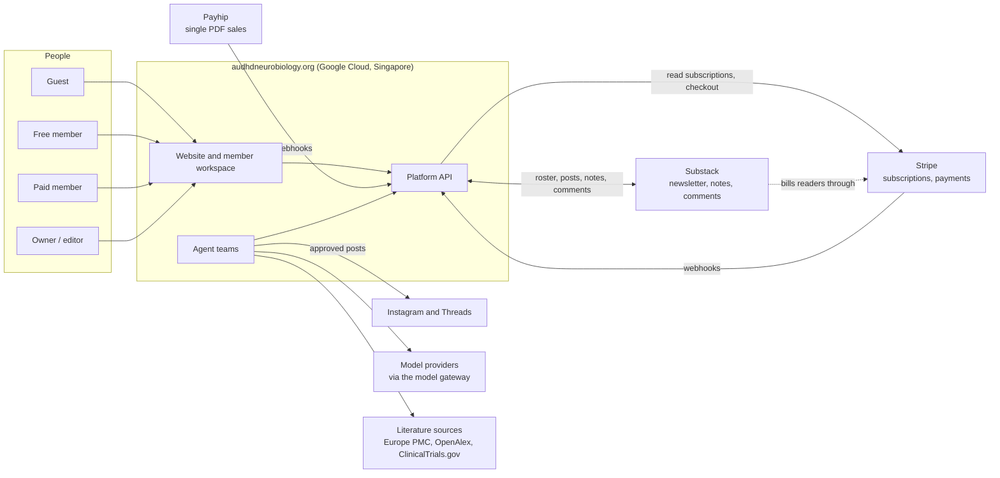
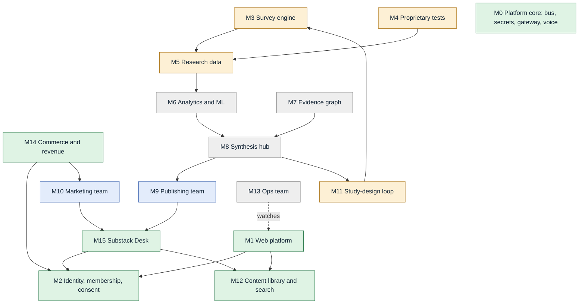
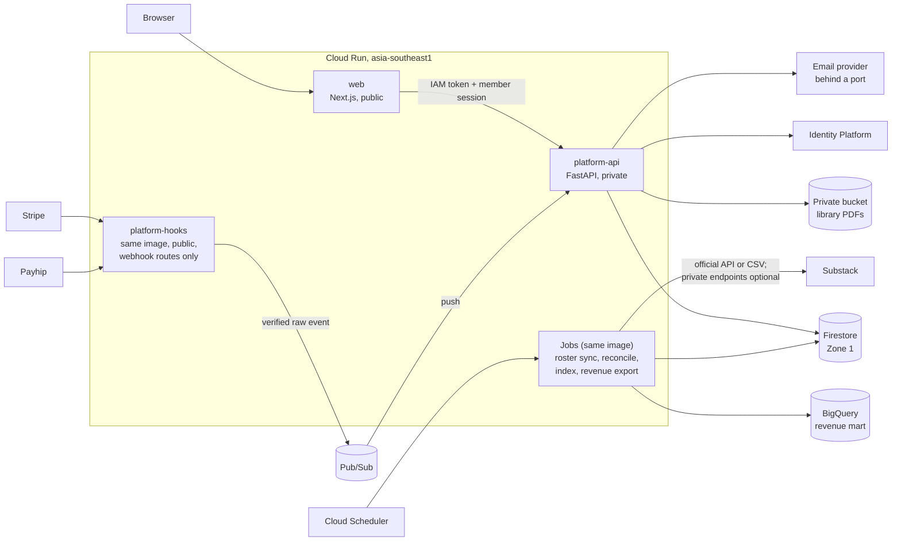

# 01 · System overview

**Status:** Proposed for review · 2026-11-16 · Architecture v4
**Replaces:** the module table and stage order of Architecture v3. Stage 0 (site on Cloud Run) is live and unchanged.

This page is the map. Each numbered page after it zooms into one area. Read this one first.

## 1. What changed from v3, in one paragraph

v3 built the research machine first and members last. v4 turns that around: **members, payments and the paid library come first**, because paid readers already exist and are served by hand today. Two modules are new (M14 Commerce and revenue, M15 Substack Desk), one is redefined (M12 is now the content library and search for the whole platform), and one design rule is revised: the platform starts as **one backend service with strict internal modules**, and splits into more services only where a data zone or a scaling need demands it.

## 2. Requirements that shape the design

| # | Requirement | Where it is met |
| --- | --- | --- |
| R1 | Substack paid subscribers get full platform access; free subscribers get the basic workspace | [02](02-membership-and-entitlements.md) |
| R2 | A paid member who does not renew is downgraded automatically; nobody edits a list by hand | [02](02-membership-and-entitlements.md) |
| R3 | Every existing Stripe customer (paid, free, guest buyer) is imported and keeps its channel flag | [03](03-commerce-and-revenue.md), [09](09-events-and-data-model.md) |
| R4 | Paid members open guides and research PDFs in their workspace; free members can buy single PDFs (Payhip now, Stripe store later) | [03](03-commerce-and-revenue.md), [04](04-content-library-and-search.md) |
| R5 | Everything published on the platform (articles, news, library PDFs) is indexed with metadata and searchable in one place | [04](04-content-library-and-search.md) |
| R6 | Substack publishing, notes, comments, statistics and membership are driven from the platform; the code can later leave as a standalone open-source project | [05](05-substack-desk.md) |
| R7 | Agent teams (publishing, marketing, revenue, study design, synthesis, ops) work through one model gateway, with a human approving anything public or irreversible | [06](06-ai-platform-and-agent-teams.md) |
| R8 | Research data stays pseudonymous and consent-scoped; exploratory patterns are shown to paid members with a visible evidence label | [07](07-research-loop-and-evidence.md) |
| R9 | Every component is replaceable; Google first, never Google only | every page: "Exit path" |
| R10 | Fixed monthly cost stays close to zero until revenue justifies more | [08](08-security-identities-and-org.md), roadmap cost table |
| R11 | The repository is public; private research and personal data never enter it | [08](08-security-identities-and-org.md), `docs/content-model.md` |

Scale assumptions for the first year (used for every sizing decision): up to 5,000 registered members, up to 500 paid, up to 300 library items, up to 2,000 indexed articles and pages, peaks of 20 requests per second on launch days. Everything below is sized for that and says where it stops being enough.

## 3. Context: who and what the platform talks to

Substack bills its readers through the owner's own Stripe account. That one fact is what makes automatic upgrade and downgrade possible without asking Substack for anything: the platform listens to Stripe.

## 4. Module map (v4)

A **module** is a unit of responsibility with one owner of its data and one public interface. A module is a folder with enforced import rules. It is not necessarily its own service.

| ID | Module | Owns | First built in | Change in v4 |
| --- | --- | --- | --- | --- |
| M0 | Platform core | Projects, identities, secrets, event bus, CI/CD, model gateway, voice profile | 0, 2 | Model gateway is self-hosted, no paid observability tool |
| M1 | Web platform | Public site, member workspace, admin cockpit | 0, 1 | Real sign-in and tier-aware workspace |
| M2 | Identity, membership, consent | Members, contacts, entitlements, invites, consent ledger | 1 | Redesigned around an entitlement engine |
| M3 | Research survey engine | Instruments, sessions, responses | 3 | Unchanged |
| M4 | Proprietary tests | Ship and Sea, scoring, reports | 3 | Informed by the PMAI and MBTI review |
| M5 | Research data and de-identification | Zone 2 and Zone 3 datasets, releases | 3, 5 | Designed to be offered as a standalone service later |
| M6 | Analytics and ML | Psychometrics, pattern search | 5 | Research loop kit borrows from AutoRA |
| M7 | Evidence graph | Studies, claims, observations, findings | 5, 6 | Five lifecycle labels visible to paid members |
| M8 | Synthesis hub | Finding and Gap records | 5 | Unchanged |
| M9 | Research and publishing team | Runs, drafts, reviews | 2 | Moves earlier |
| M10 | Marketing and distribution team | Notes, Instagram, Threads, news | 2 | Adds a Notes writer; channels reduced to two |
| M11 | Study-design loop | Draft instruments and protocols | 3, 5 | Adds the survey template agent |
| M12 | Content library and search | Library items, article mirror, one search index | 1, 2 | Redefined: one index for everything published |
| M13 | Platform ops team | Checks, triage, cost watch, Substack sentinel | 4 | Adds the Substack API change monitor |
| M14 | Commerce and revenue | Stripe and Payhip events, purchases, revenue mart, Revenue team | 1, 2 | New |
| M15 | Substack Desk | Subscribers, posts, notes, comments, statistics, change feed | 1, 2 | New, built as an extractable package |

Green is Stage 1, blue Stage 2, amber Stage 3, grey later. The research loop (M5 → M6 → M8 → M9 and M11) is the same as in v3; it is built after the member platform, not before.

## 5. What actually runs after Stage 1

| Deployable | Public | What it does | Why it is separate |
| --- | --- | --- | --- |
| `web` | Yes | Pages, sign-in, member workspace, admin screens. The browser talks only to this. | Different language and release rhythm |
| `platform-api` | No | All business rules: identity, entitlements, commerce, library, content index, admin | One place for rules that must agree with each other |
| `platform-hooks` | Yes | Receives Stripe and Payhip webhooks, checks the signature, forwards to Pub/Sub. Reads no member data. | The only public entry besides `web`; holds almost no permissions |
| Jobs | No | Scheduled work from the same image: `substack-roster-sync`, `reconcile-entitlements`, `stripe-reconcile`, `index-content`, `revenue-export` | Long-running, retried, no request to hold open |

Later stages add: `model-gateway` (Stage 2), agent team services (Stage 2 onwards), `research-api` for Zones 2 and 3 with its own identity (Stage 3). The research service is separate on purpose: the service that knows emails must not be able to read research rows.

See [ADR 0006](../adr/0006-modular-monolith-for-the-platform-api.md) for why one backend service, and what triggers a split.

## 6. How modules talk to each other

Three mechanisms, in order of preference:

1. **Events on the bus** for anything another module only needs to know happened. CloudEvents on Pub/Sub; the list is in [09](09-events-and-data-model.md). Events never carry an email address or a name, only opaque ids.
2. **A module's public interface** (`public.py`) for a synchronous question inside `platform-api`, for example the library asking "may this member download this item?". Import rules stop a module from reaching into another module's internals.
3. **Ports and adapters** for anything outside the platform: Stripe, Payhip, Substack, the email provider, the embedding model, storage. The module defines the port (a small Python protocol); an adapter implements it. Replacing a vendor is replacing an adapter.

## 7. Design rules (v4)

1. **Replaceable by construction.** Every external dependency sits behind a port. Every page ends with an exit path.
2. **Entitlements fail safe.** A broken sync never removes access from a paying member, and never grants paid access to someone new. See [02](02-membership-and-entitlements.md).
3. **No personal data on the bus, in logs, or in this repository.** Events and logs carry ids. The repo carries synthetic data only.
4. **People approve what is public or cannot be undone.** Agents draft and propose; the owner publishes, sends, deploys, releases.
5. **Configuration over code for what the owner will tune.** Tiers, quotas, prices, evidence weights, schedules live in versioned YAML.
6. **Scale to zero.** Nothing in Stages 1 and 2 keeps a server or a database instance running when nobody is using it.
7. **Borrowed code is recorded.** Any code copied from another repository is listed with its source and licence in [10](10-borrow-map.md) and in `THIRD_PARTY.md`. See [ADR 0012](../adr/0012-borrowed-code-provenance.md).
8. **Schemas when needed.** A schema is written when the first flow needs it, not before.

## 8. Quality targets

| Quality | Target for Stages 1 and 2 | How |
| --- | --- | --- |
| Availability | 99.5% a month for sign-in and downloads | Single region, managed services, uptime checks and alerts |
| Downgrade delay | Under 5 minutes after Stripe reports the end of a subscription; within a day for comps, gifts and Apple-billed readers with the Publisher API, within a week with CSV upload | Webhook path; roster check |
| Page speed | Member pages interactive in under 2 seconds on a warm instance | Server rendering, one API call per page |
| Recovery | Lose at most 24 hours of data; restore within 4 hours | Firestore point-in-time recovery (7 days) and a daily export; everything else is rebuilt from Stripe, Substack and Git |
| Cost | Under US$15 a month fixed before Stage 2 | Scale to zero, free tiers, no always-on database |
| Privacy | No email outside Zone 1; access to Zone 1 logged | Ids on the bus, data access logs, one service account per job |

## 9. What to revisit as it grows

- **More than 50,000 indexed chunks or more than 5 searches a second:** move the search index from memory to a managed vector index ([ADR 0018](../adr/0018-search-index.md)).
- **More than 20,000 members or a second developer:** consider splitting `platform-api` along the commerce and library boundary.
- **Research data collection starts (Stage 3):** `research-api` and Zone 2 come into existence with their own identities; revisit the consent ledger then.
- **Cloud SQL enters the picture** (only if model budgets or the social scheduler need it): that is the first always-on cost; decide it deliberately.
- **Leaving the GuideBuoy organisation:** the move is planned in [08](08-security-identities-and-org.md); do it before the first external data-use agreement.
