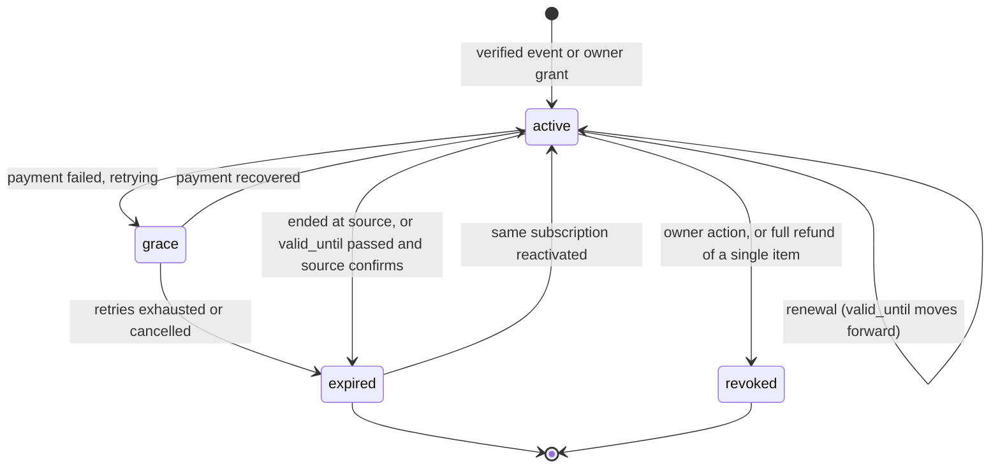
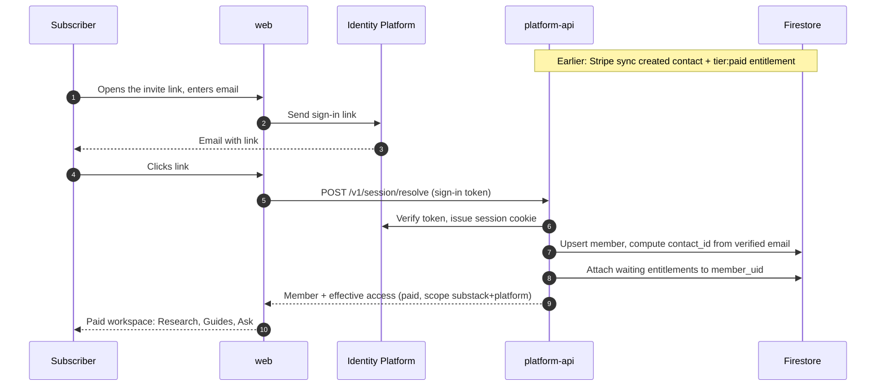
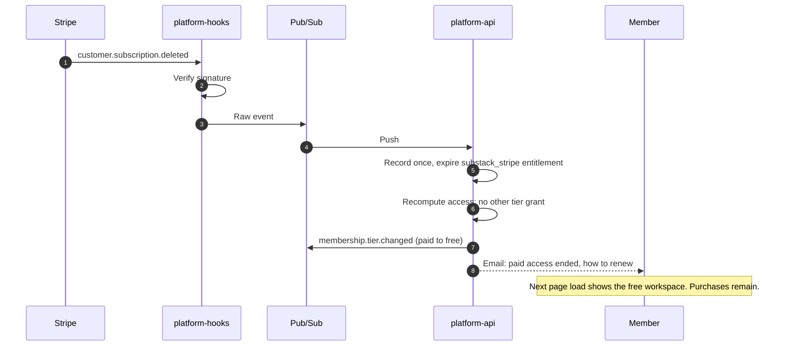

# 02 · Membership and entitlements (M2)

**Status:** Proposed for review · 2026-11-16 · Stage 1 · campaigns and launch grants added 2026-11-19 ([launch design](../superpowers/specs/2026-11-19-launch-invites-grants-promotions-design.md))

The question this module answers, thousands of times a day: **what may this person open right now, and why?** The answer must follow Substack and Stripe automatically, in both directions.

## 1. Vocabulary

| Term | Meaning |
| --- | --- |
| **Contact** | One email address known to the business, from any channel: a Substack subscriber, a Stripe customer, a Payhip buyer. A contact may never have visited the platform. |
| **Member** | A contact who has signed in to the platform. Has an account id (`uid`). |
| **Guest buyer** | A contact who bought something but has no account yet. |
| **Entitlement** | One record that grants one thing to one contact for a period, with the reason. |
| **Grant** | What an entitlement gives: `tier:paid`, or `item:<sku>` for one library item. Later: `tier:research_pro_1` to `_3`, `feature:<name>`. |
| **Source** | Where the entitlement came from. Decides who may end it. |
| **Access scope** | For a paid tier, how access was bought: `substack+platform` (through Substack) or `platform_only` (directly on the platform). Together with the contact's `channels` record, which keeps every channel a person ever came through, this preserves where each person came from. |
| **Effective access** | The computed answer for a member: tier, items, quotas. Never stored as truth; always derived from entitlements. |

## 2. Tiers and the workspace

| Workspace section | Guest | Free member | Paid member |
| --- | --- | --- | --- |
| Public site, catalogue of library items with abstracts | Yes | Yes | Yes |
| Overview | – | Yes | Yes |
| Library: catalogue, **Buy** (Payhip), **My purchases** | – | Yes | Yes |
| Submit a question | – | Yes | Yes |
| Surveys (Stage 3) | – | Yes | Yes |
| Practice Exchange (later; moderation model undecided) | – | Yes | Yes |
| Account: profile, membership, linked emails, data requests | – | Yes | Yes |
| **Research**: meta-reviews, evidence maps, clinician one-pagers, all downloads | – | Sent to the upgrade page; items bought one by one are opened from the Library | Yes |
| **Guides**: all downloads | – | Sent to the upgrade page; items bought one by one are opened from the Library | Yes |
| **Ask AuDHD Research** (Stage 2, monthly quota) | – | – | Yes |

Tiers are configuration, not code:

```yaml
# config/platform/tiers.yaml (shape; values are the owner's to set)
tiers:
  free:
    sections: [overview, library, submit_question, surveys, practice_exchange, account]
  paid:
    inherits: free
    sections: [research, guides, ask]
    quotas: { ask_per_month: 20 }
  research_pro_1: { inherits: paid, quotas: { ask_per_month: 100, graph_queries_per_month: 200 } }    # Stage 6
  research_pro_2: { inherits: paid, quotas: { ask_per_month: 400, graph_queries_per_month: 1000, exports_per_month: 5 } }
  research_pro_3: { inherits: paid, quotas: { ask_per_month: 1500, graph_queries_per_month: 5000, exports_per_month: 25, api_key: true } }
```

Data licences (quarterly or annual agreements) are not a self-service tier. They are a signed agreement plus a `grant` entitlement created by the owner. See [07](07-research-loop-and-evidence.md).

## 3. The entitlement record

| Field | Example | Notes |
| --- | --- | --- |
| `entitlement_id` | hash of source + source reference + contact + grant | Deterministic, so the same event processed twice changes nothing; the contact is part of it so two people's grants from one source never collide |
| `contact_id` | opaque id | Who it belongs to. Derived from the email with a secret key; not reversible |
| `member_uid` | account id or empty | Empty while the entitlement waits. Set when a verified sign-in claims it; from then on it belongs to that member (Rule 4) |
| `grant` | `tier:paid` | Or `item:burnout-vs-depression-map` |
| `source` | `substack_stripe` | See the table below |
| `source_ref` | Stripe subscription id, Payhip sale id, roster, grant note | Lets anyone trace it back |
| `access_scope` | `substack+platform` | Only for tier grants |
| `plan_interval` | `month` or `year` | For the revenue view and renewal notices |
| `valid_from`, `valid_until` | timestamps | `valid_until` is when the source says the current period ends. Where the source can be asked again, it is a prompt to re-check, not a cut-off (Rule 1) |
| `status` | `active`, `grace`, `expired`, `revoked` | |
| `updated_at`, `updated_by` | | Every change is also written to the audit log |

### Sources

| Source | Created when | Ended when | Speed |
| --- | --- | --- | --- |
| `substack_stripe` | Stripe reports a subscription that Substack created, in state trialing or active | Stripe reports it deleted, cancelled or unpaid | Seconds (webhook), checked weekly |
| `substack_roster` | Substack's own subscriber record shows a paid type with no Stripe subscription behind it: complimentary, gift, group seat, lifetime, or billed by Apple through the iOS app | A roster check gives positive evidence that the person is no longer paid (Rule 3) | At sign-in and daily, or weekly when fed by CSV (see §4a) |
| `platform_stripe` | A subscription bought through the platform's own Stripe Checkout | Stripe reports it ended | Seconds |
| `payhip` | A Payhip sale contains a product mapped to a library item | Refund | Seconds |
| `grant` | The owner grants access, or a campaign's grant policy does (a launch grant, §6) | `valid_until` passes, or the owner revokes it | Ended from its date at once; the stored status is updated by the daily sweep |

## 4. The rules

**Rule 1: effective access is the union of live entitlements.** An entitlement is live while its status is `active` or `grace`. Status changes only through a source event or the daily sweep, never merely because a date went by: when `valid_until` passes, the sweep asks the source again and either moves the date forward or ends the record. The one exception is `grant`, which has no source to ask and ends on its date. A member is paid if at least one live `tier:paid` entitlement is hers; her items are every live `item:<sku>` entitlement. An entitlement is hers if she has claimed it (Rule 4) or it waits under one of her contacts.

**Rule 2: each source ends only its own entitlements.** A Stripe cancellation never touches a complimentary grant. A member who cancels Substack but holds a launch grant stays paid until the grant ends.

**Rule 3: fail safe, in both directions.**

- *Never remove access on missing information.* Before the daily sweep ends a Stripe-sourced entitlement whose date has passed, it re-reads that subscription from Stripe. If Stripe cannot be reached, nothing ends and an alert is raised. A roster-sourced entitlement ends only on positive evidence: a row or look-up answer showing the person as not paid, or absence from two complete exports in a row. Absence from one file ends nothing.
- *Never mass-expire.* If any one run (a roster check or a Stripe reconciliation) would end more than 5 tier entitlements or more than 20% of them, whichever is larger, it stops, changes nothing and alerts. A half-loaded file must not downgrade the readership.
- *Never grant on a guess.* New paid access is created only from a verified Stripe event, a parsed roster row, a verified Payhip event or an owner action.

**Rule 4: a verified sign-in claims entitlements, and a claim sticks.** Sign-in is by email link or Google, both of which prove control of the address. Entitlements created before the person ever registered wait under the contact and are claimed at first sign-in. A claimed entitlement stays with that member even if the email at Stripe or Substack later changes; an unclaimed one follows the provider's current email.

**Rule 5: a tier change is an event and a message.** When effective access changes, `membership.tier.changed` goes on the bus and the member gets one plain email. Purchased items are never removed by a downgrade.

**Rule 6: apply the source's current state, not the event's.** Events arrive late, twice and out of order. On any Stripe event about a subscription, the platform fetches that subscription from Stripe and applies what it says now.

### 4a. Where the roster comes from

Stripe sees every reader who pays Substack by card on the web. It does not see complimentary and gift subscriptions, group seats, lifetime grants, or readers billed by Apple in the iOS app. For those, and for knowing who is a free subscriber, the platform asks Substack through one port, `SubscriberDirectory`, with three interchangeable adapters:

| Adapter | What it is | Standing with Substack | Use |
| --- | --- | --- | --- |
| Publisher API | Substack's own read-only API for a publication: look up one subscriber by email, returns type and expiry. Not enabled for every publication. | Official | First choice if the publication dashboard offers it. Checked at sign-in and daily. |
| CSV upload | The subscriber export from the Substack dashboard, uploaded in the admin screen | Official | Always available. Weekly is enough at this size. |
| Private endpoints (Substack Desk) | The same data read automatically with the owner's session | Substack's terms restrict automated access; see [05](05-substack-desk.md) | Not built in Stage 1. Arrives with the rest of the Desk in Stage 2, behind a switch, if the owner wants it |

Paid status for card-paying readers never depends on this port; it comes from Stripe. A failure here can delay recognising a new comp or gift subscriber; it cannot downgrade anyone (Rule 3).

### Stripe status to entitlement status

| Stripe subscription | Entitlement | `valid_until` |
| --- | --- | --- |
| `trialing`, `active` (including "cancels at period end" and paused collection) | `active` | current period end |
| `past_due` | `grace` for at most 21 days from the first failed payment, then `expired` until the status is `active` again | – |
| `incomplete` (first payment not completed) | none created | – |
| `canceled`, `unpaid`, `incomplete_expired`, or deleted | `expired` | now |

Refunds and disputes do not change a tier entitlement; only the subscription's status does. They revoke single-item purchases, on a full refund or a lost dispute.



## 5. Flows

### 5.1 A Substack paid subscriber signs in for the first time



No code to paste, no "prove you are a subscriber" step. The same email is the link. The invite link itself carries no rights: it is a campaign address (`/join/{slug}`) that selects wording and is counted ([ADR 0021](../adr/0021-one-join-link-recognition-by-verified-email.md)).

### 5.2 A paid member does not renew



### 5.3 Other cases

| Case | What happens |
| --- | --- |
| Subscribed on Substack with one email, signs in with another | Sees the free workspace and a "Paid on Substack with a different email?" link. She enters the other address; that address receives a sign-in link; after signing in as that address she is shown which account asks to be linked and confirms with a button. Clicking an email never links anything by itself, and nothing is ever linked automatically from a payment provider's data. One contact can be linked to one member only. |
| Complimentary, gift, group or Apple-billed subscription | No Stripe subscription exists for the reader. The roster check creates and ends a `substack_roster` entitlement. Until the check has run, the owner can grant access by hand in the inspector. |
| Buys a PDF on Payhip before registering | The `item:<sku>` entitlement waits under the contact. It appears in **My purchases** at first sign-in with that email. |
| Refund or lost dispute | A single-item purchase is revoked on a full refund. A subscription refund changes nothing by itself: access follows the subscription's status. |
| Upgrades from free to paid on Substack | Stripe event arrives; the workspace changes on the next page load. No action by the member. |
| Pays platform-only, later also subscribes on Substack | Two entitlements, two scopes. Access is paid; the admin view flags the double payment so the owner can offer a refund. |
| A launch grant for existing paid subscribers | A campaign's grant policy creates a `grant` entitlement, `tier:paid`, for a set number of months, at the first sign-in of a member who holds a live Substack-paid entitlement and meets the policy (for example: paying since before the announcement). One per contact per campaign; created only from verified facts. A policy can also be limited by plan interval. Whether it is a guarantee on top of included access or a free period before a separate membership is the owner's commercial decision; the engine is the same for both. |
| Member asks to delete the account | Within 30 days the owner runs the delete command. It removes the sign-in account, the member record, the contacts that member owns with their entitlements, and the member's support requests. Download records and audit entries never held an address and expire by their own lifetime. A request made in writing is first recorded by the owner (`member request-deletion`); an address that never became a member is removed with `contact forget`. Nothing is cancelled at Substack or Stripe, and nothing marks the forgotten contact: while the person's subscription continues, the next reconcile or roster import creates a new contact with no member, as the privacy notice says. A marker that stops the re-import (a tombstone holding only the keyed hash), removal at the source and replay after a restore from backup belong to full erasure, which comes after launch. |
| Owner needs to help someone | Admin inspector: search by email, see contact, entitlements, the events that created them, and grant or revoke with a written reason. |

## 6. Bringing people in

1. **Paid status first, invitations second.** Before anyone is invited, the read-only Stripe reconcile and one roster import create contacts and entitlements for paying readers. Free subscribers are not imported for the launch: anyone can register as free, so their addresses are not needed in advance. The full roster with every channel flag (`substack_paid`, `substack_free`, `payhip_buyer`, `platform_paid`) follows in S1.4. Only contacts with a live paid subscription or grant receive `tier:paid`.
2. **Invitations travel through Substack.** A paid-only Substack post invites paid subscribers; a free post invites the rest. The same link goes into Substack's welcome emails (Substack keeps separate, editable templates for free, paid and founding subscribers), so every future subscriber is invited the day they subscribe. Readers arrive, enter the email they already use, and are recognised. The platform's first email to anyone is the sign-in link they asked for themselves. This avoids cold email from a new sending domain and keeps the consent position simple.
3. **Campaigns.** An invitation is a campaign: a slug in the link (`/join/{slug}`), an audience, a time window and, optionally, a grant policy. Wave 0 is the owner and test accounts; then a campaign for current paid subscribers; then one for free subscribers. Arrivals, recognitions and grants are counted per campaign. The slug authorises nothing: grant policies of every open campaign apply to any member who meets them, whichever link they used.
4. **Upgrade routes for free members.** The upgrade page shows every route that exists: *Subscribe on Substack* (newsletter and platform), with the active promotion when there is one ([03 §5a](03-commerce-and-revenue.md)), and *Platform only* (Stripe Checkout) once that product is built. The route taken is stored as `access_scope`.
5. **Layers with switches.** Join, library and promotions each have a switch in runtime configuration, so each can open when its exit test has passed and close at once if something is wrong.

## 7. Messages the platform sends

| Message | Trigger | Channel |
| --- | --- | --- |
| Sign-in link | Member asks to sign in | Identity Platform |
| Welcome, with what the tier includes | First sign-in | Email port |
| Paid access started | Tier changes free to paid | Email port |
| Paid access ended, how to renew | Tier changes paid to free | Email port |
| Renewal coming (annual plans, 14 days before) | Daily sweep | Email port |
| Purchase ready, link to **My purchases** | Payhip or Stripe sale | Email port |
| Confirm linked email | Member adds a second address | Email port |

All transactional, all from one `EmailSender` port. No newsletters leave the platform; Substack stays the newsletter.

## 8. Internal interface

Called by `web` only. The browser never calls `platform-api`.

| Endpoint | Purpose |
| --- | --- |
| `POST /v1/session/resolve` | After sign-in: verify the sign-in token, issue the session cookie, create or load the member, attach entitlements, return effective access. The website holds no rights to administer identities. |
| `GET /v1/me` | Profile, effective access, navigation for the tier |
| `GET /v1/me/entitlements` | What the member holds and why, in plain words |
| `POST /v1/me/linked-emails`, `POST /v1/me/linked-emails/confirm` | Link a second address |
| `POST /v1/me/deletion-request` | Start account deletion |
| `POST /v1/admin/contacts/search`, `GET /v1/admin/contacts/{contact_id}` | Inspector. The search term travels in the request body so an email never lands in request logs. |
| `POST /v1/admin/entitlements`, `POST /v1/admin/entitlements/{id}/revoke` | Owner grant and revoke, reason required |
| `GET /v1/admin/segments` | Counts by channel flag, tier, scope |

The launch track adds the public campaign route, `POST /v1/me/refresh-access`, `GET /v1/me/upgrade-options`, terms acceptance, support requests and the admin routes for campaigns, promotions and the layer switches. All routes with their shapes are on the [contracts page](../contracts/stage-1-launch.md). At launch the admin routes are called by `platform-cli` with the owner's Google identity; the admin screens come later.

Inside `platform-api`, other modules ask one function: `entitlements.public.access_for(member_uid) -> Access` and `can_open(member_uid, sku) -> Decision`.

## 9. What is deliberately not here

- **Consent for research.** The consent ledger belongs to this module but is built in Stage 3 with the first survey. Stage 1 stores only acceptance of the terms and the privacy notice.
- **`research_id`.** Issued in Stage 3. The contact key and the research key are different keys in Cloud KMS, usable by different services, so commerce data and research data cannot be joined by a service that can use only one.
- **Roles beyond owner.** One owner in Stage 1, recognised by `platform-api` from a configured list of account ids plus a second-factor sign-in, not from a claim alone. Moderator and research-assistant roles arrive with the features that need them.

## 10. Exit path

Members and entitlements are plain documents with a documented shape ([09](09-events-and-data-model.md)); they export to any SQL database as three tables. Identity Platform speaks OpenID Connect, so Clerk, Auth0 or Keycloak can replace it by changing the sign-in adapter in `web` and the token check in `platform-api`. Decisions: [ADR 0007](../adr/0007-stripe-is-the-source-of-truth-for-paid-status.md), [ADR 0008](../adr/0008-entitlement-model.md), [ADR 0020](../adr/0020-sign-in-with-identity-platform.md), [ADR 0021](../adr/0021-one-join-link-recognition-by-verified-email.md), [ADR 0022](../adr/0022-campaigns-grants-and-promotions-as-configuration.md).
