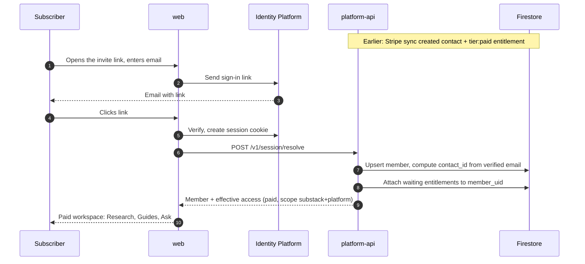
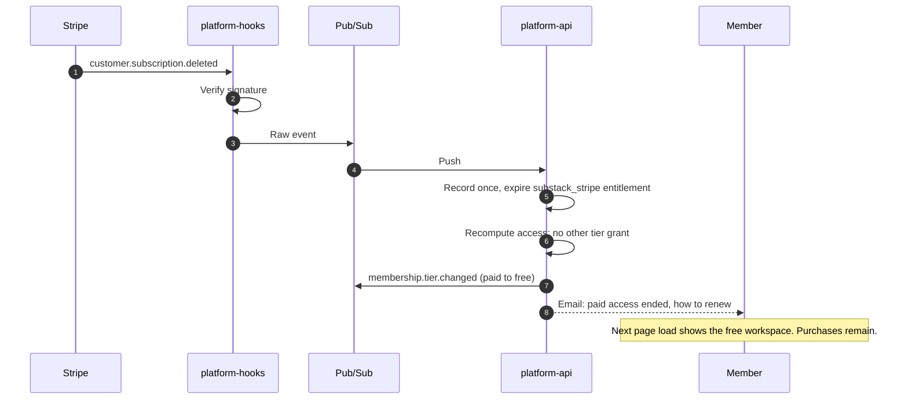

# 02 · Membership and entitlements (M2)

**Status:** Proposed for review · 2026-11-16 · Stage 1

The question this module answers, thousands of times a day: **what may this person open right now, and why?** The answer must follow Substack and Stripe automatically, in both directions.

## 1. Vocabulary

| Term | Meaning |
| --- | --- |
| **Contact** | One email address known to the business, from any channel: a Substack subscriber, a Stripe customer, a Payhip buyer. A contact may never have visited the platform. |
| **Member** | A contact who has signed in to the platform. Has an account id (`uid`). |
| **Guest buyer** | A contact who bought something but has no account yet. |
| **Entitlement** | One record that grants one thing to one contact for a period, with the reason. |
| **Grant** | What an entitlement gives: `tier:paid`, or `item:<sku>` for one library item. Later: `tier:research_pro_1` to `_3`, `feature:<name>`. |
| **Source** | Where the entitlement came from. Decides who may end it. |
| **Access scope** | For paid tiers: `substack+platform` (paid through Substack) or `platform_only` (paid directly on the platform). This is the flag that must survive in the data. |
| **Effective access** | The computed answer for a member: tier, items, quotas. Never stored as truth; always derived from entitlements. |

## 2. Tiers and the workspace

| Workspace section | Guest | Free member | Paid member |
| --- | --- | --- | --- |
| Public site, catalogue of library items with abstracts | Yes | Yes | Yes |
| Overview | – | Yes | Yes |
| Library: catalogue, **Buy** (Payhip), **My purchases** | – | Yes | Yes |
| Submit a question | – | Yes | Yes |
| Surveys (Stage 3) | – | Yes | Yes |
| Practice Exchange (later; moderation model undecided) | – | Yes | Yes |
| Account: profile, membership, linked emails, data requests | – | Yes | Yes |
| **Research**: meta-reviews, evidence maps, clinician one-pagers, all downloads | – | Bought items only | Yes |
| **Guides**: all downloads | – | Bought items only | Yes |
| **Ask AuDHD Research** (Stage 2, monthly quota) | – | – | Yes |

Tiers are configuration, not code:

```yaml
# config/platform/tiers.yaml (shape; values are the owner's to set)
tiers:
  free:
    sections: [overview, library, submit_question, surveys, practice_exchange, account]
  paid:
    inherits: free
    sections: [research, guides, ask]
    quotas: { ask_per_month: 20 }
  research_pro_1: { inherits: paid, quotas: { ask_per_month: 100, graph_queries_per_month: 200 } }    # Stage 6
  research_pro_2: { inherits: paid, quotas: { ask_per_month: 400, graph_queries_per_month: 1000, exports_per_month: 5 } }
  research_pro_3: { inherits: paid, quotas: { ask_per_month: 1500, graph_queries_per_month: 5000, exports_per_month: 25, api_key: true } }
```

Data licences (quarterly or annual agreements) are not a self-service tier. They are a signed agreement plus a `grant` entitlement created by the owner. See [07](07-research-loop-and-evidence.md).

## 3. The entitlement record

| Field | Example | Notes |
| --- | --- | --- |
| `entitlement_id` | hash of source + source reference + grant | Deterministic, so the same event processed twice changes nothing |
| `contact_id` | opaque id | Who it belongs to. Derived from the email with a secret key; not reversible |
| `member_uid` | account id or empty | Filled once the contact has signed in |
| `grant` | `tier:paid` | Or `item:burnout-vs-depression-map` |
| `source` | `substack_stripe` | See the table below |
| `source_ref` | Stripe subscription id, Payhip sale id, roster, grant note | Lets anyone trace it back |
| `access_scope` | `substack+platform` | Only for tier grants |
| `plan_interval` | `month` or `year` | For the revenue view and renewal notices |
| `valid_from`, `valid_until` | timestamps | `valid_until` empty means "until revoked" |
| `status` | `active`, `grace`, `expired`, `revoked` | |
| `updated_at`, `updated_by` | | Every change is also written to the audit log |

### Sources

| Source | Created when | Ended when | Speed |
| --- | --- | --- | --- |
| `substack_stripe` | Stripe reports a subscription that Substack created, in state trialing or active | Stripe reports it deleted, cancelled or unpaid | Seconds (webhook), checked weekly |
| `substack_roster` | Substack's own subscriber record shows a paid type with no Stripe subscription behind it: complimentary, gift, group seat, lifetime, or billed by Apple through the iOS app | A successful roster check no longer shows the person as paid, or the expiry date Substack reports has passed | At sign-in and daily, or weekly when fed by CSV (see §4a) |
| `platform_stripe` | A subscription bought through the platform's own Stripe Checkout | Stripe reports it ended | Seconds |
| `payhip` | A Payhip sale contains a product mapped to a library item | Refund | Seconds |
| `grant` | The owner grants access, or a migration does (the founding-member promise) | `valid_until` passes, or the owner revokes it | Daily sweep |

## 4. The rules

**Rule 1: effective access is the union of active entitlements.** A member is paid if at least one `tier:paid` entitlement is `active` or `grace` and not past `valid_until`. Items are every `item:<sku>` entitlement that is active. If a member has linked more than one email, the union runs over all linked contacts.

**Rule 2: each source ends only its own entitlements.** A Stripe cancellation never touches a complimentary grant. A member who cancels Substack but holds a founding grant stays paid until the grant ends.

**Rule 3: fail safe, in both directions.**

- *Never remove access on missing information.* Before the daily sweep expires a Stripe-sourced entitlement whose date has passed, it re-reads that subscription from Stripe. If Stripe cannot be reached, nothing expires and an alert is raised.
- *Never mass-expire.* If a roster sync would end more than 5 paid entitlements or more than 20% of them (whichever is larger), it stops, changes nothing and alerts. A half-loaded page from Substack must not downgrade the readership.
- *Never grant on a guess.* New paid access is created only from a verified Stripe event, a parsed roster row, a verified Payhip event or an owner action.

**Rule 4: only a verified email attaches entitlements.** Sign-in is by email link or Google, both of which prove control of the address. Entitlements created before the person ever registered are waiting under the same contact id and attach at first sign-in.

**Rule 5: a tier change is an event and a message.** When effective access changes, `membership.tier.changed` goes on the bus and the member gets one plain email. Purchased items are never removed by a downgrade.

### 4a. Where the roster comes from

Stripe sees every reader who pays Substack by card on the web. It does not see complimentary and gift subscriptions, group seats, lifetime grants, or readers billed by Apple in the iOS app. For those, and for knowing who is a free subscriber, the platform asks Substack through one port, `SubscriberDirectory`, with three interchangeable adapters:

| Adapter | What it is | Standing with Substack | Use |
| --- | --- | --- | --- |
| Publisher API | Substack's own read-only API for a publication: look up one subscriber by email, returns type and expiry. Not enabled for every publication. | Official | First choice if the publication dashboard offers it. Checked at sign-in and daily. |
| CSV upload | The subscriber export from the Substack dashboard, uploaded in the admin screen | Official | Always available. Weekly is enough at this size. |
| Private endpoints (Substack Desk) | The same data read automatically with the owner's session | Substack's terms prohibit automated access; see [05](05-substack-desk.md) | Optional, behind a switch, off unless the owner turns it on |

Paid status for card-paying readers never depends on this port; it comes from Stripe. A failure here can delay recognising a new comp or gift subscriber; it cannot downgrade anyone (Rule 3).

### Stripe status to entitlement status

| Stripe subscription | Entitlement | `valid_until` |
| --- | --- | --- |
| `trialing`, `active` (including "cancels at period end" and paused collection) | `active` | current period end + 3 days |
| `past_due` | `grace` | unchanged: access continues while Stripe retries the card |
| `incomplete` (first payment not completed) | none created | – |
| `canceled`, `unpaid`, `incomplete_expired`, or deleted | `expired` | now |


## 5. Flows

### 5.1 A Substack paid subscriber signs in for the first time



No code to paste, no "prove you are a subscriber" step. The same email is the link.

### 5.2 A paid member does not renew



### 5.3 Other cases

| Case | What happens |
| --- | --- |
| Subscribed on Substack with one email, signs in with another | Sees the free workspace and a "Paid on Substack with a different email?" link. Enters the other address, confirms from that inbox, and the two contacts are linked. One contact can be linked to one member only. |
| Complimentary, gift, group or Apple-billed subscription | No Stripe subscription exists for the reader. The roster check creates and ends a `substack_roster` entitlement. Until the check has run, the owner can grant access by hand in the inspector. |
| Buys a PDF on Payhip before registering | The `item:<sku>` entitlement waits under the contact. It appears in **My purchases** at first sign-in with that email. |
| Refund or chargeback | The matching entitlement is `revoked`. |
| Upgrades from free to paid on Substack | Stripe event arrives; the workspace changes on the next page load. No action by the member. |
| Pays platform-only, later also subscribes on Substack | Two entitlements, two scopes. Access is paid; the admin view flags the double payment so the owner can offer a refund. |
| Founding promise to the current paid subscribers | A migration creates a `grant` entitlement, `tier:paid`, valid six months from launch. It only matters if they cancel Substack inside that window. |
| Member asks to delete the account | Member record and linked data are deleted; entitlements revert to "waiting under the contact"; commerce records the law requires are kept without the account link. |
| Owner needs to help someone | Admin inspector: search by email, see contact, entitlements, the events that created them, and grant or revoke with a written reason. |

## 6. Bringing people in

1. **Import first, invite second.** Stage 1 imports every Stripe customer and the Substack roster as contacts, each with its channel flags: `substack_paid`, `substack_free`, `payhip_buyer`, `platform_paid`. Only contacts with a live paid subscription or grant receive `tier:paid`.
2. **Invitations travel through Substack.** A paid-only Substack post invites paid subscribers; a free post invites the rest. The same link goes into Substack's welcome emails (Substack keeps separate, editable templates for free, paid and founding subscribers), so every future subscriber is invited the day they subscribe. Readers arrive, enter the email they already use, and are recognised. The platform's first email to anyone is the sign-in link they asked for themselves. This avoids cold email from a new sending domain and keeps the consent position simple.
3. **Waves.** Wave 0: the owner and test accounts. Wave 1: current paid subscribers. Wave 2: free subscribers. Each wave has an invite code in the link so sign-ups can be counted per wave.
4. **Two upgrade routes for free members**, always shown side by side: *Subscribe on Substack* (newsletter and platform) and *Platform only* (Stripe Checkout). The route taken is stored as `access_scope`.

## 7. Messages the platform sends

| Message | Trigger | Channel |
| --- | --- | --- |
| Sign-in link | Member asks to sign in | Identity Platform |
| Welcome, with what the tier includes | First sign-in | Email port |
| Paid access started | Tier changes free to paid | Email port |
| Paid access ended, how to renew | Tier changes paid to free | Email port |
| Renewal coming (annual plans, 14 days before) | Daily sweep | Email port |
| Purchase ready, link to **My purchases** | Payhip or Stripe sale | Email port |
| Confirm linked email | Member adds a second address | Email port |

All transactional, all from one `EmailSender` port. No newsletters leave the platform; Substack stays the newsletter.

## 8. Internal interface

Called by `web` only. The browser never calls `platform-api`.

| Endpoint | Purpose |
| --- | --- |
| `POST /v1/session/resolve` | After sign-in: create or load the member, attach entitlements, return effective access |
| `GET /v1/me` | Profile, effective access, navigation for the tier |
| `GET /v1/me/entitlements` | What the member holds and why, in plain words |
| `POST /v1/me/linked-emails`, `POST /v1/me/linked-emails/confirm` | Link a second address |
| `POST /v1/me/deletion-request` | Start account deletion |
| `GET /v1/admin/contacts`, `GET /v1/admin/contacts/{contact_id}` | Inspector |
| `POST /v1/admin/entitlements`, `POST /v1/admin/entitlements/{id}/revoke` | Owner grant and revoke, reason required |
| `GET /v1/admin/segments` | Counts by channel flag, tier, scope |

Inside `platform-api`, other modules ask one function: `entitlements.public.access_for(member_uid) -> Access` and `can_open(member_uid, sku) -> Decision`.

## 9. What is deliberately not here

- **Consent for research.** The consent ledger belongs to this module but is built in Stage 3 with the first survey. Stage 1 stores only acceptance of the terms and the privacy notice.
- **`research_id`.** Issued in Stage 3. The contact id key and the research id key are different secrets, so commerce data and research data cannot be joined by anyone who holds only one.
- **Roles beyond owner.** One `owner` role in Stage 1. Moderator and research-assistant roles arrive with the features that need them.

## 10. Exit path

Members and entitlements are plain documents with a documented shape ([09](09-events-and-data-model.md)); they export to any SQL database as three tables. Identity Platform speaks OpenID Connect, so Clerk, Auth0 or Keycloak can replace it by changing the sign-in adapter in `web` and the token check in `platform-api`. Decisions: [ADR 0007](../adr/0007-stripe-is-the-source-of-truth-for-paid-status.md), [ADR 0008](../adr/0008-entitlement-model.md), [ADR 0020](../adr/0020-sign-in-with-identity-platform.md).
