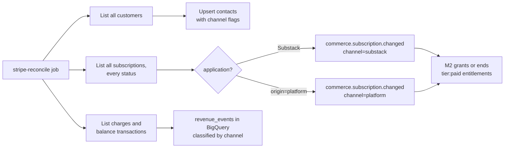
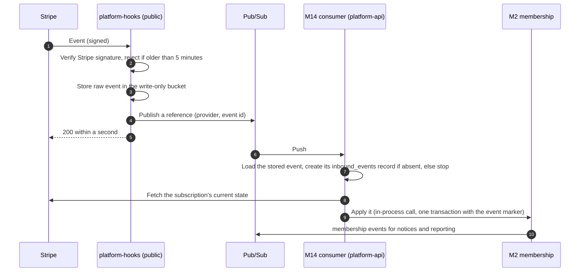
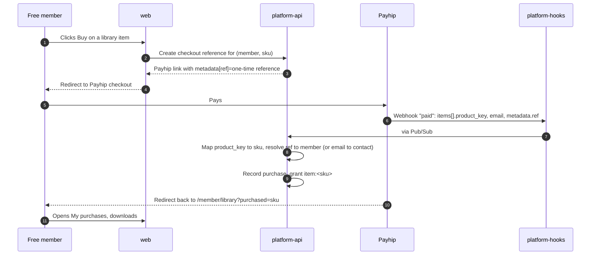

# 03 · Commerce and revenue (M14)

**Status:** Proposed for review · 2026-11-16 · Stage 1 (Stripe sync, Payhip purchases, revenue mart) and Stage 2 (Stripe store, Revenue team, owner cockpit)

This module turns money events into two things: facts the membership module can act on, and one honest picture of revenue across every channel.

## 1. Three channels, one Stripe account

| Channel | What is sold | Who runs checkout | How the platform learns of a sale | Platform fee |
| --- | --- | --- | --- | --- |
| **Substack** | Monthly and annual newsletter subscriptions, which include full platform access | Substack, charging through the owner's Stripe account | Stripe webhook; Substack's subscriptions are ordinary subscription objects in the owner's account, marked with Substack's application id | Substack takes 10% of each payment, plus Stripe's fees |
| **Payhip** | Single PDFs for free members and guests (Stage 1) | Payhip, charging through the same Stripe account (and PayPal if enabled) | Payhip webhook: it is the only machine-readable record of *which* product was bought | 5% on the free plan, plus Stripe's fees; Payhip may also withhold sales tax for some countries inside its fee |
| **Platform** | Platform-only membership (Stage 1); single PDFs and bundles through a Stripe-native store (Stage 2) | Stripe Checkout, created by the platform | Stripe webhook | Stripe's fees only |

Verified in November 2026: the account's event log contains `customer.subscription.created`, `customer.subscription.updated`, `invoice.paid` and `invoice.payment_failed` events for subscriptions created by Substack, so one registered webhook endpoint receives them. See [ADR 0007](../adr/0007-stripe-is-the-source-of-truth-for-paid-status.md).

Channel is decided on each Stripe object: `application` equals Substack's id or Payhip's id, or the object carries the platform's own `origin=platform` metadata, which the platform sets when it creates a Checkout session. Anything else is labelled `unknown` and flagged, never guessed. The ids are configuration, kept outside this repository.

## 2. Rules for touching Stripe

1. **Read-only towards anything Substack or Payhip created.** The platform never updates, cancels or refunds those objects. Refunds for Substack are done in Substack; refunds for Payhip in Payhip.
2. **Restricted keys, one per consumer.** The sync job gets a key that can only read customers, subscriptions, invoices, charges and balance transactions. The checkout creator gets a key that can only create Checkout Sessions and read prices. No service holds the full secret key.
3. **Never press "Disconnect Stripe" in Substack.** That button cancels and refunds every paid subscriber. Leaving Substack is done through Substack support (§8).
4. **Test in a sandbox.** Development uses a Stripe sandbox with test clocks to play a year of renewals and failures in minutes. The live account is touched only by the read-only backfill and the production webhook.

## 3. Stage 1: importing and listening

The launch track builds the reconcile job first and runs it on a schedule, more often while a campaign is open and on a member's request; the webhook path of §3.2 is added afterwards without changing it ([ADR 0022](../adr/0022-campaigns-grants-and-promotions-as-configuration.md)). The launch track's key reads customers and subscriptions only; the other read scopes of rule 2 arrive with the revenue export. Only the job's identity can read the key.

### 3.1 Backfill (once, then nightly as reconciliation)

- **Every Stripe customer becomes a contact**, with the flag of each channel they came through: paid subscriber, past subscriber, Payhip buyer, guest. Only customers with a live subscription or a grant receive `tier:paid`.
- The first production run is a **dry run that writes a report and nothing else**: how many contacts, how many paid by channel, and the list of anything odd (two customers with one email, a subscription with no email). The owner compares the paid count with the Substack dashboard before the real run.
- Reconciliation acts only on subscription objects it has fetched, never on a subscription's absence from a list, and the mass-change guard of [02 §4](02-membership-and-entitlements.md) applies.
- The nightly run repeats the comparison. Stripe retries a failed webhook for three days and does not guarantee order, so reconciliation is what makes the result certain rather than likely.

### 3.2 Webhooks

| Stripe event | Effect |
| --- | --- |
| `customer.subscription.created`, `.updated` | Fetch the subscription and apply its current state: grant, refresh, `grace` or end; note "ends on" when cancellation at period end is set |
| `customer.subscription.deleted` | Fetch and apply: the entitlement ends |
| `invoice.paid` | Fetch and apply the subscription. The money itself is picked up by the nightly revenue export |
| `invoice.payment_failed` | Fetch and apply the subscription; its status decides `grace`, never the invoice event |
| `charge.refunded`, `charge.dispute.closed` | A single-item purchase is revoked on a full refund or a lost dispute. For a subscription payment nothing changes; it is flagged for the owner |
| `checkout.session.completed` | Platform sale: create the purchase or the platform subscription |
| `customer.updated` (email changed) | The subscription's entitlement follows the customer's current email and moves to that contact. Contacts are never linked to each other from payment data. |

The endpoint pins its Stripe API version, so a Stripe upgrade cannot change payload shapes unannounced.

## 4. Stage 1: single PDFs through Payhip

What the design has to respect, because Payhip is simple:

| Payhip fact | Design answer |
| --- | --- |
| The checkout cannot be pre-filled with the buyer's email, and buyers mistype or use another address | The Buy link carries a one-time reference (`metadata[ref]`) that Payhip returns in the webhook; the platform resolves it to the signed-in member. Guests buying on Payhip directly are matched by email and attach when they register. |
| The webhook "signature" is a constant derived from the API key, not a signature of the message | Treat the webhook as weakly authenticated: an unguessable endpoint path, constant-time comparison of the signature, one record per transaction id, and a **cross-check in Stripe** (a payment by Payhip's application with the same buyer email and amount; each payment can verify one purchase only) before the purchase is marked verified. PayPal-paid orders cannot be cross-checked and are flagged for a glance. The secret path shows up in request logs, so those logs are restricted and the path is rotated. |
| Three hourly retries, then the event is gone; there is no API to list sales | A weekly reminder to upload Payhip's sales CSV in the admin screen; the importer fills any gap. Payments by Payhip's application seen in Stripe without a matching purchase raise an alert the same day. |
| Payhip emails the PDF itself | Fine: the buyer has the file at once, and the workspace copy is the permanent, always-current one. |
| Refund event carries the amount | A full refund revokes the item; a partial refund is flagged for the owner. |
| A 100% coupon produces a sale with no payment to cross-check | Zero-amount orders wait for one click of approval by the owner. |

Each library item maps to a Payhip product by `product_key` in its manifest ([04](04-content-library-and-search.md)). A sale of an unmapped product is recorded and flagged, never dropped.

## 5. Stage 1: platform-only membership

A Stripe product "Platform membership" with a monthly and an annual price, bought through Stripe Checkout from the upgrade page. The session carries the member id as `client_reference_id` and the `origin=platform` mark, and its email field is pre-filled and locked to the member's address; the webhook creates a `platform_stripe` entitlement with scope `platform_only`, bound to that member directly. Cancelling and card changes go through Stripe's hosted customer portal, so the platform builds no billing screens. Stripe Tax is switched on at this point, because this is the first sale the owner makes without a marketplace in between; GST registration thresholds are a question for an accountant.

The upgrade page shows every route that exists: **Subscribe on Substack** (newsletter and platform) and, once this product is built, **Platform only**. It is built after the launch track unless the owner decides that a Substack subscription does not include the platform.

### 5a. Promotions

A **promotion** is a time-boxed offer shown on the upgrade page and, as a banner, on the public site. It is a record, written from private configuration: a window, an audience, display text and a **channel** that says where the money changes hands.

| Channel | Who takes the payment and enforces the terms | What the platform does | When |
| --- | --- | --- | --- |
| `substack_offer` | Substack, through a special offer the owner creates in Substack's settings (a percentage or a free trial, how long the reduced price lasts, an end date, shown to everyone or only through its link) | Shows the offer inside its window, links to it, and counts Substack-paid entitlements that start inside the window for contacts who were not paid at its start | Launch track |
| `platform_checkout` | Stripe, through a coupon restricted to the platform's annual price | Applies the coupon on the server when it creates the Checkout Session; nothing for the member to type; counts exactly | With platform-only membership |

- No percentage, price or date is in code or in this repository.
- The window in the record is set to the offer's own end, the page states the end, and one switch hides every promotion at once.
- A promotion never changes an entitlement. Access changes only when the source reports a paid subscription.
- Seasonal promotions proposed by the Revenue team (Stage 2) become these same records after the owner approves them.

## 6. Stage 2: the Stripe-native store

Payhip is the quick start; the store replaces it item by item without a migration day.

- Each library item gains a Stripe price; **Buy** opens Stripe Checkout; the purchase and entitlement path is the one already built for platform membership.
- Bundles and series passes become one more grant type (`bundle:<id>` expands to items).
- Coupons, pay-what-you-want and gift purchases come from Stripe features, not custom code.
- Payhip keeps running for items that have not moved. An item moves by adding `stripe_price_id` to its manifest.
- Decision and trade-offs: [ADR 0010](../adr/0010-payhip-now-stripe-store-later.md).

## 7. One revenue picture

Everything lands in BigQuery `ops_commerce` ([09 §3](09-events-and-data-model.md)), keyed by contact id, no emails. One job, `revenue-export`, loads it each night from Stripe's balance transactions and the recorded purchases; nothing else writes there.

| Question the owner asks | Answered from |
| --- | --- |
| Total revenue this month, gross and net of every fee, by channel | `revenue_events`. Substack's and Payhip's cuts are on each sale's balance transaction. Stripe's own fees (card, currency conversion, billing) are posted as **daily totals by kind**, not per sale: they are stored as their own rows and shared out across channels in proportion to that day's volume, and the view says so. |
| Who buys what: free members, paid members, guests | `revenue_events` joined to `membership_daily` |
| Plan mix: monthly, annual, founding, platform-only | `membership_daily` |
| Upgrades, downgrades, cancellations, and why | `tier_changes` |
| Which PDFs sell, and to which segment | `revenue_events` by `sku` |
| Money from readers billed by Apple | A separate manual line: Apple pays Substack in monthly lumps, not per reader, so it never appears per person in Stripe |

### The owner cockpit: decisions, not charts

The cockpit in `/admin` does not copy Substack's dashboard. Each card is a **decision**: a signal, a proposed action, the expected effect, and a switch.

| Card | Signal | Action when switched on | Executed through |
| --- | --- | --- | --- |
| Invite to upgrade | Free members with high engagement or two or more purchases | Upgrade invitation with both routes | Substack post; platform email only to members who opted in to it |
| Win back | Paid readers who cancelled in the last 60 days | Offer, or a one-month complimentary pass | Substack offer (manual link until the Desk capability is verified) |
| Annual push | Monthly payers for six months or more | Annual-plan offer | Substack offer |
| Paywall timing | A free article still drawing sign-ups after N days | Move it behind the paywall, or keep it free | Substack Desk post audience |
| Open one up | A paid article with unusually high engagement | Free for a week, announced with a Note | Substack Desk |
| Bundle | PDFs often bought together | Create the bundle price | Stripe |
| Price test | Conversion by price point | Change a price for new buyers | Stripe, Payhip |
| Renewal risk | Annual renewals due in 30 days with low recent activity | Personal note from the owner | Email draft for approval |

Nothing switches itself on. Every executed action is recorded with its result two and four weeks later, so the next proposal is better informed.

### Revenue team (Stage 2)

Three agents on the model gateway, reading only Zone 1b:

| Agent | Does | Hands to |
| --- | --- | --- |
| **Revenue analyst** | Weekly: what changed, what it means, what is unusual. Raises `revenue.insight.raised`. | Cockpit, Revenue manager |
| **Revenue manager** | Turns insights into cockpit cards with an expected effect and a way to measure it (`promo.proposed`) | The owner; on approval, the Marketing team |
| **Store manager** | Keeps the product catalogue consistent across the library manifest, Payhip and Stripe; checks every sale has an entitlement and every refund a revocation; drafts product pages | The owner |

The Revenue manager and the Marketing team share one calendar: a promotion approved here becomes a brief there (`promo.approved`), and the marketing results flow back as revenue events.

## 8. Exit paths

- **Leaving Payhip:** stop linking to it; purchases and entitlements are already in the platform.
- **Leaving Substack:** the subscriptions and cards live in the owner's Stripe account and keep running. Ask Substack support to disconnect without cancelling and to release the 10% fee; do not use the Disconnect button. Entitlements then change source from `substack_stripe` to `platform_stripe`; nothing else in the platform changes. Readers billed by Apple cannot be moved and would need to re-subscribe.
- **Leaving Stripe:** the `PaymentProvider` port has three calls (create checkout, parse event, list subscriptions). Paddle or Lemon Squeezy fit the same shape.
