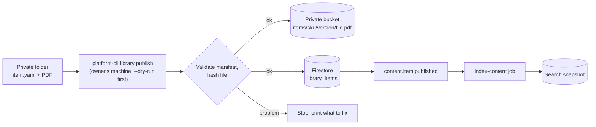
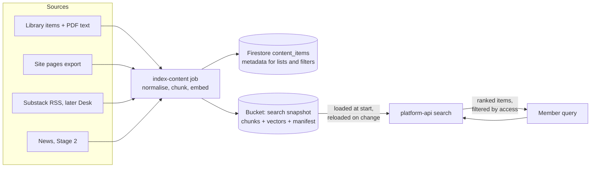

# 04 · Content library and search (M12)

**Status:** Proposed for review · 2026-11-16 · Stage 1 (library, index, search) and Stage 2 (article mirror, news)

Two jobs: hold everything the platform publishes with proper metadata, and let a reader find any of it from one search box, seeing only what their tier allows.

## 1. What counts as content

| Type | Examples | Source of truth | Indexed from | Stage |
| --- | --- | --- | --- | --- |
| Library item | Meta-reviews, evidence maps, clinician one-pagers, guides, worksheets (PDF) | The private content folder, published by a manifest | PDF text and manifest | 1 |
| Site page | Evidence library entries, research agenda, public pages | The website code | A build-time export from `web` | 1 |
| Substack post | Articles, free and paid | Substack | RSS in Stage 1 (title, summary, link); full body through Substack Desk in Stage 2 | 1, 2 |
| News item | Short platform news written by the marketing team | Platform | Platform | 2 |
| Evidence graph record | Studies, claims, findings | M7 | M7 | 6 |

Everything becomes a **content item** with the same metadata (title, type, summary, topics, dates, language, access, link), so search, lists, sitemaps and the agent teams all read one catalogue.

## 2. The library

### 2.1 Publishing a library item

The PDF and its metadata live in the private content folder, never in this repository. A small manifest file sits next to each PDF:

```yaml
# $AUDHD_CONTENT_DIR/library/items/<sku>/item.yaml
sku: example-evidence-map            # permanent, never reused
title: "Example: an evidence map"
kind: evidence_map                   # meta_review | evidence_map | clinician_one_pager | guide | worksheet
series: clinician-one-pagers
abstract: >
  Two or three sentences shown publicly and used by search.
topics: [burnout, differential-diagnosis]
audience: [members, clinicians]
evidence_status: supported           # same labels as the evidence library
version: "1.0"
language: en
access: paid                         # paid | free_members | purchase_only
file: example-evidence-map-v1.0.pdf
cover: cover.png
payhip: { url: "https://payhip.com/b/XXXX", product_key: "XXXX" }
price_display: "US$X"
citation: "Author (Year). Title. audhdneurobiology.org."
related_urls: []
status: published                    # draft | published | retired
```



- `--dry-run` prints what would change and uploads nothing. Publishing is the owner's action; no agent publishes library items in Stage 1.
- A new version is a new object path. Older versions are kept. Buyers and paid members always get the current version.
- Retiring an item hides it from the catalogue and search; people who bought it keep access.
- Stage 2 adds a drop folder (an inbox bucket and a job) so approved agent output can be published without the command line.

### 2.2 Reading and downloading

| Page | Who sees it | What it shows |
| --- | --- | --- |
| `/library`, `/library/<sku>` (public) | Everyone, search engines, AI answer engines | Title, abstract, kind, topics, evidence status, version, pages, how to get it. Structured data marks it as paywalled content. Never the file. |
| Workspace **Research** and **Guides** | Paid members | Every published item, filters by kind, topic and series, **Open** and **Download** |
| Workspace **Library** | Free members | The same catalogue with **Buy** (Payhip) and **Upgrade**; **My purchases** with Open and Download |

Download path: `web` asks `platform-api`; the library module takes the member's access (tier and bought items) from the entitlement module and applies the rule of §2.3; on yes, it returns a signed link that works for 10 minutes and logs the download. The bucket is private and has no public links, so a shared URL stops working within minutes. A limit of 30 downloads an hour per member blocks scripted scraping.

Optional from Stage 2, per item: stamp each downloaded copy with the member's email in the footer. It deters sharing and costs a few hundred milliseconds per download.

### 2.3 Access rule

```
may_open(member, item) =
     item.access == "free_members"                       and member is signed in
  or item.access in ("paid", "free_members")             and member.tier is paid or higher
  or member holds an active "item:<sku>" entitlement     (any access value)
```

`purchase_only` exists for products that even paid members buy separately, such as a future book.

## 3. One index for everything



**Indexing.** The job reads each source through a `ContentSource` adapter, skips anything whose checksum has not changed, splits text into passages of roughly 200 to 400 tokens along headings, and turns each passage into a vector with the embedding model behind the `Embedder` port. It writes metadata to Firestore and one snapshot (passages, vectors, manifest) to a bucket, then moves the "current" pointer and announces `content.index.published`. It runs when something is published and once a night.

**Searching.** `platform-api` keeps the current snapshot in memory. Passages the reader may not open are set aside first. The rest are scored two ways, by words (BM25) and by meaning (vector similarity); the two rankings are merged by reciprocal rank fusion and grouped by item. This needs no search server and no database, which is why it costs nothing while idle. See [ADR 0018](../adr/0018-search-index.md).

**Access-aware results.** Every passage is marked `public` (abstracts, public pages, free posts) or `gated` (full text of paid items). Gated passages take part in ranking and snippets only for a reader who may open that item, so gated text can neither appear in a snippet nor influence the order for anyone else. Everyone else still finds the item through its abstract and sees a label: *Paid members* or *Buy*. A free reader never receives a sentence of gated text, including in snippets.

**Filters.** Type, topic, series, evidence status, language, date.

**Limits.** Sized for up to about 50,000 passages on a 1 GiB instance. Beyond that, the same port takes a managed vector index.

### Search interface

| Endpoint | Purpose |
| --- | --- |
| `POST /v1/search` (query and filters in the body) | Results for the calling member or guest. The query stays out of request logs: what a member searches for is health-related. |
| `GET /v1/library/items`, `GET /v1/library/items/{sku}` | Catalogue and one item, with the caller's access decision |
| `POST /v1/library/items/{sku}/download` | Signed link, after the entitlement check |
| `GET /v1/me/library` | Purchases and recently opened |

## 4. From search to Ask AuDHD Research

Ask is search plus a written answer with citations, for paid members, with a monthly quota. It reuses this index unchanged: retrieve the passages the member may open, pass them to a model through the model gateway, return an answer where every sentence points to a source, and refuse when the passages do not support an answer. It is switched on in Stage 2, when the gateway exists, and gains the evidence graph in Stage 6. The quota is one number in `config/platform/tiers.yaml`.

Rules for Ask from day one: answers are built only from indexed content; no diagnosis and no treatment advice; exploratory observations are labelled as such ([07](07-research-loop-and-evidence.md)); each question and answer is kept with its sources in Zone 1 for 90 days for review, and never in traces or analytics.

## 5. For search engines and AI answer engines

- Catalogue pages carry JSON-LD (`Report` or `ScholarlyArticle`, with the paywall marked the way Google documents for paywalled content).
- `sitemap.xml` and `llms.txt` list catalogue pages, evidence library entries and mirrored articles.
- Mirrored Substack articles (Stage 2) point their canonical URL at Substack unless the owner decides the site should rank first; one setting per article.

## 6. What is borrowed

Passage quality metrics from `adaptive-chunking`; PDF text extraction with `pypdf`; ranking with `rank-bm25` and NumPy. Details and file paths in [10](10-borrow-map.md).

## 7. Exit path

The library is files in a bucket and documents with a published shape; any object store and any database will do. The search snapshot is three plain files (JSON Lines, a NumPy array, a manifest), readable anywhere. The `SearchIndex`, `Embedder` and `ContentSource` ports are the seams: Vertex AI Search, Firestore vector search, BigQuery vector search, Typesense or pgvector can each replace the in-memory adapter without touching callers.
