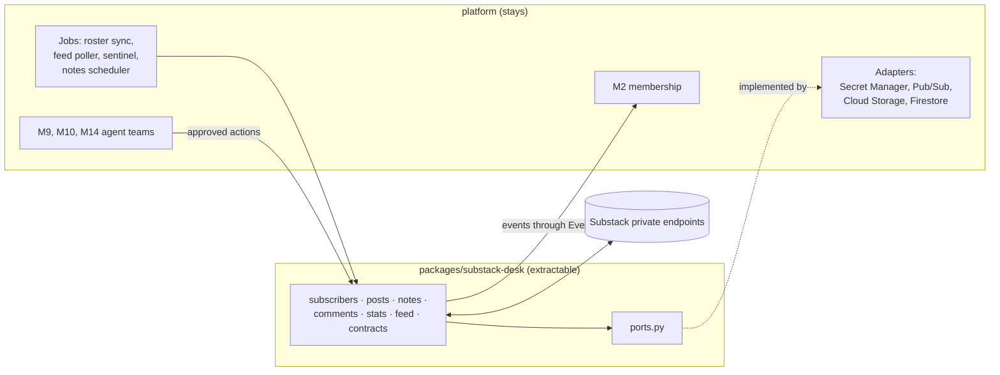
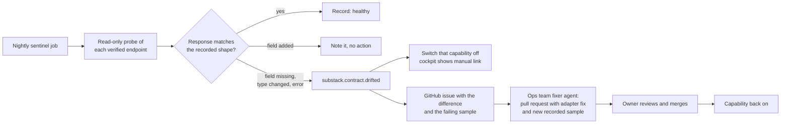
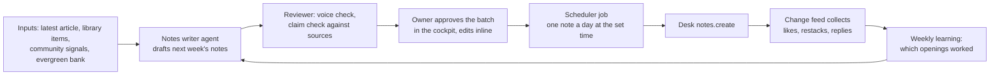

# 05 · Substack Desk (M15)

**Status:** Proposed for review · 2026-11-16 · Stage 1 (subscriber roster) and Stage 2 (posts, notes, comments, statistics, change feed, sentinel)

Substack Desk is the platform's single doorway to Substack: who subscribes, what is published, what readers say, how it performs. It is built inside this repository first and shaped so the whole folder can leave as a standalone open-source project later.

## 1. Facts that constrain the design

- **Substack has no webhooks and no general API.** Its official surfaces are narrow: a subscriber CSV export, an RSS feed, editable welcome emails, and a read-only Publisher API (posts, statistics, daily counts, look-up of one subscriber by email) that is not enabled for every publication. Whether this publication has it is the first thing to check in the dashboard.
- **Everything else here uses the private web endpoints the Substack website itself uses**, signed in with the owner's session cookie. They can change without notice.
- **Substack's Terms of Use prohibit crawling or scraping "through use of manual or automated means".** Read literally, automated calls to private endpoints fall under that clause, even for one's own publication. How Substack applies it to a publisher reading her own data is not documented. This is a business risk for the owner to accept knowingly, feature by feature: the worst case is action against the Substack account. The Desk reduces the exposure (official surfaces first, read mostly, human speed, owner-approved writes, every capability behind its own switch) but cannot remove it.
- **Every feature must degrade to "do it by hand".** When an endpoint breaks, the capability switches itself off, the owner is told, and the cockpit shows a link to the right Substack screen instead.
- **Paid status does not depend on private endpoints.** Stripe is the fast path for upgrades and downgrades, and the Publisher API or a CSV upload covers what Stripe cannot see ([02 §4a](02-membership-and-entitlements.md)). Private-endpoint reading of the roster is an optional convenience.

## 2. Built to be lifted out

```
packages/substack-desk/                 ← becomes its own repository later
├─ pyproject.toml                       name: substack-desk; depends on nothing in this repo
├─ README.md · THIRD_PARTY.md
├─ src/substack_desk/
│  ├─ core/            HTTP transport, session, polite rate limiter, errors, paging
│  ├─ ports.py         CredentialStore · EventSink · BlobStore · KeyValueStore · Clock
│  ├─ capabilities.py  the capability matrix as data: verified · unverified · off
│  ├─ subscribers/     roster, types, filters, CSV import
│  ├─ posts/           drafts, publish, schedule, audience and paywall, images, Markdown conversion
│  ├─ notes/           create, reply, delete, schedule queue
│  ├─ comments/        threads, reply, like
│  ├─ stats/           publication and post statistics
│  ├─ membership/      comps, gifts, offers (only after traffic capture)
│  ├─ feed/            change feed: poll, compare, emit events
│  ├─ contracts/       recorded responses, response shapes, sentinel checks
│  ├─ api/             optional REST router, for standalone use
│  └─ mcp/             optional MCP server, for standalone use
└─ tests/              run against recorded responses; no network

services/platform-api/src/platform_api/adapters/substack_desk/   ← stays here
   SecretManagerCredentialStore · PubSubEventSink · GcsBlobStore · FirestoreKeyValueStore
```



Three rules keep it liftable, each checked in CI:

1. **No import from the platform.** An import-linter contract fails the build if `substack_desk` imports `platform_api`.
2. **Installs and tests alone.** A CI job installs only `packages/substack-desk` into a clean environment and runs its tests.
3. **Nothing about one publication in code.** Publication address, limits and feature switches come from `DeskSettings`.

The rest of the platform depends on a narrow `NewsletterProvider` port (roster, publish, comment events), not on the Desk directly, so Ghost, Beehiiv or Buttondown could stand in. Decision: [ADR 0009](../adr/0009-substack-desk-as-an-extractable-package.md).

## 3. Capability matrix

"Verified" means a reviewed repository contains code that works against live responses. "Capture first" means nobody has verified code; a short recording session of the owner using the Substack website gives the real requests before anything is built.

| Capability | State | Port from | Stage |
| --- | --- | --- | --- |
| Subscriber look-up by email, posts, statistics through the **official Publisher API** | Reported by third parties; check the dashboard | `substack-publisher-mcp` as a reference | 1 |
| Subscriber CSV import | Official export; built new | – | 1 |
| Subscriber roster through private endpoints: type, plan, dates, activity rating, filters | Verified; off by default | `substack-mcp` `SubscriberQuery.js`, `SubstackApi.js` | 1, optional |
| Drafts, publish with or without email, schedule, images | Verified | `python-substack` | 2 |
| Markdown to and from Substack's document format; tables as images; covers | Verified | `substack-cli-publishing` `md2pm.py`, `pm2md.py`, `tables.py`, `covers.py` | 2 |
| Post audience (free or paid) and paywall position | Verified | `substack-mcp` `document.js` | 2 |
| Notes: create, reply, react, delete | Verified | `substack-gateway-oss` `gateway_notes*` | 2 |
| Comments: read threads, reply, like | Verified | `substack-gateway-oss` `gateway_comments*`, `substack-mcp` `comment.js` | 2 |
| Publication and post statistics | Verified | `substack-mcp` `get_analytics.js` | 2 |
| Restacks, mentions, recommendations (read) | Capture first | – | 2 |
| Direct messages and chat (read) | Capture first | – | 2, read-only |
| Comps, gifts, special offers and discounts | Capture first | – | 2 |
| Moderation: hide, mute, ban | Undecided by the owner; capture first | – | Later |

The matrix lives in `capabilities.py` as data. The cockpit reads it, so a capability that is off shows a "Do this in Substack" link instead of a button.

## 4. The change feed

Substack will not tell the platform when something happens, so the Desk asks at intervals, compares with what it saw last time and emits events.

| Watched | Interval | Event |
| --- | --- | --- |
| Subscriber roster | Daily in Stage 1, every 6 hours from Stage 2 | `substack.subscriber.changed` with the kind of change: joined, left, free to paid, paid to free, plan changed, comp or gift started or ended |
| Posts | 15 minutes | `substack.post.published` |
| Comments on posts of the last 60 days | 15 minutes | `substack.comment.created` |
| Notes and their reactions | Hourly | `substack.note.published`, `substack.note.engaged` |
| Statistics | Daily | `substack.stats.snapshotted` |
| Restacks, mentions, recommendations, messages | Hourly, once captured | `substack.restack.created`, `substack.mention.created`, `substack.recommendation.changed`, `substack.message.received` |

Politeness limits: at most one request a second with jitter, back-off on any refusal, a daily request budget, and no parallel sessions. Events carry ids, never comment text or emails.

## 5. The sentinel: watching Substack's private API for changes



- The probe uses only read requests against the owner's own publication.
- Until the ops team exists (Stage 4), the hand-off stops at the issue and an email; the fix is done in a normal coding session.
- A session cookie that stopped working is reported separately (`substack.credential.expired`) with the runbook step to renew it. The cookie is stored in Secret Manager from the owner's own terminal and is never pasted into a chat or a file.
- Manual fallback always exists: CSV import for the roster, the Substack editor for publishing, the Substack dashboard for everything else.

## 6. Notes: at least one a day



Guards: nothing is posted that the owner did not approve; an empty queue two days ahead raises an alert; "skip today" is one switch; a note that makes a health claim must cite an indexed source or it does not pass review.

## 7. Comments as a community signal

Comments contain private medical stories. They are personal data in Zone 1 and are handled accordingly.

| Use | How | Privacy rule |
| --- | --- | --- |
| A member sees their own comment history in the workspace | The member connects their Substack profile in **Account**; their comments are then listed for them only | Opt-in by the member |
| The member brings a comment into Practice Exchange | A button on their own comment | Only the author can do it |
| Community signal for the writers and the study-design loop | Comments are grouped into themes; only theme, count and trend leave Zone 1 as `community.signal.raised` | No comment text, no author, minimum group of 5 comments per theme |
| Unanswered questions | A queue in the cockpit; the owner replies through the Desk | Reply is the owner's approved text |
| Engagement and loyalty | Substack's activity rating, comment and like counts combine into one engagement score per contact | Used by the Revenue team for invitations; never shown publicly |

Never: comment text in research datasets, in public posts without the author's permission, or in a model prompt together with the author's identity. Theme extraction runs on text with names and contact details removed first.

Likes and restacks are treated the same way: counted per contact for the engagement score, reported in aggregate.

## 8. How the rest of the platform uses the Desk

| Caller | Uses | Human gate |
| --- | --- | --- |
| M2 membership | Roster sync for free, comp, gift and group subscribers | None; rules in [02](02-membership-and-entitlements.md) |
| M9 publishing team | Create draft, upload figures, schedule | Owner approves the article and the schedule |
| M10 marketing team | Notes queue, reply drafts | Owner approves each batch |
| M14 revenue team | Read statistics and roster segments; propose promos, paywall changes, comps | Owner switches each proposal on |
| M12 content | Full post bodies for the mirror and the search index | None |
| M13 ops team | Sentinel results, fixes | Owner merges |

## 9. Example of the Python surface

```python
desk = SubstackDesk(settings, credentials=..., events=..., blobs=..., kv=...)

for sub in desk.subscribers.iter_roster():        # Subscriber(email, type, plan_interval, since, activity_rating)
    ...
draft = desk.posts.create_draft(DraftInput(title=..., markdown=..., audience="paid", paywall_after=3))
desk.posts.schedule(draft.id, when)               # raises CapabilityOff if the sentinel switched it off
note = desk.notes.create(NoteInput(text=..., link=...))
events = desk.feed.poll()                         # list[DeskEvent]; also sent through EventSink
report = desk.contracts.run_sentinel()            # SentinelReport(healthy=[...], drifted=[...])
```

## 10. Exit path

Lift `packages/substack-desk` into its own repository, add a licence, publish. Before that day: review every ported file against the licence of its source (recorded in [10](10-borrow-map.md)), and rewrite any file whose source licence does not allow redistribution. The owner's instruction for now is to copy freely and triage at release time; the provenance list is what makes that triage possible.
