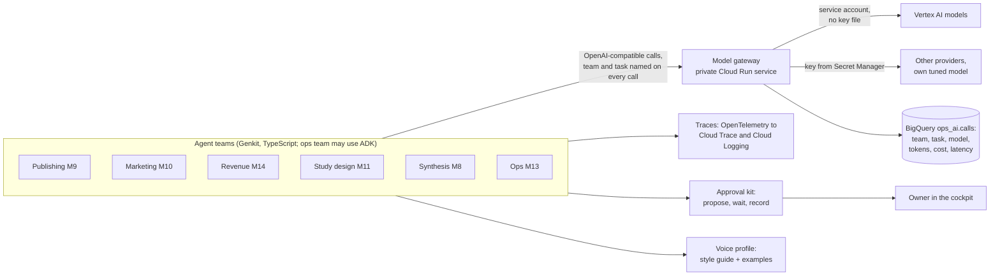

# 06 · AI platform and agent teams (M0, M9, M10, M11, M13, M14)

**Status:** Proposed for review · 2026-11-16 · Stage 2 onwards

Six teams of agents do drafting, checking and watching. They share four things that are built once: a model gateway, a voice profile, an approval kit and a way to see what happened. The aim for cost is plain: **no fixed monthly fee for AI tooling**; pay only for model tokens.

## 1. Shared capabilities

### 1.1 Model gateway

One private service that every model call passes through. No agent holds a provider key or calls a provider directly.

| Need | Answer |
| --- | --- |
| Swap models and providers without touching agents | LiteLLM proxy with a configuration file: model list, routing, fallbacks. Agents ask for a **task tier** (`cheap`, `standard`, `strong`), never a model name. |
| No database | Configuration-file mode needs none. The database is only required for LiteLLM's own virtual keys, budgets and admin screens. |
| Know what each team spends | A small callback writes one row per call to BigQuery. The weekly cost report and the cost-watch agent read that table. |
| Stop a runaway agent | A daily cap per team, checked before each call against a counter. Provider-side quotas are the second line. |
| Reach Google models without keys | The gateway's service account has the Vertex AI user role. |
| Bring the owner's own model | Any OpenAI-compatible endpoint is one more entry in the model list. |

**Supply-chain caution.** LiteLLM's published packages were compromised twice in 2026 (March on PyPI; October on PyPI and the moving Docker tags). The gateway is therefore deployed from an image pinned by digest, never a moving tag; its signature is verified; upgrades are deliberate pull requests; and its service account can do nothing except call models and write its log table.

**Stage 2 starts with a two-day spike** that must pass four tests before any agent is built: route by task tier with a fallback; refuse a call over the team cap; write the spend row; reach a Vertex model with no key. If the caps cannot be enforced cleanly without LiteLLM's database, the fallbacks in order are: the smallest Cloud SQL instance (about US$13 to 14 a month, the first always-on cost), or a thin gateway of our own for the two or three providers actually used. Decision: [ADR 0011](../adr/0011-self-hosted-model-gateway.md).

### 1.2 Seeing what agents did, without a paid tool

| Need | Tool | Cost |
| --- | --- | --- |
| Step-by-step trace of a run | Genkit's built-in telemetry and OpenTelemetry into Cloud Trace and Cloud Logging. Traces record steps, timing and sizes, not the text of prompts or answers. | Free at this volume |
| Spend by team, task, model | BigQuery `ops_ai.calls` | Free tier |
| Quality checks on prompts before a change ships | promptfoo test suites in CI | Free |
| Answer-with-sources quality for Ask | ragas metrics on a fixed question set, run on change | Tokens only |

Langfuse is not self-hosted: it needs two databases, a cache, a worker and object storage, which is the opposite of near-zero cost. If a trace browser is wanted later, Phoenix (one container) or Langfuse's free cloud tier for runs without personal data are the options to weigh then.

### 1.3 Approval kit

Every public or irreversible action is a **proposal**: what, why, expected effect, exact content. It waits in the cockpit. The owner approves, edits or declines; the decision and the final content are recorded; only then does the executing adapter run. Agents have no path around it: the permissions to publish, post, send or change prices belong to executor jobs of the platform, not to agents, and an executor acts only on an approval that `platform-api` recorded from the owner's signed-in action, checking a hash of the approved content first.

### 1.4 Voice profile

The owner's writing voice, used by every agent that drafts public text.

| Step | What | When | Running cost |
| --- | --- | --- | --- |
| 1 | **Corpus.** Her own published writing from before AI assistance: Substack posts first, then selected long-form emails she chooses. Stored in a private bucket, never in Git, never in the public repo. | Stage 2 | Storage only |
| 2 | **Style guide.** Extracted once from the corpus and edited by her: sentence habits, vocabulary, what she never says, how she handles uncertainty. Small, versioned in the private content folder. | Stage 2 | None |
| 3 | **Retrieval of examples.** For each draft, the three to five most similar passages of her own writing are placed in the prompt as examples. | Stage 2 | A few dollars of tokens a month |
| 4 | **A tuned style rewriter** (her first fine-tuning project). A small open model (4 to 8 billion parameters) is LoRA-tuned on pairs of *plain paraphrase → her original paragraph*, so it learns to rewrite a neutral draft into her voice. It does not write content; it restyles a draft whose facts are already checked. | Stage 7, or earlier as a learning project | Training fits a free notebook GPU; serving on a scale-to-zero Cloud Run GPU costs a few dollars a month if runs are batched |

On email as a source: mail contains other people's words and private matters. Only messages she selects, only her own text (quoted replies removed), names and contact details stripped before anything is stored. Substack posts are the better first corpus.

**Drift.** A drafting prompt that is edited often slowly stops sounding like her. Three guards: prompts and the style guide are versioned and changed only by pull request; a fixed set of twenty reference briefs is re-drafted on every change and scored against her real pieces by the reviewer (and by promptfoo assertions for banned phrases); and each month the reviewer compares that month's published pieces with the corpus and reports the distance.

**Can her own model run on Google Cloud?** Yes, three ways: a Cloud Run service with a GPU that sleeps when unused (the fit for a rarely used style model); a Vertex AI endpoint (always on, hundreds of dollars a month, not for this); or tuning a Google model inside Vertex AI (cheapest to run, but the weights stay with Google, so less of a learning project and not portable). Whichever is chosen, it is registered in the gateway like any other model. Decision: [ADR 0017](../adr/0017-voice-profile.md).

## 2. The teams

Each team is a folder under `agents/`, one service account, one daily model budget, one list of events it reads and writes. An agent is a Genkit flow with typed input and output.

### Publishing team (M9) · Stage 2

| Agent | Does | Gate |
| --- | --- | --- |
| Scouts | Watch literature sources and community signals; propose ideas with a coverage check | |
| Investigator | Reads the papers, extracts claims with passages, judges whether evidence is sufficient | |
| Author | Drafts in the owner's voice from the evidence pack | **Owner picks the idea** |
| Designer | Figures and tables as images | |
| Reviewer | Claim-by-claim check against sources; voice check; no treatment claims | **Owner edits the article** |
| Publisher | Creates the Substack draft through the Desk; proposes the schedule | **Owner approves the schedule** |

### Marketing team (M10) · Stage 2

| Agent | Does | Gate |
| --- | --- | --- |
| Notes writer | Next week's daily Notes ([05 §6](05-substack-desk.md)) | Owner approves the batch |
| Channel writer | Instagram carousels and Threads posts from each article and library item | Owner approves the batch |
| News editor | Short news items for the site | Owner approves |
| Scheduler | Posts approved items at set times | None: executes approved items only |
| Analyst | What worked; feeds the writers and the Revenue team | |

Instagram and Threads are posted through Meta's own APIs behind a `SocialPublisher` port. For the owner's own accounts no app review is needed; tokens last 60 days and are refreshed by a job. Postiz is not used: it now needs a database, a cache and a workflow engine running permanently, which costs more each month than the two channels justify. (Its AGPL licence would allow private modification; that is not the obstacle.) Decision: [ADR 0016](../adr/0016-social-publishing.md).

### Revenue team (M14) · Stage 2

Analyst, Revenue manager and Store manager, described in [03 §7](03-commerce-and-revenue.md). They read business reporting tables only and propose cockpit decisions.

### Study-design team (M11) · Stages 3 and 5

The survey template agent ([07 §6](07-research-loop-and-evidence.md)) and, from Stage 5, a protocol drafter (hypotheses, sample size, analysis plan, registration text).

### Synthesis team (M8) · Stage 5

Pattern explainer, evidence matcher, verdict proposer. Output is a Finding or a Gap for the owner to approve.

### Ops team (M13) · Stage 4

| Agent | Does |
| --- | --- |
| Sentinel | Uptime, synthetic journeys (sign in, download, a sandbox purchase), page rendering |
| Bus inspector | Dead letters, events that do not match their schema |
| Substack sentinel | Private API shape changes ([05 §5](05-substack-desk.md)) |
| Fixer | Reproduces a fault, opens a pull request with a test and a fix |
| Dependency and drift | Updates; differences between Terraform and what is deployed |
| Cost watch | Cloud and model spend against budget; model price changes; proposes routing changes |

The ops team works through pull requests. It cannot deploy to production or merge.

## 3. Rules every agent obeys

1. Models are reached only through the gateway, naming team and task.
2. No personal data in a prompt unless the task is about that one person and runs inside Zone 1 (for example, drafting a reply to a member). Research rows and comment text with identity never enter a prompt.
3. An agent that reads text written by outsiders (comments, web pages, feeds, issues) has no tools and no network access beyond the gateway. Its output is data for the next step, never instructions. The fixer acts on the platform's own check results, not on issue text written by others.
4. Public or irreversible output is a proposal until approved.
5. Every claim about health in public text carries a source from the index or the graph, or it does not pass review.
6. Each team has its own identity, reaches data only through `platform-api`, and sees only what [08](08-security-identities-and-org.md) lists for it.
7. Prompts are files, versioned, changed by pull request, tested in CI.

## 4. Cost

| Item | Stage 2 estimate per month |
| --- | --- |
| Gateway, agents, jobs on Cloud Run | US$0 to 3 (scale to zero) |
| Model tokens: four articles, thirty Notes, forty social posts, weekly revenue and analytics runs | US$20 to 60 |
| Ask AuDHD Research within quotas | US$2 to 15 |
| Embeddings | US$1 to 3 |
| Traces, logs, spend table | US$0 |
| Database for the gateway | US$0 (none), or about US$14 if the spike shows one is needed |

## 5. What is borrowed

Router and spend patterns from LiteLLM; reviewer loops from `deepagents` and `gstack`; approval and fallback patterns from ADK; ops trigger and ticket design from `dsh-superagent-prototype`; writing checks from `humanizer` and `no-ai-slop`; marketing skills from `marketingskills`; literature clients from `science-skills`. Files and licences in [10](10-borrow-map.md).

## 6. Exit path

Agents speak the OpenAI-compatible protocol to the gateway and A2A to each other, so a team can be rewritten in another framework without the others noticing. The gateway's configuration is a YAML file. Traces are OpenTelemetry. Nothing here is specific to Google except the default models.
