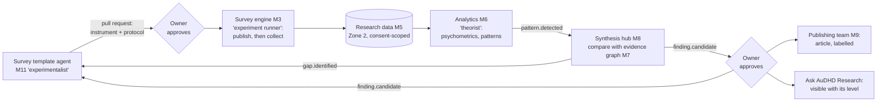
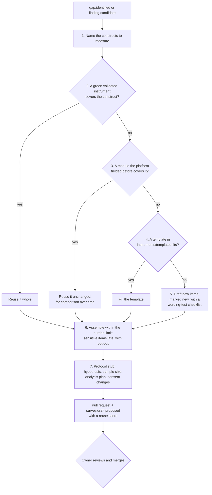

# 07 · Research loop and evidence (M3 to M8, M11)

**Status:** Proposed for review · 2026-11-16 · Stages 3, 5, 6. Outline level: each part gets its own detailed design when its stage is next.

The research machine is unchanged in purpose from v3: collect answers with consent, find patterns, compare them with published evidence, write about what holds up, and design the next survey from what is missing. v4 changes four things: when it is built (after the member platform), what paid members may see (exploratory patterns, clearly labelled), how surveys are drafted (by reuse first), and how the loop itself is structured (borrowing AutoRA's design).

## 1. The loop

### Structure borrowed from AutoRA

AutoRA (MIT, github.com/AutoResearch) is a framework for closed-loop behavioural research. Its code was reviewed and run. The verdict: **port the design, do not install it.** The core has had no release since October 2024, pins an old NumPy, runs the whole loop inside one Python process, stores raw rows in a pickled file, and has no notion of consent, waiting for people, or approval.

What is taken:

| From AutoRA | Becomes here |
| --- | --- |
| Three roles: experimentalist, experiment runner, theorist | The survey template agent, the survey engine, the pattern detector. Keeping the names makes the kit recognisable to researchers. |
| State plus delta: every step is a function of the loop state that returns a change, and each field declares how changes merge (extend, append, replace) | `research_loop/state.py`: a `LoopState` record per cycle and a `Delta`; **each event on the bus carries a delta**. About 150 lines, with AutoRA's own test cases ported. |
| A runner that blocks until data arrives | Split in two: `publish()` returns at once; `collect()` is called again later. Status: `awaiting_approval`, `fielding`, `closed`, with a target sample size and a deadline. |
| Fitted models kept in the state | The state holds **references** to data snapshots, never rows. |
| Synthetic ground-truth experiments | A synthetic respondent generator with a planted pattern, so the whole loop runs in CI and must find the planted pattern. |

Complements for steps AutoRA lacks: the hypothesis-refinement pattern of HypoGeniC (MIT) for turning a pattern into a testable statement; PaperQA2 (Apache-2.0) for checking a pattern against the literature with citations; catsim (BSD) later, if adaptive item selection is wanted. Details in [10](10-borrow-map.md) and `docs/research/autora.md`.

## 2. Five evidence levels, visible to paid members

An observation from the platform's own data carries one of five levels. The level is shown wherever the observation appears.

| Level | Label | It means | Default weight |
| --- | --- | --- | --- |
| 1 | **Exploratory** | A pattern found in member data. Not yet tested on new data. | 0.2 |
| 2 | **Reported** | Written up with method, sample and limits. Same data as level 1. | 0.3 |
| 3 | **Replicated** | The analysis plan was registered in advance and run on a fresh dataset; the pattern held. | 0.6 |
| 4 | **Preprint** | Posted publicly with a DOI and full methods. Not peer reviewed. | 0.75 |
| 5 | **Published** | Accepted by a peer-reviewed journal. Only now does it also enter the graph as a study. | 1.0 |

Weights are a starting heuristic in `config/platform/evidence_weights.yaml`, alongside weights for published literature by study design and by whether the sample was neurodivergent. They order results and tell the answer writer how firmly to phrase a sentence. They are not statistics and are described to members as a reading aid.

**What paid members see in Ask AuDHD Research**

- Answers are grouped: published research in neurodivergent samples; published research in general samples; the platform's own observations, each with its level badge.
- A filter with five tick-boxes, all on by default, and a one-click "Published evidence only".
- An explanation behind every badge: what the level means, the sample size, how people were recruited, what would move it up a level.
- A fixed sentence pattern for levels 1 and 2: "In our member data (n = …) we observed …. This has not been tested on new data."

**Guard rails before any level 1 or 2 observation is visible**

- At least 30 respondents per compared group; no cell under 5 shown.
- An effect size with its interval, not only a p-value.
- No treatment, diagnosis or causation wording.
- The owner approves each one; approval and wording are logged.
- The participants' consent covers reporting aggregates to members.

**Who may use which level**

| Output | Levels |
| --- | --- |
| Ask AuDHD Research, member articles | 1 to 5, labelled |
| Book chapters | 1 to 5, each claim says its level |
| PhD proposals and pitches | 3 to 5 only |
| Graph as "evidence in neurodivergent samples" | 5 only |

Decision: [ADR 0013](../adr/0013-observation-lifecycle-visible-to-paid-members.md).

## 3. Collecting: consent, zones and two collection modes

Collection starts in Stage 3. The zones and keys are in [09](09-events-and-data-model.md). Three rules come first:

1. **Every study declares its ethics route before it can open.** The study protocol file carries `ethics.route` (`independent_review`, `institutional_review`, `anonymous_collection`, `not_research`), a reference to the approval or the written reasoning, and the date. The survey engine refuses to field an instrument whose study has no route on file.
2. **Two collection modes, chosen per study.** *Pseudonymous*: answers are keyed by `research_id`, can be linked across waves, withdrawn and recontacted. *Anonymous*: answers carry nothing that links to an account, payment or sign-in; no linkage across waves and no withdrawal after submission. This is harder than leaving out a key: an answer sent from a signed-in session, a logged network address, or a "completed" mark written in the same second all link it back. The Stage 3 design therefore has to include a one-time participation token issued by blind signature (the issuer cannot match token to member), a survey endpoint on its own origin with no cookies and no request logging, times stored to the day only, and responses released in batches. **Until that is built and independently checked, anonymous mode must not be what an ethics route rests on.** Which mode a study may use follows from its ethics route.
3. **Consent is data.** Each scope is a separate, versioned yes: taking part, linking to other surveys, recontact, reporting aggregates to members, future research use, sharing de-identified data, commercial licensing of de-identified data. A row is usable for a purpose only if the consent in force when it was collected covers that purpose.

The background on ethics review, national law and journal policies is in the private project notes, not in this repository.

## 4. The research data module as a product of its own (M5)

A review of existing tools found no lightweight, API-first, open-source service that combines a scoped consent ledger, pseudonym issuance, guest claim, withdrawal purge and release checks. The closest complete stack (gICS, gPAS and E-PIX from Greifswald) is three Java server products built for a staffed hospital trust office. Survey tools either cannot re-link an anonymous response or have no consent ledger. So M5 is built here, with a clean boundary, and can be offered later as a self-hostable package and then as an API.

**Corrections to the v3 design that existing tools already solved**

| Gap in v3 | Fix |
| --- | --- |
| One pseudonym per person links them across every study and release | A pseudonym **per domain**: `research_id` is derived per study, and each release gets its own ids, so two datasets cannot be joined by id |
| The guest `test_id` is a bearer secret stored as is | Store only its hash; single use; expires |
| k-anonymity alone is thin for health answers | Add l-diversity on sensitive columns to the release gate |
| Withdrawal cannot recall a release already delivered | A release register: who received which release under which agreement, so withdrawals are honoured in the next release and licence holders are notified |

**Standards to align with, so the module speaks a language universities already use:** ISO/IEC TS 27560 field names for consent records and receipts; FHIR Consent as an export format; GA4GH Data Use Ontology codes on releases.

**Components embedded rather than written:** pyCANON (checks k-anonymity, l-diversity, t-closeness), ANJANA (applies them), Presidio (removes names and contact details from free text). All permissively licensed.

## 5. Instruments and their licences

Only instruments that are free to use on a member platform are fielded. "Free for academic research" is not enough here: a platform with paying members can be read as commercial use by a licence holder.

- The instrument registry (`instruments/registry.yaml`) records for each instrument: source, version, `licence.status` (`green`, `amber`, `red`), the exact terms, whether scores may be shown to respondents, and a reference to any written permission.
- **The survey engine refuses to field an instrument that is not green or does not have a permission reference.**
- Validated instruments are used whole and unchanged; items are never edited or picked out singly unless a subscale is validated on its own.
- The first survey draws on the verified-green list (short screeners for ADHD traits, autistic traits, camouflaging, alexithymia, mood, anxiety, somatic symptoms, trauma, and a public-domain personality inventory), about 150 items and 22 minutes in full; the survey template agent trims it to the burden limit.
- Where no free validated instrument exists (sleep, hormones, menopause, chronic illness came up empty on verified evidence), the survey uses clearly labelled descriptive questions and the gap is recorded for a permission request.

The reviewed list with licence terms is in the private project notes.

## 6. The survey template agent (M11)

It turns a `gap.identified` or `finding.candidate` event into a draft survey, reusing as much as possible.

- Templates live in `instruments/templates/` as YAML: item text, response scale, construct tags, source, licence, seconds to answer.
- The pull request states the reuse score (share of items reused), what is new and why reuse was not possible.
- The agent proposes; it never fields a survey. Fielding needs the merge and the study's ethics route.
- Stage 3 ships a first version that assembles from the registry and templates on request. Stage 5 connects it to the events.

## 7. Proprietary tests (M4): what the review of two well-known instruments implies

Two commercial type instruments were reviewed for how they were built, what evidence stands behind them and how they are sold. The architecture takes these requirements from it:

| Requirement | Why |
| --- | --- |
| Store every raw item answer, not only scores | Reliability, factor structure and re-scoring under a new key all need item-level data |
| Version items, scoring keys and norms separately; score on the server | A result must be reproducible years later; keys must not be readable in the browser |
| Link retakes by the same person | Test-retest stability is the first evidence a type instrument is asked for |
| Report continuous scores with a clarity band alongside any type label | Hard types are the contested part of type instruments; scores are defensible |
| Slots for trial items and for a companion scale | New items are tested without affecting scores; a public-domain personality inventory alongside gives convergent evidence |
| Separate consent for research use of test answers | A paid test result and a research contribution are different agreements |
| Reports as entitlements (`item:report-<test>-<level>`) | A free basic result, paid detailed reports and several reports from one set of answers all use the entitlement engine already built |
| A public technical manual that reports what was and was not tested | Claims that run ahead of the evidence are the main criticism of the instruments reviewed |

Items and marks of other publishers' instruments are never hosted. Asking a member for a type they already know is allowed.

## 8. What is sold from research

| Product | Access | Built on |
| --- | --- | --- |
| Paid membership | Ask with all five levels | Entitlements, quotas |
| ResearchPro, three usage tiers | More questions, graph queries, exports, API key at the top tier | Quotas in `config/platform/tiers.yaml` |
| Data licence, quarterly or annual | A versioned de-identified release under a signed agreement, with updates for the term | Release gate, release register, a `grant` entitlement; needs the participants' separate consent for commercial licensing |

## 9. Exit path

Instruments, protocols, templates and weights are files in Git. Responses and releases are BigQuery tables that export to Parquet. The loop state is one record per cycle with a published schema. The evidence graph sits behind the `EvidenceStore` port ([ADR 0019](../adr/0019-graph-store.md)); it can be rebuilt from BigQuery into Neo4j or Spanner Graph.
