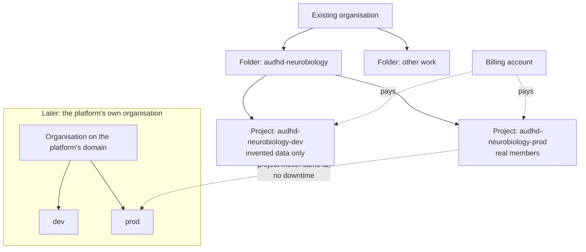

# 08 · Security, identities and organisation

**Status:** Proposed for review · 2026-11-16 · Applies from Stage 1

From Stage 1 the platform holds personal data: emails, what people paid for, later what they answered. This page says where things live, who and what can reach them, and how that is enforced. It also says plainly where enforcement comes from the cloud's permissions and where it comes from the platform's own code.

## 1. Where the projects live

**Can there be an organisation inside an organisation? No.** In Google Cloud an organisation is the root and cannot contain another. The supported way to separate one venture from another under the same root is a **folder**: it has its own access rules and policies, and projects inside it inherit from the folder.

**Now (Stage 1):** a folder under the existing organisation, holding a new dev project and the existing prod project. Access is granted at the folder. Administrators of the organisation can still reach it, so who they are is reviewed now.

**Later:** create an organisation on the platform's own domain (a free Cloud Identity account is enough), then move the two projects into it. A project keeps its id, number and resources when it moves; services keep running. The move needs the project-mover role on the source and the project-creator role on the destination, and both organisations must allow the transfer in their policies. A billing account can pay for projects in any organisation, so billing need not change when the projects move.

**Two things to settle before personal data is imported, neither of them technical:**

1. **Billing.** Confirm that the billing arrangement used for these projects is permitted for this platform.
2. **Who operates the platform in law.** The privacy notice must name the organisation responsible for members' data. An accountant or lawyer should confirm the structure.

Move to the platform's own organisation **before the first external data-use agreement** at the latest. Decision: [ADR 0014](../adr/0014-folder-now-own-organisation-later.md).

## 2. Environments

| | dev | prod |
| --- | --- | --- |
| Data | Invented people only | Real members |
| Stripe | Sandbox with test clocks | Live, read-only towards Substack and Payhip objects |
| Substack | Synthetic recorded responses; no credentials | Official surfaces; private endpoints only where switched on |
| Deploys | Every merge to `main` | A version tag, approved by the owner in the protected `production` environment |
| Who can read data | The owner, coding agents through tests | The owner; the services listed below |

## 3. Identities: why there is no key file, for any agent group

A key file is a long-lived password saved in a file. Anyone who copies the file is that service forever. The platform has none.

Instead, every service, job and agent team **runs as its own service account**. Google hands the running code a short-lived token automatically; nothing is stored. GitHub Actions gets the same through Workload Identity Federation. What replaces "a key file per agent group" is a **permissions manifest**: one Terraform file per environment, `identities.tf`, containing every service account and every permission, and nothing else. Reviewing who can do what is reading one file; changing it is a pull request.

### What the cloud enforces, and what the platform's code enforces

Firestore permissions apply to a whole database, not to single collections. So every identity that can reach Firestore (`platform-api` and the jobs, all running the same reviewed image) can technically read all of Zone 1. Their separate identities limit what differs between them in practice: **which secrets and which outside systems each can reach.** Three rules follow:

1. **Agent teams never touch a data store.** They call `platform-api` endpoints, which check the caller's identity and return only that team's inputs.
2. **Approval cannot be forged by an agent.** An approval is recorded only by `platform-api`, from the owner's signed-in action, with a hash of the approved content. Executors are jobs of the platform, not agents, and check the hash before acting.
3. **The audit trail cannot be rewritten by a service.** It is also written to a log bucket with a retention lock.

| Identity | Runs | Can reach | Cannot reach |
| --- | --- | --- | --- |
| `web-runtime` | The website | `platform-api` | Any data store, any secret, identity administration |
| `platform-api` | The API | Firestore; the library bucket (sign download links); the contact key; Stripe keys; email provider key; event bus | Substack credentials; the research key; research data |
| `platform-hooks` | Webhook receiver (public) | Write-only access to the raw-event bucket; publish to the inbound topic; webhook signing secrets | Reading anything, including what it wrote |
| `job-stripe` | Stripe reconciliation and the entitlement sweep | Firestore; the read-only Stripe key; the contact key | Substack credentials; the library bucket |
| `job-substack` | Roster check; from Stage 2 the feed and sentinel | Firestore; Substack credentials; the contact key | Stripe keys; the library bucket |
| `job-index` | Indexing | The library bucket (read); the embedding model; the search snapshot bucket; Firestore | Stripe and Substack credentials |
| `job-reporting` | Revenue export | Firestore (read); the read-only Stripe key; BigQuery `ops_commerce` | Substack credentials; buckets |
| `pubsub-push` | Event delivery | `platform-api`'s internal endpoints | Everything else |
| `github-deployer` (one per project) | CI | Push images; update Cloud Run images. The prod deployer can be assumed **only** by a workflow in the protected `production` environment on a version tag | Data, secrets and IAM directly. It can put a new image on a service or job, and that image runs with the service's or job's own identity; so what `job-stripe` can read is as safe as the deploy path (the branch and tag rules, the owner's approval for production, and review of every change) |
| `model-gateway` (Stage 2) | Gateway | Models; its spend table | Member data |
| `agents-<team>` (Stage 2 on), one per team | Agent flows | The gateway; that team's `platform-api` endpoints | Any data store; any executor permission |
| Executor jobs (Stage 2): `job-publish`, `job-social`, `job-store` | Carry out approved proposals | The one outside system each acts on, and Firestore | Creating or approving proposals is not in their code path; the hash check stops a tampered one |
| `research-api` (Stage 3) | Zones 2 and 3 | Its own database and datasets; the research key | Zone 1, emails, commerce |

Decision: [ADR 0015](../adr/0015-one-identity-per-service-agents-propose-executors-act.md).

## 4. Keys and secrets

| Item | Held in | Used by | Set by | Rotation |
| --- | --- | --- | --- | --- |
| Contact key (derives `contact_id`) | Cloud KMS, as a MAC key: the key never leaves KMS and is not in Terraform state | `platform-api`, `job-stripe`, `job-substack` | Terraform creates the key ring; KMS generates the key | By key version; each id records its version; a re-key run exists |
| Research key (Stage 3) | Cloud KMS, MAC key | `research-api` only | As above | As above |
| Sessions | Identity Platform | `platform-api` | Managed by Google | Automatic |
| Stripe restricted key: read-only | Secret Manager | `job-stripe` only in Stage 1 (`platform-api` never reads it: it starts the reconcile job instead; `job-reporting` gets its own grant when it is built) | Owner, from her terminal | Yearly, or on suspicion |
| Stripe restricted key: create Checkout | Secret Manager | `platform-api` | Owner | Yearly |
| Stripe webhook signing secret | Secret Manager | `platform-hooks` | Owner (script) | When the endpoint changes |
| Payhip API key and webhook path token | Secret Manager | `platform-hooks`, `platform-api` | Owner | Yearly |
| Substack Publisher API key | Secret Manager | `job-substack` | Owner | Yearly |
| Substack session cookie (only if private endpoints are switched on, Stage 2) | Secret Manager | `job-substack`, `job-publish` | Owner | When it expires, and at once if exposure is suspected |
| Email provider key | Secret Manager | `platform-api` | Owner | Yearly |
| Meta tokens (Stage 2) | Secret Manager | `job-social` | Refresh job | Every 60 days, automatic |

Secrets are entered with `gcloud secrets versions add` from the owner's own terminal. They are never pasted into a chat, an issue, a file or a CI variable.

## 5. What is reachable from the internet

Two services: `web` and `platform-hooks`. Everything else requires a Google-signed identity.

- `platform-hooks` accepts only provider webhooks. Stripe events are verified by signature and timestamp. Payhip events are verified as far as Payhip allows and cross-checked in Stripe ([03 §4](03-commerce-and-revenue.md)). It writes the raw event to a bucket it cannot read back and publishes a reference.
- `web` holds the member's session in an http-only, secure cookie issued by `platform-api`. Paid routes are checked on the server on every request; the browser is never trusted with tier decisions. Requests that change something carry a CSRF token.
- Rate limits on sign-in, download and search.
- Queries and email look-ups travel in request bodies, not URLs, so they stay out of request logs.

## 6. Protecting members' data

| Control | How |
| --- | --- |
| Location | Firestore, buckets, BigQuery, Pub/Sub message storage, Secret Manager replicas and log buckets are pinned to Singapore. Two services are global and are declared as such in the privacy notice: Identity Platform's sign-in records and the email provider |
| Encryption | In transit and at rest by default |
| Least privilege | §3; no human has standing access to production data except the owner |
| Access logging | Data-access audit logs on Firestore and the library bucket in prod; every admin view of a contact is recorded with a reason; the audit trail is mirrored to a locked log bucket |
| Break-glass | The owner's direct console access to Firestore is a separate role, granted for a day when needed, and logged |
| Backups | Firestore point-in-time recovery (7 days) and a daily backup kept 14 days; buckets versioned; a monthly export of members and entitlements to storage the owner controls independently of this project |
| Minimisation | Events and logs carry ids only; the log formatter redacts email-shaped text; raw webhook payloads are kept 90 days in a restricted bucket; traces carry no prompt or answer text |
| Deletion and erasure | Account deletion removes the sign-in identity, the member record and its links. Full erasure also removes the person at the source systems, leaves a tombstone so a sync does not re-import them, swaps ids in long-retention tables for random ones, and is replayed after any restore |
| No trackers | No advertising or behavioural analytics on member pages; page analytics without cookies |
| Separation | Commerce ids and research ids come from different keys held by different services. Keys are necessary, not sufficient: see [09 §1](09-events-and-data-model.md) |

## 7. Admin access

One owner in Stage 1. `platform-api` recognises her from a configured list of account ids **and** a second-factor sign-in; a claim on the session is not enough by itself. `/admin` requires both. Admin and download requests check that the session has not been revoked. Every grant, revoke, replay and data view in admin is recorded with a reason.

## 8. The public repository

- Private research never enters it: `ops/scripts/check-private-content.sh` runs before every commit and in CI. It checks paths and file types, not wording, so wording is a review responsibility.
- No real personal data, provider ids, account details, subscriber numbers or prices under discussion in code, tests or docs. Fixtures use invented people.
- Issues and recorded samples describe outside systems by field names and types, never by real values.
- CI adds secret scanning (TruffleHog), static analysis (Semgrep) and image scanning (Trivy) in Stage 1.
- Base images and the model gateway are pinned by digest. Dependency updates arrive as pull requests.
- Copied code is recorded in `THIRD_PARTY.md` ([ADR 0012](../adr/0012-borrowed-code-provenance.md)).

## 9. Main threats and answers

| Threat | Answer |
| --- | --- |
| Someone signs in as a paid member by controlling their email | Sign-in proves control of the mailbox, the same assurance the newsletter itself relies on; second factor for the owner |
| A member is tricked into linking her account to someone else's | Linking needs a sign-in as the second address and an explicit confirmation that names the requesting account; nothing links from an email click alone or from payment data |
| Forged webhook grants access | Stripe: signature and timestamp. Payhip: secret path, signature, one-to-one Stripe cross-check, low value per item |
| A workflow on some branch deploys to production | The prod deployer identity accepts only the protected `production` environment on a version tag, which needs the owner's approval |
| An agent is steered by text it reads (a comment, a web page) | Readers of outside text have no tools; agents cannot act or approve; executors verify a hash of what the owner approved |
| Personal data leaks through logs, events, issues or the repository | Id-only events enforced in code; payloads kept off the bus; log redaction; shape-only issues; guard script; scanners |
| A compromised dependency in the gateway | Digest pinning; signature check; the gateway's identity can only call models |
| A leaked key that derives ids | The key is in Cloud KMS and cannot be exported; use is logged; versions can be rotated |
| A mistake in a sync mass-downgrades members | Positive evidence before ending anything, verify-before-expire, and the mass-change guard ([02 §4](02-membership-and-entitlements.md)) |

## 10. Before the first production import

Importing the subscriber list and the payment records is the moment personal data enters the platform, so the gate is the first import, not the first invitation. A checklist for the owner, to be confirmed with a professional where marked:

- [ ] Privacy notice published: who is responsible, purposes, where data is stored, the processors used and where each keeps data, retention, how to withdraw and delete (**confirm**)
- [ ] Terms of use for the member workspace, including a minimum age (**confirm**)
- [ ] A short impact assessment for holding payment status and, later, health-related answers (**confirm**)
- [ ] A named contact for data protection questions
- [ ] The retention schedule in [09 §6](09-events-and-data-model.md) accepted or adjusted
- [ ] A one-page incident procedure: who is told, within what time
- [ ] Position on readers in other jurisdictions with their own data-protection or health-data laws (**confirm**)
- [ ] Platform emails are transactional only; upgrade invitations go through the newsletter or to members who opted in
- [ ] Two-step verification switched on for the Google, GitHub, Stripe, Substack, Payhip and DNS accounts
- [ ] The list of administrators of the Google organisation reviewed
- [ ] Billing arrangement and operating entity settled (§1)
- [ ] Backup restore tested once in dev

This list is a working aid, not legal advice.

## 11. Exit path

Service accounts and permissions are declared in Terraform and map to any cloud's roles. Secrets move to any secret manager; the KMS keys' role can be taken by any HSM-backed MAC. Identity Platform users export with their ids. Nothing depends on the organisation the projects sit in.
