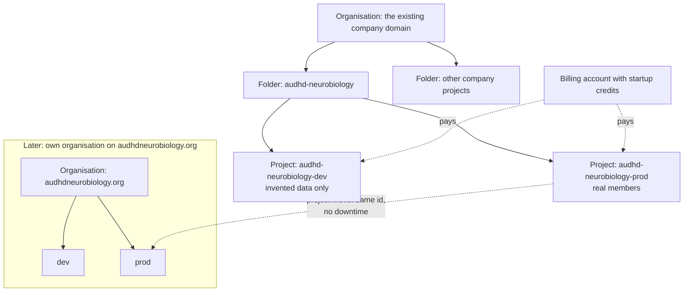

# 08 · Security, identities and organisation

**Status:** Proposed for review · 2026-11-16 · Applies from Stage 1

From Stage 1 the platform holds personal data: emails, what people paid for, later what they answered. This page says where things live, who and what can reach them, and how that is proved.

## 1. Where the projects live

**Can there be an organisation inside an organisation? No.** In Google Cloud an organisation is the root and cannot contain another. The supported way to separate one venture from another under the same root is a **folder**: it has its own access rules and policies, and projects inside it inherit from the folder.

**Now (Stage 1):** a folder under the existing organisation, holding a new dev project and the existing prod project. Access is granted at the folder, so nobody inherits access from elsewhere in the organisation except its administrators.

**Later:** create an organisation for `audhdneurobiology.org` (a free Cloud Identity account on that domain is enough), then move the two projects into it. A project keeps its id, number and resources when it moves; services keep running. The move needs the project-mover role on the source and the project-creator role on the destination, and both organisations must allow the transfer in their policies. A billing account can pay for projects in any organisation, so the credits can keep paying after the move if the programme allows it.

**Two things to settle before relying on this, neither of them technical:**

1. **The credit programme's terms.** Whether credits granted to one company may pay for a separate venture is decided by the programme's terms, which could not be retrieved for this review. Ask the programme contact in writing.
2. **Who operates the platform in law.** The privacy notice must name the organisation responsible for members' data. Projects under the company's organisation, paid by the company, with a Stripe account in another name, is a combination to straighten out before the first invitation goes out. An accountant or lawyer should confirm the structure.

Move to the platform's own organisation **before the first external data-use agreement** at the latest. Decision: [ADR 0014](../adr/0014-folder-now-own-organisation-later.md).

## 2. Environments

| | dev | prod |
| --- | --- | --- |
| Data | Invented people only | Real members |
| Stripe | Sandbox with test clocks | Live, read-only towards Substack and Payhip objects |
| Substack | Recorded responses; no session cookie | Official surfaces; private endpoints only where switched on |
| Deploys | Every merge to `main` | A version tag, approved in the `production` environment |
| Who can read data | The owner, coding agents through tests | The owner; services listed below |

## 3. Identities: why there is no key file, for any agent group

A key file is a long-lived password saved in a file. Anyone who copies the file is that service forever. The platform has none.

Instead, every service, job and agent team **runs as its own service account**. Google hands the running code a short-lived token automatically; nothing is stored. GitHub Actions gets the same through Workload Identity Federation. What replaces "a key file per agent group" is a **permissions manifest**: one Terraform file per environment, `identities.tf`, containing every service account and every permission, and nothing else. Reviewing who can do what is reading one file; changing it is a pull request.

| Identity | Runs | May | May not |
| --- | --- | --- | --- |
| `web-runtime` | The website | Call `platform-api`; verify sessions | Read Firestore, buckets or secrets |
| `platform-api` | The API | Read and write Zone 1; publish events; sign download links; read its own secrets | Read the Substack cookie; read research data |
| `platform-hooks` | Webhook receiver (public) | Publish to the inbound topic; read webhook signing secrets | Read any member data |
| `job-substack` | Roster check, later feed and sentinel | Read the Substack credentials; write Zone 1 roster data | Stripe, library files |
| `job-stripe` | Reconcile | Read the Stripe restricted key; write contacts and revenue rows | Substack, library files |
| `job-index` | Indexing | Read library files and content; call the embedding model; write the search snapshot | Entitlements, Stripe |
| `job-reporting` | Revenue export | Read Zone 1 commerce facts; write `ops_commerce` | Anything else |
| `pubsub-push` | Event delivery | Call `platform-api`'s internal endpoint | Anything else |
| `github-deployer` | CI | Push images; update Cloud Run images | Read data or secrets; change IAM |
| `model-gateway` (Stage 2) | Gateway | Call models; write its spend table | Any member data |
| `agents-publishing`, `agents-marketing`, `agents-revenue`, `agents-study`, `agents-synthesis`, `agents-ops` (Stage 2 on) | One per team | Call the gateway; read the tables and topics listed for the team; write proposals | Execute a proposal; read another team's data; read Zone 1 unless the team's task requires it |
| `executor-substack`, `executor-social`, `executor-store` (Stage 2) | Carry out approved proposals | Publish, post, change a price, **only** for a proposal marked approved | Create proposals |
| `research-api` (Stage 3) | Zones 2 and 3 | Read and write research data; hold the research key | Read emails or commerce |

The split between **agents** (propose) and **executors** (act on approved proposals) is what makes the human gate real: an agent has no permission to publish even if its prompt is subverted. Decision: [ADR 0015](../adr/0015-one-identity-per-service-agents-propose-executors-act.md).

## 4. Secrets

| Secret | Read by | Set by | Rotated |
| --- | --- | --- | --- |
| Contact key (derives `contact_id`) | `platform-api`, `job-stripe`, `job-substack` | Generated by Terraform | Never (rotation would change every id); guarded instead |
| Session signing material | Identity Platform | Managed by Google | Automatic |
| Stripe restricted key: read-only sync | `job-stripe`, `platform-api` | Owner, from her terminal | Yearly, or on suspicion |
| Stripe restricted key: create Checkout | `platform-api` | Owner | Yearly |
| Stripe webhook signing secret | `platform-hooks` | Owner (script) | When the endpoint changes |
| Payhip API key and webhook path token | `platform-hooks`, `platform-api` | Owner | Yearly |
| Substack Publisher API key | `job-substack` | Owner | Yearly |
| Substack session cookie (only if private endpoints are switched on) | `job-substack`, `executor-substack` | Owner | When it expires |
| Email provider key | `platform-api` | Owner | Yearly |
| Meta tokens (Stage 2) | `executor-social` | Refresh job | Every 60 days, automatic |
| Research key (Stage 3) | `research-api` only | Generated by Terraform | Never |

Secrets are entered with `gcloud secrets versions add` from the owner's own terminal. They are never pasted into a chat, an issue, a file or a CI variable.

## 5. What is reachable from the internet

Two services: `web` and `platform-hooks`. Everything else requires a Google-signed identity.

- `platform-hooks` accepts only provider webhooks. Stripe events are verified by signature and timestamp. Payhip events are verified as far as Payhip allows and cross-checked in Stripe ([03 §4](03-commerce-and-revenue.md)). It can publish to one topic and read nothing.
- `web` holds the member's session in an http-only, secure cookie. Paid routes are checked on the server on every request; the browser is never trusted with tier decisions.
- Rate limits on sign-in, download and search.

## 6. Protecting members' data

| Control | How |
| --- | --- |
| Location | Firestore, buckets and BigQuery in Singapore |
| Encryption | In transit and at rest by default |
| Least privilege | The table in §3; no human has standing access to production data except the owner |
| Access logging | Data-access audit logs on Firestore and the library bucket in prod; every admin view of a contact written to the audit log |
| Break-glass | The owner's direct console access to Firestore is a separate role, granted for a day when needed, and logged |
| Backups | Firestore point-in-time recovery (7 days) and a daily backup kept 14 days; buckets versioned |
| Minimisation | Events and logs carry ids only; the log formatter redacts email-shaped text; raw webhook payloads kept 90 days |
| Deletion | Account deletion removes the member record and links within 30 days; accounting records are kept without the account link |
| No trackers | No advertising or behavioural analytics on member pages; page analytics without cookies |
| Separation | Commerce ids and research ids come from different keys held by different services |

## 7. Admin access

One `owner` role in Stage 1, set as a claim on the owner's account by a command, never from the web. `/admin` requires the role and a second factor. Every grant, revoke, replay and data view in admin is written to the audit log with a reason.

## 8. The public repository

- Private research never enters it: `ops/scripts/check-private-content.sh` runs before every commit and in CI.
- No real personal data, Stripe ids, provider application ids or subscriber numbers in code, tests or docs. Fixtures use invented people.
- CI adds secret scanning (TruffleHog), static analysis (Semgrep) and image scanning (Trivy) in Stage 1.
- Base images and the model gateway are pinned by digest. Dependency updates arrive as pull requests.
- Copied code is recorded in `THIRD_PARTY.md` ([ADR 0012](../adr/0012-borrowed-code-provenance.md)).

## 9. Main threats and answers

| Threat | Answer |
| --- | --- |
| Someone signs in as a paid member by controlling their email | Sign-in proves control of the mailbox, which is the same assurance Substack itself relies on; second factor for the owner; sign-in alerts for the admin role |
| Forged webhook grants access | Stripe: signature and timestamp. Payhip: secret path, signature, Stripe cross-check, low value per item |
| Leaked Substack session cookie | Stored only in Secret Manager; readable by two identities; expiry alarms; cookie can be revoked by signing out of Substack |
| An agent is tricked by text it reads (a comment, a web page) into acting | Agents cannot act: executors need an approved proposal; agents read comments only as scrubbed themes |
| Personal data leaks through logs, events or the repo | Id-only events enforced in code; log redaction; guard script; scanners |
| A compromised dependency in the gateway | Digest pinning; signature check; the gateway's identity can only call models |
| Organisation administrators outside the project | Access granted at the folder; the list of organisation administrators reviewed now; own organisation later |
| A mistake in a sync mass-downgrades members | Verify-before-expire and the mass-change guard ([02 §4](02-membership-and-entitlements.md)) |

## 10. Before the first invitation goes out

A checklist for the owner, to be confirmed with a professional where marked:

- [ ] Privacy notice naming the responsible organisation, purposes, where data is stored, retention, how to withdraw and delete (**confirm**)
- [ ] Terms of use for the member workspace (**confirm**)
- [ ] A named contact for data protection questions
- [ ] The retention schedule in [09 §6](09-events-and-data-model.md) accepted or adjusted
- [ ] A one-page incident procedure: who is told, within what time
- [ ] Position on readers in the EU, UK and US states with health-data laws (**confirm**)
- [ ] Credit programme terms and operating entity settled (§1)
- [ ] Backup restore tested once in dev

This list is a working aid, not legal advice.

## 11. Exit path

Service accounts and permissions are declared in Terraform and map to any cloud's roles. Secrets move to any secret manager. Identity Platform users export with their ids. Nothing depends on the organisation the projects sit in.
