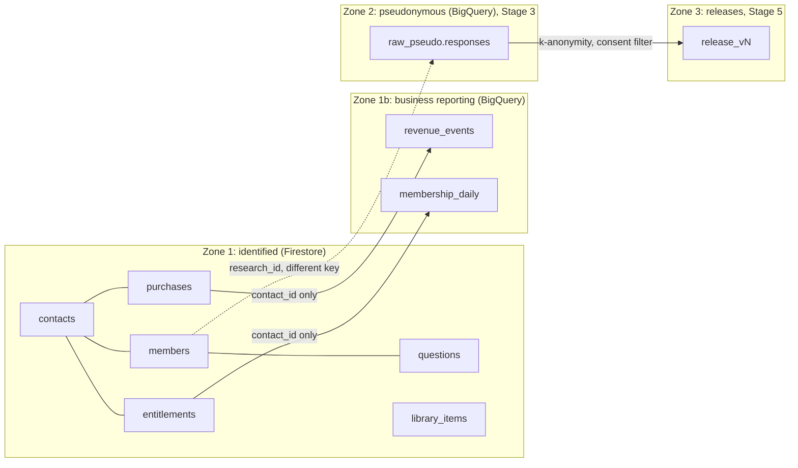
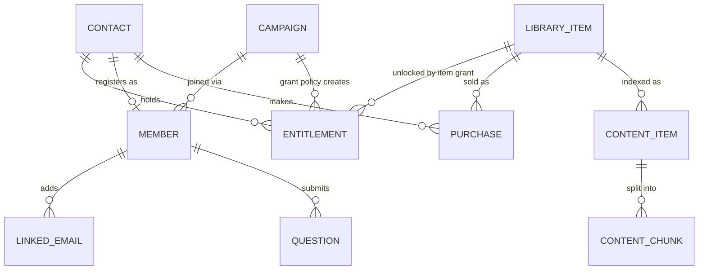

# 09 · Events and data model

**Status:** Proposed for review · 2026-11-16 · Stage 1 shapes are firm; later stages are outlines

Schemas are written when the first flow needs them. This page fixes the Stage 1 shapes and names the later ones so nothing built now blocks them.

## 1. Data zones

| Zone | Holds | Store | Who can read | Built |
| --- | --- | --- | --- | --- |
| **Zone 1: identified** | Members, contacts, entitlements, purchases, invites, questions, Substack roster and comments, consent records | Firestore (Singapore), private buckets | `platform-api` and named jobs; the owner through the admin screens; break-glass access is logged | Stage 1 |
| **Zone 1b: business reporting** | Revenue and membership facts with the contact id instead of the email | BigQuery dataset `ops_commerce` | Revenue export job, the owner, the Revenue team (read) | Stage 1 |
| **Zone 2: pseudonymous research** | Survey and test responses keyed by `research_id` | BigQuery dataset `raw_pseudo` | `research-api`, analytics jobs | Stage 3 |
| **Zone 3: de-identified releases** | Versioned datasets, every cell k ≥ 5 | BigQuery `release_vN`, Cloud Storage | Licence holders, by agreement | Stage 5 |

Two keys keep the zones apart. `contact_id` is derived from the email with the *contact key*. `research_id` is derived, separately for each study, with the *research key*. Both are MAC keys inside Cloud KMS: the key material never leaves KMS, is not in Terraform state, and each key can be used only by the services named in [08](08-security-identities-and-org.md). The keys are necessary, not sufficient: the Stage 3 design must also show that the research service never receives an email or a member session (it works from a participant handle issued by the identity module), and that no request or trace id crosses from Zone 1 into Zone 2.

## 2. Zone 1 collections (Stage 1)

Firestore, Native mode, `asia-southeast1`. Document ids are shown in braces. Types are Pydantic models in `services/platform-api/src/platform_api/<module>/models.py`; those files are the source of truth once they exist.

### `contacts/{contact_id}` (M2, fed by M14 and M15)

| Field | Type | Notes |
| --- | --- | --- |
| `contact_id` | string | HMAC-SHA256 of the lower-cased, trimmed email, computed by the contact key in Cloud KMS; first 32 hex characters |
| `key_version` | string | Which version of the contact key made the id, so the key can be rotated with a re-key run |
| `email` | string | As first seen. Dots and plus-tags are not rewritten |
| `channels.substack` | map | `type` (`free`, `paid`, `comp`, `gift`, `group_seat`, `founding`, `lifetime`), `plan_interval`, `since`, `activity_rating`, `last_seen_in_roster` |
| `channels.stripe` | map | `customer_ids[]`, `has_substack_subscription`, `has_platform_subscription` |
| `channels.payhip` | map | `buyer`, `first_purchase_at`, `purchase_count` |
| `channels.platform` | map | `member_uid`, `registered_at` |
| `segment` | string | Derived: `substack_paid`, `substack_free`, `platform_paid`, `buyer_only`, `lapsed_paid`, `unknown` |
| `invite` | map | `campaign` (slug), `state` (`none`, `accepted`), timestamps |
| `created_at`, `updated_at` | timestamp | |

The `channels` map is the preserved flag: it records every channel a person came through, independent of what they may open today.

### `members/{uid}` (M2)

`uid` (Identity Platform), `primary_contact_id`, `linked_contact_ids[]`, `email`, `display_name`, `locale`, `terms_accepted` (`version`, `at`), `status` (`active`, `deletion_requested`), `created_at`, `last_seen_at`. No tier and no role are stored here: the tier is derived, and the owner is a configured list of account ids.

### `entitlements/{entitlement_id}` (M2)

Fields as in [02 §3](02-membership-and-entitlements.md). `entitlement_id = sha256(source ":" source_ref ":" contact_id ":" grant)[:32]`. `valid_from` is the start the source reports (for a Stripe subscription its start date), never the time of the platform's first import; for a grant it is the moment of the grant. A launch grant has `source_ref` `campaign:<slug>`. Indexed by `contact_id` and by (`status`, `valid_until`).

### `purchases/{purchase_id}` (M14)

`purchase_id` (provider + provider sale id), `contact_id`, `provider` (`payhip`, `stripe`), `skus[]`, `amount`, `currency`, `status` (`paid`, `refunded`, `disputed`), `occurred_at`, `raw_event_id`.

### `library_items/{sku}` (M12)

`sku`, `title`, `kind` (`meta_review`, `evidence_map`, `clinician_one_pager`, `guide`, `worksheet`), `series`, `abstract`, `topics[]`, `audience[]`, `evidence_status`, `version`, `language`, `pages`, `published_at`, `updated_at`, `access` (`paid`, `free_members`, `purchase_only`), `price_display`, `payhip` (`url`, `product_key`), `stripe_price_id` (Stage 2), `file` (`bucket`, `object`, `sha256`, `bytes`), `cover_object`, `citation`, `related_urls[]`, `status` (`draft`, `published`, `retired`).

### `content_items/{content_id}` (M12)

One `content_item` per thing a reader can find: a library item, a site page, a Substack post, a news item. `type`, `title`, `summary`, `url`, `source` (`library`, `site`, `substack`, `news`), `access` (`public`, `members`, `paid`, `item:<sku>`), `topics[]`, `published_at`, `language`, `checksum`. Passages are not stored in Firestore: they exist only in the search snapshot ([04](04-content-library-and-search.md)), each with `content_id`, `seq`, `text` and `visibility` (`public`, `gated`).

### Supporting collections

| Collection | Module | Purpose |
| --- | --- | --- |
| `inbound_events/{provider:event_id}` | M14 | One document per webhook event; created with "create if absent" so a repeat is detected and skipped |
| `inbox/{event_id}` | shared | The same guard for events consumed from the bus |
| `audit_log/{auto}` | shared | Who changed what, when, why. Append-only. Admin reads of a contact are logged here too |
| `campaigns/{slug}` | M2 | An invitation: audience, window, wording, optional grant policy, counts. Replaces `invite_waves`. The slug is the id |
| `promotions/{promotion_id}` | M14 | A time-boxed offer: channel, audience, window, display text, counts ([03 §5a](03-commerce-and-revenue.md)) |
| `support_requests/{auto}` | M2 | A member's request for help, for example "paid but not recognised": `member_uid`, `kind`, `note`, `status`. The note never leaves Zone 1 |
| `config/launch` | shared | The layer switches (join, library, promotions) and the required versions of the terms and privacy notice |
| `questions/{auto}` | M2 | "Submit a question" entries: `member_uid`, `text`, `topic`, `status`, `created_at` |
| `downloads/{auto}` | M12 | `member_uid`, `sku`, `version`, `at`. Used for "recently opened" and for abuse limits |
| `sync_runs/{auto}` | M14, M15 | One per job run: counts, guard decisions, errors |
| `quota_counters/{uid:feature:yyyymm}` | M2 | Monthly usage per feature (Stage 2) |

## 3. Zone 1b: business reporting (BigQuery `ops_commerce`)

| Table | Grain | Columns |
| --- | --- | --- |
| `revenue_events` | One row per money movement | `occurred_at`, `provider`, `channel` (`substack`, `payhip`, `platform`, `unallocated`), `kind` (`subscription_payment`, `one_off`, `refund`, `platform_fee`, `processor_fee`), `fee_kind` (`card`, `fx`, `billing`, `application`), `contact_id`, `plan_interval`, `sku`, `gross`, `fees`, `net`, `currency`, `settled_currency`, `gross_usd` |
| `processor_fee_allocation` | One row per day, channel and fee kind | The processor's daily fee totals shared across channels by that day's volume |
| `membership_daily` | One row per contact per day | `date`, `contact_id`, `segment`, `tier`, `access_scope`, `is_member`, `sources[]` |
| `tier_changes` | One row per change | `at`, `contact_id`, `from_tier`, `to_tier`, `reason`, `source` |

No emails, no names. The owner's dashboards and the Revenue team read these tables; they never read Firestore.

## 4. Events

CloudEvents 1.0 in JSON on Pub/Sub. `type` is `org.audhdneurobiology.<area>.<thing>.<past-tense verb>`. `subject` is the id the event is about. `data` holds ids and facts, never an email, a name or free text written by a member. `new_event()` rejects any payload containing an email-shaped string.

### Topics

| Topic | Carries | Dead-letter |
| --- | --- | --- |
| `inbound.webhooks` | References to verified provider events. The payload itself, which contains emails, is stored by `platform-hooks` in a restricted bucket and never travels on the bus. | `inbound.webhooks.dlq` after 5 attempts |
| `platform.events` | Every domain event below | `platform.events.dlq` after 5 attempts |

### Stage 1 events

| Type (after the prefix) | Published by | Consumed by | Key data |
| --- | --- | --- | --- |
| `commerce.provider_event.received` | hooks | M14 | `provider`, `provider_event_id`, `payload_ref` |
| `commerce.purchase.recorded` | M14 | M2, M12 | `purchase_id`, `contact_id`, `skus[]` |
| `commerce.purchase.refunded` | M14 | M2 | `purchase_id`, `contact_id`, `skus[]` |
| `commerce.subscription.changed` | M14 | Reporting, notices. Entitlements are not driven by this event: M14 applies the fetched state to M2 in-process | `contact_id`, `channel`, `source_ref`, `status`, `plan_interval`, `current_period_end`, `provider_time` |
| `membership.entitlement.granted` | M2 | M14 (reporting) | `entitlement_id`, `contact_id`, `grant`, `source`, `access_scope` |
| `membership.entitlement.ended` | M2 | M14 | `entitlement_id`, `contact_id`, `status`, `reason` |
| `membership.tier.changed` | M2 | notifications, M14 | `contact_id`, `from`, `to`, `reason` |
| `membership.member.registered` | M2 | M14, M10 (later) | `member_uid`, `contact_id`, `campaign` |
| `membership.campaign.joined` | M2 | reporting | `member_uid`, `contact_id`, `campaign`, `recognition` |
| `commerce.reconcile.completed` | M14 | alerting, reporting | `run_id`, `kind`, `dry_run`, `guard`, counts |
| `commerce.promotion.upgrade_counted` | M14 | reporting | `promotion_id`, `contact_id`, `channel`, `source_ref` |
| `content.item.downloaded` | M12 | reporting | `member_uid`, `sku`, `version` |
| `substack.roster.synced` | M15 | M2 | `run_id`, counts, `guard` |
| `substack.subscriber.changed` | M15 | M2 | `contact_id`, `type`, `plan_interval` |
| `substack.contract.drifted` | M15 | M13 (later), alert | `endpoint`, `expected`, `observed` |
| `content.item.published` | M12 | M12 index job | `content_id`, `source`, `access` |
| `content.index.published` | M12 | `platform-api` | `snapshot`, `items`, `chunks` |
| `community.question.submitted` | M2 | admin queue, M9 (later) | `question_id`, `member_uid`, `topic` |

### Later events (names reserved)

`response.recorded`, `test.scored`, `test.claimed`, `consent.changed`, `study.opened`, `study.amended`, `study.closed` (Stage 3) · `substack.post.published`, `substack.note.published`, `substack.note.engaged`, `substack.comment.created`, `substack.stats.snapshotted`, `substack.restack.created`, `substack.mention.created`, `substack.message.received`, `substack.recommendation.changed`, `substack.credential.expired`, `community.signal.raised`, `social.post.published`, `revenue.insight.raised`, `promo.proposed`, `promo.approved` (Stage 2) · `ops.check.failed`, `ops.incident.opened` (Stage 4) · `pattern.detected`, `finding.candidate`, `gap.identified`, `survey.draft.proposed` (Stage 5).

### Delivery rules

- **At least once.** A handler must give the same result when run twice. State changes use deterministic ids and are written together with their event marker in one Firestore transaction; an email is sent once per event and template; warehouse rows carry the event id as their insert id. The inbox is a shortcut on top of that, not the guarantee.
- **Order is not guaranteed.** Handlers apply the source's current state, fetched at handling time, not the contents of the event.
- **A handler that fails returns an error.** Pub/Sub retries with back-off (acknowledgement deadline 60 seconds); after five attempts the message goes to the dead-letter topic. Each dead-letter topic has its own subscription, so nothing is discarded, and an alert fires on any backlog. The admin screen lists dead letters and can replay them.
- **Inside `platform-api`, modules call each other directly** for changes that must be consistent. The bus tells other deployables and later consumers that something happened.

## 5. Ids

| Id | Made from | Lives in |
| --- | --- | --- |
| `uid` | Identity Platform | Zone 1 |
| `contact_id` | MAC by the contact key in Cloud KMS over the email | Zones 1 and 1b, events |
| `research_id` | MAC by the research key in Cloud KMS over a participant handle and the study id; one per study | Zone 2 only (Stage 3) |
| `test_id` | Random, checksummed, shown to guests | Zone 2 and the guest's own file (Stage 3) |
| `sku` | Human-readable slug, never reused | Library, purchases, entitlements |
| `entitlement_id`, `purchase_id` | Deterministic hash of the source reference | Zone 1 |

## 6. Retention

| Data | Kept | Reason |
| --- | --- | --- |
| Contacts never seen in any channel for 24 months and never registered | Deleted | Minimisation |
| Purchases and revenue events | 7 years | Accounting |
| Audit log | 2 years | Accountability |
| Raw webhook payloads | 90 days | Debugging and replay; the facts are already in purchases and entitlements |
| Download log | 12 months | Abuse limits, "recently opened" |

Retention periods are a starting position to confirm with an accountant and against the privacy notice before launch.

## 7. Exit path

Firestore documents map one-to-one to rows: each collection above is one table in Postgres. Events are CloudEvents, readable by NATS, Kafka or any HTTP consumer. BigQuery tables export to Parquet.
