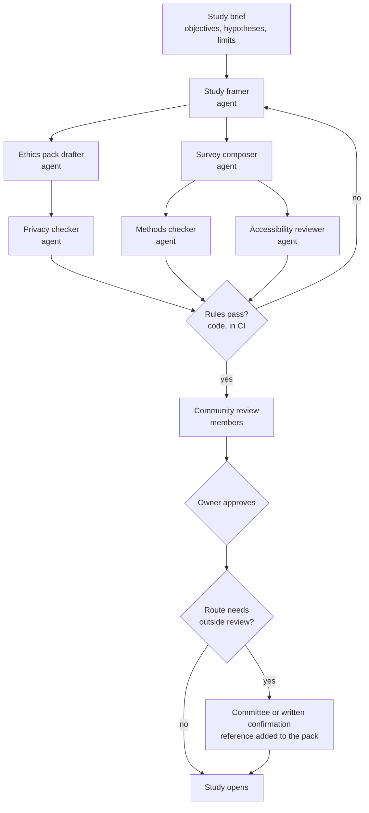

# 11 · Study governance and survey templates (M3, M5, M11)

**Status:** Proposed · 2026-11-19 · built in Stage 3; templates can be written earlier
**Extends:** [07 research loop](07-research-loop-and-evidence.md) §3, §5, §6 · **Decisions:** [ADR 0023](../adr/0023-study-pack-and-ethics-policy-as-code.md), [ADR 0024](../adr/0024-linkage-options-for-anonymous-collection.md)

One sentence: **every study is a folder of files (a study pack) built from templates, and the survey engine opens a study only when a set of rules, run as code, says the pack is complete and consistent.**

This page is a design aid. A template never replaces an ethics review, and nothing here is legal advice. Which review a study needs is the owner's decision, backed by a written confirmation that is referenced in the pack.

## 1. How studies of this kind are run today, and what the platform takes from it

Sources are listed in §12. Numbers in brackets refer to them.

| Practice | What the sources show | What the platform does |
| --- | --- | --- |
| **Review comes before collection** | Publishers and committees expect approval, or a committee's exemption, before the first response; investigators are advised not to decide their own exemption [1] | A study cannot open without `ethics.route` and a reference to the evidence for it. The date of the evidence must precede the opening date |
| **Review is proportionate** | Survey research with adults is commonly reviewed at the lightest level when identities cannot readily be ascertained; once responses are linked to identifiers or to earlier responses, the committee looks at privacy and confidentiality provisions, and consent to the linkage is needed [1][2] | The collection mode and the linkage method are fields of the pack. Stricter combinations require a stricter route |
| **"Anonymous" means identifiers were never attached** | Survey tools record network addresses unless a specific setting is switched on; an address stored with the answers may identify a person; contact details for a prize draw or follow-up belong in a separate form [3][4] | In anonymous mode the survey service has no cookies, no request logs, no network address, no account reference, and times stored to the day. This is enforced by the engine, not by a setting someone must remember |
| **A pseudonym is still personal data** | A panel that gives researchers only a participant id still calls that id personal data, forbids collecting direct identifiers and forbids re-identification [5] | Pseudonymous mode is never described as anonymous in any text the templates produce |
| **Indirect identifiers add up** | Age, place, education, occupation, rare health combinations and dates identify people in combination, more so in small samples; the usual treatments are banding, coarsening, top-coding and suppression [6] | Demographics come from one block with banded answers. A privacy check counts quasi-identifiers and estimates the smallest group before a survey is approved, and again before any release |
| **Sensitive questions carry duties** | A study that asks about suicidal thoughts gives support resources to everyone. If answers are not monitored, the consent text says so, says no individual follow-up is possible and describes the kind of question beforehand. If answers are identifiable, a safety plan with a qualified responder and a review time is expected. International studies give local resources [7][8] | Instruments are tagged by sensitive topic. The rules in §5 refuse a pack that lacks the matching safeguards |
| **Consent online is short and explicit** | A designated consent page with check boxes; a visible exit on every page leading to the debrief; a final confirmation that the answers may be used, because a closed browser is not a clear withdrawal; a code the participant keeps so data can be removed later [4] | These are engine behaviours and reusable blocks, not per-survey work |
| **Autistic participants are designed for, not adapted to afterwards** | Do not assume a capacity assessment is needed for a low-risk online survey; simplify consent, add definitions and prefaces; avoid figurative wording; clarify vague response options; do not assume an instrument validated in the general population works unchanged, and change only what causes real problems; offer more than one way to take part; involve autistic partners and return plain-language results [9] | An accessibility review is a required step, and community review by members is a recorded gate |
| **Closed surveys resist fraud** | Open online surveys that advertise payment attract scripted and impostor responses, including in autism research; the countermeasures (address checks, cameras) cost privacy and accessibility [10] | Surveys are offered to signed-in members and carry no public payment. One participation token per member replaces address checks (§6) |
| **Reports follow a checklist** | Reporting checklists for web surveys ask for the review and consent process, data protection, whether the survey was open or closed, the number of screens, completeness checks, view, participation and completion rates, how multiple entries were prevented and how incomplete answers were handled [11] | The engine keeps these as counts and the pack carries a pre-filled checklist |
| **Company-run research uses outside review and separate consent** | A consumer company's research programme describes an external ethics committee, a research consent separate from the service, no penalty for declining, de-identified data shared in aggregate, and extra consent for individual-level data [12] | Research consent is separate from membership terms and from any purchase ([07 §3](07-research-loop-and-evidence.md), rule 3) |
| **Recent studies of this population** | Typical designs are cross-sectional online surveys of adults recruited through patient organisations or panels, with self-reported and unverified diagnosis, electronic consent, a named committee and reference, and increasingly a public preregistration and reported exclusions [13][14] | The first archetypes in §4 are these designs |

## 2. The study pack

```
studies/<study_id>/
├─ study.yaml                     objectives, hypotheses (ids from the private research notes), design archetype,
│                                 population, sample reasoning, owner, status
├─ ethics/
│  ├─ ethics.yaml                 the policy the engine enforces (§5)
│  ├─ protocol.md                 background, aims, procedures, risks, safeguards
│  ├─ information-sheet.md        what a participant reads before agreeing
│  ├─ consent.yaml                scopes and statements, versioned
│  ├─ data-management-plan.md
│  ├─ privacy-risk-assessment.md  quasi-identifiers, smallest expected group, mitigations
│  ├─ distress-protocol.md        only when a sensitive add-on applies
│  └─ approvals.yaml              references to letters and written confirmations; the documents stay private
├─ survey/
│  └─ survey.yaml                 blocks and instruments in order, logic, burden estimate, reuse score
├─ analysis/
│  ├─ analysis-plan.yaml          hypotheses to tests, exclusions, missing-data handling
│  └─ preregistration.md
└─ reporting/
   └─ checklist.yaml              web-survey reporting items, filled by the engine as data arrives
```

- **Templates, schemas and rules are public** and live in this repository under `packages/study-governance/`. They contain no research content and are written to be reusable by other independent researchers.
- **Filled packs are private.** They hold hypotheses and study content, so they live in the private content folder (`AUDHD_CONTENT_DIR`, see `docs/content-model.md`) until the owner publishes a study.
- **A pack is versioned by commit.** An open study records the commit of its pack. Changing `ethics.yaml`, `consent.yaml` or the survey after opening is an **amendment**: a new commit, the rules run again, and where the route involves a committee, the amendment needs its own reference in `approvals.yaml` before it takes effect.

## 3. Who does what



| Role | Kind | Produces | May not |
| --- | --- | --- | --- |
| Study framer | Agent | `study.yaml`: the type of question (describe, associate, validate an instrument, track change), constructs to measure, candidate archetype, sample reasoning, known biases of an opt-in sample | Choose the ethics route |
| Ethics pack drafter | Agent | The `ethics/` folder from an archetype and its add-ons, with every slot it could not fill listed as an open question | Mark a route as confirmed, write an approval reference |
| Survey composer | Agent | `survey.yaml` from a blueprint (§7), reuse first | Edit a validated instrument, field anything |
| Methods checker | Agent, fresh context | Findings: coverage of each objective, intact instruments, order effects, analysis plan matches hypotheses | Fix what it finds |
| Privacy checker | Agent, fresh context | `privacy-risk-assessment.md`, findings on quasi-identifiers and free text | Lower a threshold |
| Accessibility reviewer | Agent, fresh context | Findings against the checklist in §8 | Rewrite validated items |
| Rules | Code | Pass or a list of violations (§5) | – |
| Community reviewers | Members | Recorded comments on wording, burden and tone | – |
| Owner | Person | Approval; the route decision; every outside submission | – |

Agents work through pull requests and call models only through the gateway ([06](06-ai-platform-and-agent-teams.md)). Agents propose; the owner approves; only an approved, rule-passing pack can be opened.

## 4. Ethics policy templates

A template is an **archetype** (the kind of study) plus **add-ons** (conditions that bring extra duties). Each archetype ships default values for `ethics.yaml`, the document templates with named slots, the questions a committee usually asks about that design, and the reporting checklist that fits.

| Archetype | Collection | Linkage | Typical use | Route it can rest on |
| --- | --- | --- | --- | --- |
| `anonymous-cross-sectional` | Anonymous | None | A one-off survey of traits, experiences and symptoms | Any; the only archetype that can rest on `anonymous_collection` |
| `anonymous-longitudinal` | Anonymous | Participant-held code, with a self-generated code as recovery (§6) | Repeated waves without identities | `independent_review` or `institutional_review` recommended, because linkage raises re-identification risk |
| `pseudonymous-registry` | Pseudonymous | `research_id` per study | A cohort that can be recontacted, linked across studies, verified and withdrawn | `independent_review` or `institutional_review` only |
| `instrument-development` | Either | Retest link required | Building and validating an own instrument: trial items, a companion scale, a retest | As for the collection mode chosen |
| `qualitative-free-text` | Either | Optional | Open questions analysed for themes | Review recommended: free text is the hardest to de-identify |
| `secondary-analysis` | None new | – | A new question on data already held | Depends on what participants consented to; the rules check the consent scopes |
| `service-evaluation` | Anonymous | None | Feedback about the platform itself | `not_research`, with the criteria written down; its data may never be relabelled as research |

| Add-on | Adds |
| --- | --- |
| `sensitive-topics` | Topic tags, advance description, skip option on every sensitive item, resources by country, and either the non-monitoring statement (anonymous) or a safety plan (pseudonymous) |
| `adults-only` | Always on. Age gate, minimum age by country list, no parental-consent path |
| `recontact` | A separate consent scope and a separately stored contact list |
| `incentive` | Entry collected in a separate form with no join to answers |
| `data-sharing` | Consent scopes for de-identified sharing and for commercial licensing, release thresholds, the release register |
| `translation` | Only existing validated translations of instruments; back-translation record for own items |

## 5. The policy the engine enforces

```yaml
# ethics.yaml (shape)
route: anonymous_collection          # independent_review | institutional_review | not_research
route_evidence: { kind: written_reasoning, ref: approvals.yaml#a1, date: 2027-01-10, valid_until: null }
risk_tier: minimal                   # minimal | sensitive | elevated
population: { adults_only: true, min_age_default: 18, min_age_by_country: {}, eligibility: [] }
collection:
  mode: anonymous                    # anonymous | pseudonymous
  linkage: none                      # none | participant_code | self_generated_code | research_id
  duplicate_control: participation_token   # participation_token | none
  identifiers_collected: []
  free_text: short_scrubbed          # none | short_scrubbed | long_reviewed
  paradata: { time_resolution: day, network_address: never, device: never }
consent:
  version: 1
  required_scopes: [take_part, aggregate_reporting]
  optional_scopes: [linkage, recontact, future_research, deidentified_sharing, commercial_licensing]
  final_confirmation: true
withdrawal: { during: always, after_submit: { until_days: 30, by: participant_code } }
sensitive: { topics: [], safeguards: [] }
data: { retention_months: 60, release: { k_min: 5, l_min: 2, free_text_released: false }, observation_min_n: 30 }
review: { community_min_reviewers: 2, methods: required, privacy: required, accessibility: required, owner: required }
reporting: { checklist: web_survey, preregistration: required }
```

`can_open(pack, now)` is a pure function. Each rule has a unit test with a pack that breaks only that rule.

| # | Rule | Refuses when |
| --- | --- | --- |
| G1 | Route on file | `route` or its evidence is missing, undated, expired, or dated after the opening |
| G2 | Route fits the collection | `anonymous_collection` with any linkage other than `none`, any identifier, a network address, time resolution finer than a day, or `long_reviewed` free text; `not_research` with any research output declared; pseudonymous collection on a route without outside review |
| G3 | Anonymous mode is real | A study rests on `anonymous_collection` while the platform's anonymous collection has not been independently checked ([07 §3](07-research-loop-and-evidence.md), rule 2) |
| G4 | Adults only | The age gate block is missing or the minimum age is below the default without a country entry |
| G5 | Instruments are permitted | An instrument is not green in the registry and has no permission reference, or its items or scale were changed |
| G6 | Sensitive topics are safeguarded | An instrument tagged with a sensitive topic appears without the advance description, a skip option and resources; a self-harm item appears in pseudonymous mode without a safety plan naming a qualified responder and a review time |
| G7 | Consent covers every use | A declared use (linkage, recontact, reporting to members, sharing, licensing) has no matching scope; the consent version is missing |
| G8 | Burden is bounded | The estimate exceeds the study's limit, a sensitive block is in the first third, or there is no exit on every page |
| G9 | Reviews are recorded | Any required review or the owner's approval has no reference |
| G10 | Privacy assessment exists | The assessment is missing, or its estimated smallest group is below `k_min` with no mitigation |
| G11 | Pinned and amended properly | The pack changed since approval without an amendment record |

The same function runs in three places: in CI on every pull request to a pack, at `platform-cli study check`, and inside the survey engine when a study is opened. The engine's check is the one that counts.

## 6. Collection modes and linkage

| Linkage | How it works | Privacy | What it costs | Evidence |
| --- | --- | --- | --- | --- |
| `none` | Each response stands alone | Strongest | No change over time, no retest | – |
| `participant_code` | At the first wave the survey shows a random code once and offers to keep it on the device. The participant enters it at later waves and to withdraw inside the window | No personal fact is involved | People lose codes. Offer the recovery below | Recommended practice for withdrawal in online studies [4] |
| `self_generated_code` | The participant answers a few stable questions (for example a parent's initial, birth month) and the answers form the code | The elements are themselves indirect identifiers. They are stored only as keyed hashes, never released, and matched element by element | In a school panel a four-element code linked about half of cases across three waves before tolerant matching, a shorter code matched better than a longer one (67% against 51%), and tolerant matching recovered roughly 5 to 7% more. An eight-element code matched 95.7% when two elements could differ. Errors are mostly missed links, rarely false ones [15][16] | Used here only as recovery, with one element allowed to differ; every link is marked `exact`, `recovered` or `unlinked` |
| `research_id` | A pseudonym per study, derived for the member by the research key ([09](09-events-and-data-model.md)) | Identifiable to the platform; protected by zones, keys and consent | Needs outside review | Standard for cohorts |

**One response per member without knowing which member.** For member-only anonymous surveys the membership service issues a single-use participation token by blind signature: it can confirm that a member took a token, and the survey service can confirm that a token is valid and unused, but neither can match token to member. This gives the "closed survey" property that reporting checklists ask about without recording network addresses. A mainstream survey tool's separation of its participant table from its response table is the precedent for the idea; the blind signature removes the need to trust the operator.

**Two things need an independent check, in this order.** First the anonymous path itself: a survey address of its own, no cookies, no request logs, no network address, times to the day, responses released in batches. Until it has passed, no study may rest on `anonymous_collection` at all (rule G3). Second the participation token. Until it has passed, member-only anonymous surveys are not offered: an anonymous study uses an open link with `duplicate_control: none` and says so in its limitations.

## 7. Survey templates

Three layers, each reusable:

| Layer | Lives in | Is |
| --- | --- | --- |
| **Instrument** | `instruments/registry.yaml` | A validated scale used whole, with licence status, sensitive-topic tags and seconds per item ([07 §5](07-research-loop-and-evidence.md)) |
| **Block** | `packages/study-governance/blocks/` | A reusable part with fixed behaviour: `consent`, `eligibility-and-age`, `demographics-banded`, `sensitive-wrapper` (advance description, skip, resources), `final-confirmation`, `debrief-and-resources`, `participant-code`, `retest-invitation` |
| **Blueprint** | `packages/study-governance/blueprints/` | An ordered set of slots with constraints, one per study archetype and objective type |

```yaml
# blueprints/cross-sectional-association.yaml (shape)
for: { archetype: anonymous-cross-sectional, objective: associate }
burden_minutes_max: 25
slots:
  - block: consent
  - block: eligibility-and-age
  - block: demographics-banded          # optional answers, bands only
  - constructs: { from: study.constructs.core, fill: instrument, min: 1 }
  - constructs: { from: study.constructs.secondary, fill: instrument_or_template, min: 0 }
  - custom: { max_items: 12, marked_new: true }
  - block: sensitive-wrapper            # contains every item tagged sensitive, in the last third
  - block: final-confirmation
  - block: debrief-and-resources
quality: { consistency_pairs: 2, instructed_items: 0 }
```

Blueprints shipped first: `cross-sectional-screening`, `cross-sectional-association`, `instrument-validation` (trial items, companion scale, retest invitation), `longitudinal-wave` (a fixed core module and one rotating module), `qualitative-prompt`, `service-feedback`.

**How the composer fills a blueprint.** It follows the reuse order already in [07 §6](07-research-loop-and-evidence.md): a green validated instrument, then a module fielded before, then an item template, then new items marked as new. It then orders, estimates burden from seconds per item, and writes the reuse score and the reason for every new item into the pull request. The methods checker confirms each objective in `study.yaml` is measured by at least one slot.

**Data quality without surveillance.** Two pairs of items that should agree replace trick questions, which penalise literal readers. Completion time is kept as a coarse band. Open-text review is done on scrubbed text. No network address is recorded in any mode.

## 8. Accessibility checklist the reviewer applies

Plain sentences in the active voice; no idioms or figurative phrases; a definition one tap away for every technical term; a preface before any block that changes topic or time frame; response options with concrete anchors instead of vague frequency words; one question per item; a visible progress indicator and time estimate; a pause that keeps answers on the device only; text that works with screen readers and read-aloud; no time limits; consent text at a plain reading level with a short summary first. Validated instruments are not reworded: problems are recorded as a finding for the owner [9].

## 9. Results return to participants

Every study pack names how results come back: a plain-language summary to members, with the evidence level from [07 §2](07-research-loop-and-evidence.md), sample size, how people were recruited and what the study cannot show. Aggregates only, with small groups suppressed.

## 10. What is built when

| When | What |
| --- | --- |
| Any time, no personal data involved | Schemas, the rules with their tests, the archetype and add-on templates, blocks and blueprints as files; `platform-cli study new` and `study check` |
| Stage 3 | The survey engine's gate, consent blocks wired to the consent ledger, participant code, the first study from `anonymous-cross-sectional` or `pseudonymous-registry` depending on the route chosen |
| Stage 3, after an independent check | The blind participation token |
| Stage 5 | The study-design agents driven by gaps and findings instead of by request |

## 11. Exit path

A pack is YAML and Markdown. The rules are a small pure Python package with no cloud dependency. Consent records export in ISO/IEC TS 27560 field names and FHIR Consent ([07 §4](07-research-loop-and-evidence.md)). Another survey tool can field a `survey.yaml` through an adapter; the gate does not depend on which tool renders the questions.

## 12. Sources

1. US Department of Health and Human Services, Office for Human Research Protections, *The ABCs of the §104 exemptions*: <https://www.hhs.gov/sites/default/files/abcs-of-104-exemptions.pdf>
2. University of Michigan HRPP, *Exemption 2: tips and examples*: <https://hrpp.umich.edu/wp-content/uploads/sites/4/2024/10/exemption_2_-_tips_and_examples.pdf>
3. Queen's University, *Guidance for Qualtrics: conducting anonymous surveys*: <https://www.queensu.ca/vpr/sites/vprwww/files/uploaded_files/Ethics/HSREB-guidelines/Guidance%20for%20Qualtrics%20-%20Conducting%20Anonymous%20Surveys%20Final%202019OCT08.pdf>
4. British Psychological Society, *Ethics guidelines for internet-mediated research* (2021): <https://abdn.ac.uk/media/site/psychology/documents/Ethics_Guidelines_for_Internet-mediated_Research.pdf>
5. Prolific, *Participants' personal data*: <https://researcher-help.prolific.com/en/articles/445116-participants-personal-data>
6. UK Data Service, *Considerations for common indirect identifiers*: <https://ukdataservice.ac.uk/learning-hub/data-producer-support/preparing-data-for-sharing-and-reuse/anonymising-data-and-protecting-participants/considerationsforcommonindirectidentifiers/>
7. University of California San Francisco IRB, *Suicidal ideation and/or behavior in research protocols*: <https://irb.ucsf.edu/suicidal-ideation-andor-behavior-research-protocols>
8. Carleton University, *Suicidal thoughts protocol for use in research settings*: <https://research.carleton.ca/researchethics/policies-and-resources/suicidal-thoughts-protocol-for-use-in-research-settings/>
9. Nicolaidis et al. (2019), *The AASPIRE practice-based guidelines for the inclusion of autistic adults in research as co-researchers and study participants*, Autism: <https://warwick.ac.uk/fac/sci/psych/research/autism/creative-approaches-participatory-research-toolkit/partic_research_guidleline_nicolaidis_2019.pdf>
10. The Transmitter, *Scammers threaten quality of research survey data*: <https://www.thetransmitter.org/ethics/scammers-threaten-quality-of-research-survey-data>
11. *Checklist for Reporting Results of Internet E-Surveys (CHERRIES)*, as used by CMAJ Open: <https://www.cmajopen.ca/highwire/filestream/89063/field_highwire_adjunct_files/2/open-2021-0273-cherries-checklist.pdf>
12. 23andMe, *Protecting people in people-powered research*: <https://www.23andme.org/blog/articles/protecting-people-in-people-powered-research/>
13. Wurth et al. (2025), Frontiers in Psychiatry, an anonymous online survey of adults with ADHD and autism: <https://www.frontiersin.org/articles/10.3389/fpsyt.2025.1668780/full>
14. *Identifying as autistic without a formal diagnosis*, a preregistered panel survey: <https://www.schleiderlab.org/uploads/2/1/8/4/21847128/identifying_as_autistic_without_a_formal_diagnosis.pdf>
15. Survey Insights: Methods from the Field, self-generated codes in a school panel: <https://surveyinsights.org/?p=14270>
16. *Use of a respondent-generated personal code for matching anonymous adolescent surveys in longitudinal studies*: <https://www.pubmed.gov/28279541/>
