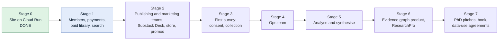

# Roadmap: Stages 0 to 7

**Status:** Proposed for review · 2026-11-16 · Architecture v4
**Order set by the owner:** members and money first, then publishing and marketing, then data collection, then the ops team, then analysis, the graph, and finally the PhD and book work.

Every stage ends with something a person can use and a written exit test. No stage starts until the previous exit test passes and the owner has approved the next stage's design and cost.

## Stage summary

| Stage | Builds | Modules | Exit test | New fixed cost per month |
| --- | --- | --- | --- | --- |
| **0 Foundation** (done) | Project, Terraform, CI/CD without key files, site on Cloud Run, domain, uptime check | M0, M1 | The domain serves the site from Cloud Run; a push deploys to dev | about US$1 |
| **1 Members and commerce** | Separate dev project; sign-in; entitlement engine; Stripe import and webhooks; Substack roster; paid library with gated downloads; Payhip purchases; search; platform-only membership; onboarding waves; cockpit v0; revenue mart | M2, M12, M14, M15 (roster), M1 | A paid Substack reader signs in and downloads a guide with no manual step; a lapsed test subscription is downgraded automatically; a free member buys a PDF and finds it in the workspace; the owner stops emailing files | US$3 to 15 |
| **2 Publishing, marketing, revenue** | Model gateway; voice profile v1; Substack Desk (posts, notes, comments, statistics, change feed, sentinel); publishing team with three approval gates; marketing team with Notes writer and Instagram and Threads; article mirror and news; Ask AuDHD Research v1 with quotas; Stripe-native store; Revenue team and decision cockpit; promos | M0 gateway and voice, M9, M10, M12, M14, M15 | An idea becomes a scheduled Substack draft in the owner's voice; one approved Note goes out daily for two weeks; a cockpit decision is switched on, executed and measured; a paid member gets a cited answer | US$25 to 80, mostly model tokens |
| **3 Collect data** | Ethics route chosen and documented; consent ledger; `research_id`; `research-api` in its own zone; instrument runtime; first survey built from free validated instruments and templates; withdrawal; published data management plan; survey template agent v1; optionally the first proprietary test | M2 consent, M3, M5, M11 (templates), M4 (optional) | A member consents, completes the survey, withdraws, and the rows are purged; a new instrument ships by merging one YAML file | US$0 to 5 |
| **4 Ops team** | Uptime and synthetic journeys (sign-in, download, sandbox purchase); bus and dead-letter inspector; fixer agent that opens pull requests; dependency and drift agents; cost and model-spend watch; Substack sentinel hand-off | M13 | An injected fault produces a pull request with a passing fix; a console change is reported as drift next morning; the weekly cost report arrives | US$5 to 20 |
| **5 Analyse and synthesise** | Psychometrics and clustering; pattern detector; research loop kit; thin evidence graph on Aura Free; synthesis hub; five lifecycle labels visible to paid members with filters; survey template agent driven by gaps and findings | M6, M7 thin, M8, M11 | A detected pattern becomes a Finding with a verdict, appears in Ask with its label, and a Gap becomes a draft survey pull request | US$5 to 25 |
| **6 Graph product** | Literature scouts and ingestion; full label set; evidence portal; ResearchPro in three usage tiers; API keys; first de-identified release | M7 full, M5 releases, M2 tiers | A ResearchPro member asks a question and gets the grouped, labelled answer; `release_v1` passes k ≥ 5 | US$0 to 90 (graph store choice) plus tokens that scale with paying users |
| **7 PhD, book, licences** | PhD proposal pack from levels 3 to 5; book mode from levels 1 to 5; data-use agreement templates (quarterly, annual); research data module packaged as a standalone service; own Google Cloud organisation; voice fine-tune; more languages | M5 as a service, M9 book mode, M0 | A proposal pack lists every claim with its level and replication; the first licence is signed and its release delivered | Negotiated per licence |

Costs are estimates before any revenue and before credits. The cost section of the architecture doc holds the item-by-item table.

## What each stage needs from the owner

| Stage | Decisions | Actions only the owner can take |
| --- | --- | --- |
| 1 | Prices and quotas; terms of the launch grant; privacy notice and terms; email sender | Create Stripe restricted keys and the webhook endpoint (script provided); check the Substack dashboard for the Publisher API; export the subscriber CSV; set the Payhip webhook; publish the invitation posts |
| 2 | Which Desk capabilities to switch on; Notes posting time; first cockpit decisions | Refresh the Substack session cookie when asked; connect Instagram and Threads; approve batches |
| 3 | Ethics route: anonymous collection, independent review first, or wait; first instruments | Obtain written confirmation of which research ethics rules apply; sign off consent texts |
| 4 | Which fixes may be proposed automatically | Review pull requests |
| 5 | Evidence weights; what counts as replication | Approve each Finding before members see it |
| 6 | ResearchPro prices; graph store upgrade | Approve the first release |
| 7 | Licence terms; university | Sign agreements |

## Dependencies that cross stages

- **The model gateway (Stage 2) precedes every agent.** No agent calls a model provider directly.
- **Substack Desk's roster slice is in Stage 1**, the rest in Stage 2. The sentinel exists from Stage 2 and gains automatic fixes in Stage 4.
- **Ask AuDHD Research** is gated in Stage 1, answers from the library and articles in Stage 2, and adds exploratory observations with labels in Stage 5 and the graph in Stage 6.
- **Zone 2 does not exist until Stage 3.** Nothing before it stores research answers.
- **Moving to the platform's own organisation** is scheduled for Stage 7 at the latest and must happen before the first external data-use agreement.

## What is deliberately late

| Item | Why it waits |
| --- | --- |
| Practice Exchange | Needs a moderation model the owner has not chosen |
| Ops team | The platform must exist before it can be watched; until then, uptime checks and alerts cover the basics |
| Evidence graph | Needs both literature ingestion and the owner's own findings to be worth a product |
| Voice fine-tune | The style guide and retrieval come first and may be enough |
| Cloud DNS | Cloudflare is free and already managed in Terraform; planned move mid-2027 |

Detailed plans: [Stage 1](stage-1-members-and-commerce.md). Later stages get their own plan when they are next.
