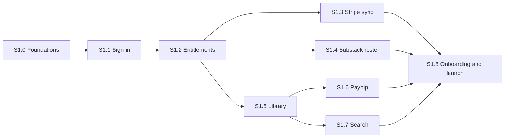

# Stage 1 plan: members and commerce

**Status:** Proposed for review · 2026-11-16
**Design:** [01 overview](../architecture/01-system-overview.md) · [02 membership](../architecture/02-membership-and-entitlements.md) · [03 commerce](../architecture/03-commerce-and-revenue.md) · [04 library and search](../architecture/04-content-library-and-search.md) · [05 Substack Desk](../architecture/05-substack-desk.md) · [08 security](../architecture/08-security-identities-and-org.md) · [09 data and events](../architecture/09-events-and-data-model.md)

## Goal

A Substack reader signs in with the email they already use and finds the workspace their subscription entitles them to. Paid readers open every guide and research PDF. Free members buy single PDFs. When a subscription ends, access changes without anyone lifting a finger. The owner stops emailing files.

## Out of scope for Stage 1

Agent teams and the model gateway; Ask AuDHD Research answers (the section is gated but shows "coming"); Substack publishing, notes and comments; the Stripe-native store; surveys; Practice Exchange; research data of any kind.

## Slices

Nine slices, each shippable to dev on its own, each with an exit test. Every slice gets a detailed task plan under `docs/superpowers/plans/` just before it starts, so plans are written against the code that actually exists. The first is ready: [S1.0](../superpowers/plans/2026-11-16-stage-1-slice-0-platform-skeleton.md).

### S1.0 Foundations for personal data

| | |
| --- | --- |
| Builds | A folder and a separate dev project; Terraform split into dev and prod; Firestore in both; Pub/Sub topics with dead-letter topics; service accounts and the permissions manifest; the `platform-api` skeleton (API, hooks and job modes) with event envelope, idempotent inbox and enforced module boundaries; CI that tests, builds and deploys to dev; `CLAUDE.md` |
| Exit test | An authenticated call to `platform-api` in dev returns healthy; a test event published to the bus is delivered once and recorded once when sent twice; `platform-hooks` answers only webhook routes; Terraform plan is clean in both projects |
| Owner actions | Run the foundations script in Cloud Shell (creates the folder and the dev project) |

### S1.1 Sign-in and session

| | |
| --- | --- |
| Builds | Identity Platform with email link and Google; sign-in, sign-out and session cookie in `web`; member record on first sign-in; tier-aware workspace shell (everyone is free at this point); Account page; owner role and `/admin` guard with a second factor |
| Exit test | A new person signs in by email link on dev and sees the free workspace; the owner sees `/admin`; a signed-out visitor is sent to sign-in; a tampered cookie is rejected |
| Owner actions | Choose the sender name for sign-in emails |

### S1.2 Entitlement engine

| | |
| --- | --- |
| Builds | Contacts and entitlements; the pure `access_for` and `can_open` functions with the rules of [02 §4](../architecture/02-membership-and-entitlements.md); grant, end and revoke with audit log and events; admin inspector with manual grant; paid-only route guard in `web`; link-another-email flow; daily sweep with verify-before-expire |
| Exit test | A manual grant makes a member paid on the next page load; expiry makes them free and sends one email; a second email linked from Account brings its entitlements; the sweep does not expire anything when the source cannot be reached |
| Owner actions | None |

### S1.3 Stripe sync

| | |
| --- | --- |
| Builds | Restricted-key client; `stripe-reconcile` job (dry-run report, then import of every customer as a contact with channel flags); webhook route with signature check; consumer mapping subscription events to entitlements; revenue rows in BigQuery; nightly reconciliation |
| Exit test | In a Stripe sandbox with a test clock: subscribe, renew, fail a payment, recover, cancel at period end, and see each state arrive as the right entitlement status; the production dry-run report's paid count matches the Substack dashboard |
| Owner actions | Create the two restricted keys and the webhook endpoint with the provided script; compare the dry-run report with Substack |

### S1.4 Substack roster (first slice of Substack Desk)

| | |
| --- | --- |
| Builds | `packages/substack-desk` skeleton with ports and capability matrix; `SubscriberDirectory` port with the Publisher API adapter (if available) and the CSV adapter; admin CSV upload; roster-sourced entitlements for comp, gift, group and Apple-billed readers; free-subscriber flags; mass-change guard; sync status in admin. The private-endpoint adapter is written last and ships switched off. |
| Exit test | Roster counts by type match the Substack dashboard; a complimentary subscriber is paid on the platform; removing the comp downgrades them at the next check; a truncated CSV changes nothing and raises an alert; the Desk package installs and passes its tests alone |
| Owner actions | Look for "Publisher API" in the Substack dashboard and create a key if offered; export the subscriber CSV; decide whether private-endpoint reading is switched on |

### S1.5 Library

| | |
| --- | --- |
| Builds | Private bucket; manifest schema; `platform-cli library publish` with dry run; public catalogue pages with structured data; workspace Research, Guides and Library sections; signed downloads with entitlement check, log and rate limit; "recently opened" |
| Exit test | A paid member opens and downloads any published item; a free member sees the catalogue with Upgrade and Buy; a copied download link stops working after 10 minutes; the bucket refuses anonymous reads; retiring an item hides it but keeps buyers' access |
| Owner actions | Write `item.yaml` for the first ten items; run the publish command |

### S1.6 Payhip purchases

| | |
| --- | --- |
| Builds | Buy link with one-time reference; Payhip webhook route and consumer; product-to-item mapping; purchase and `item:<sku>` entitlement; Stripe cross-check; guest attach at registration; refund handling; sales CSV importer; My purchases |
| Exit test | A test purchase with a 100% coupon unlocks the PDF in the buyer's workspace within a minute; the same webhook sent twice creates one purchase; a guest purchase appears when that email registers; a refund removes the item; a forged webhook without the right path and signature is rejected |
| Owner actions | Add the webhook URL in Payhip settings; set the checkout redirect; put each product key into its manifest |

### S1.7 Search

| | |
| --- | --- |
| Builds | Content sources for library, site pages and Substack RSS; `index-content` job; snapshot format; hybrid ranking; access-aware results and snippets; search box in the workspace and on the public site |
| Exit test | One query returns a library item, an article and a site page with correct access labels; a free member's results contain no text from a paid PDF; a newly published item is findable within five minutes; a set of 30 owner-written test questions finds the expected item in the top three for at least 27 |
| Owner actions | Write the 30 test questions with the item each should find |

### S1.8 Onboarding, platform-only membership and launch

| | |
| --- | --- |
| Builds | Stripe product and Checkout for platform-only membership with the hosted customer portal; upgrade page with both routes; founding grant migration; invite waves with codes; transactional emails through the email port with the domain's SPF, DKIM and DMARC records; Submit a question; privacy notice and terms pages; cockpit v0 (segments, sign-up funnel, revenue by channel, sync health, dead letters); runbooks; production rollout; Vercel switched off |
| Exit test | Wave 0 (owner and test accounts) completes every journey on production; a platform-only test subscription upgrades and, cancelled, downgrades; the revenue view matches Stripe for the last full month; wave 1 is invited |
| Owner actions | Set the platform-only prices; approve the privacy notice and terms; publish the invitation posts; add the link to Substack's welcome emails |

## Definition of done for every slice

- Tests written first; unit tests for rules, emulator tests for storage, one end-to-end journey in dev.
- No personal data in logs, events or test fixtures. Fixtures use invented people.
- Terraform plan clean; no resource created by hand.
- The page in `docs/architecture/` still tells the truth; an ADR is added if a decision changed.
- The owner can demo the exit test herself from the runbook.

## Risks specific to Stage 1

| Risk | Likelihood | Effect | Answer |
| --- | --- | --- | --- |
| A paid reader is not recognised (different email, Apple billing, gift) | High at first | Frustration at the first visit | Link-another-email flow; roster check; a visible "I'm a paid subscriber" help link that reaches the owner's inspector; manual grant takes ten seconds |
| A webhook is missed | Medium | A late downgrade or upgrade | Nightly reconciliation; verify-before-expire |
| Substack changes or blocks private endpoints | Medium | Roster automation stops | Paid status does not depend on it; CSV upload always works |
| Payhip webhook forged or lost | Low | A free PDF, or a missing purchase | Stripe cross-check; CSV importer; alert on unmatched Payhip payments |
| Sign-in emails land in spam | Medium | Nobody gets in | Google sign-in as the second route; authenticated sending domain; invitations sent through Substack |
| Personal data now lives in the project | Certain | Legal duties begin | Separate dev project with invented data; privacy notice before wave 1; access logging; retention schedule |

## Sequence and effort

Rough effort, assuming the owner reviews between slices and a coding agent implements: S1.0 three sessions; S1.1 three; S1.2 four; S1.3 four; S1.4 three; S1.5 four; S1.6 three; S1.7 three; S1.8 five. S1.3, S1.4 and S1.5 can run in parallel after S1.2. These are estimates to plan around, not commitments.
