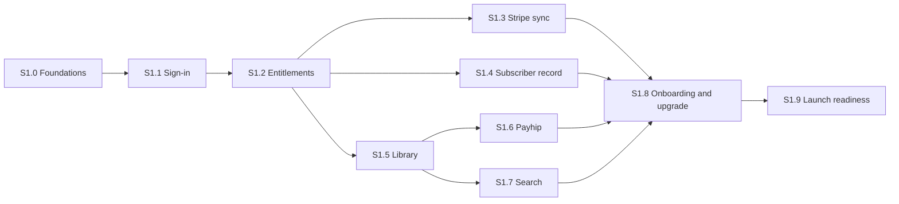

# Stage 1 plan: members and commerce

**Status:** Proposed for review · 2026-11-16
**Design:** [01 overview](../architecture/01-system-overview.md) · [02 membership](../architecture/02-membership-and-entitlements.md) · [03 commerce](../architecture/03-commerce-and-revenue.md) · [04 library and search](../architecture/04-content-library-and-search.md) · [05 Substack Desk](../architecture/05-substack-desk.md) · [08 security](../architecture/08-security-identities-and-org.md) · [09 data and events](../architecture/09-events-and-data-model.md)

## Goal

A Substack reader signs in with the email they already use and finds the workspace their subscription entitles them to. Paid readers open every guide and research PDF. Free members buy single PDFs. When a subscription ends, access changes without anyone lifting a finger. The owner stops emailing files.

## Out of scope for Stage 1

Agent teams and the model gateway; Ask AuDHD Research answers (the section is gated but shows "coming"); Substack publishing, notes, comments and any use of Substack's private endpoints; the Stripe-native store; surveys; Practice Exchange; research data of any kind.

## Slices

Ten slices, each shippable to dev on its own, each with an exit test. Every slice gets a detailed task plan under `docs/superpowers/plans/` just before it starts, so plans are written against the code that actually exists. The first is ready: [S1.0](../superpowers/plans/2026-11-16-stage-1-slice-0-platform-skeleton.md).

### S1.0 Foundations for personal data

| | |
| --- | --- |
| Builds | A folder and a separate dev project; Terraform split into dev and prod; Firestore in both; Pub/Sub topics with dead-letter topics that have their own subscriptions and alerts; service accounts and the permissions manifest; a production deployer that only the protected `production` environment can use; the `platform-api` skeleton (API, hooks and job modes) with event envelope, idempotent receiver and enforced module boundaries; CI that tests, builds and deploys to dev |
| Exit test | An authenticated call to `platform-api` in dev returns healthy; a test event sent twice is handled once; `platform-hooks` answers only webhook routes; Terraform plan is clean in both projects |
| Owner actions | Run the foundations script in Cloud Shell (creates the folder and the dev project); protect the `production` environment in GitHub |

### S1.1 Sign-in and session

| | |
| --- | --- |
| Builds | Identity Platform with email link and Google; sign-in and sign-out screens in `web`; session cookie issued and verified by `platform-api`; CSRF protection; member record on first sign-in; tier-aware workspace shell (everyone is free at this point); Account page; the owner allow-list with second factor and the `/admin` guard; SPF, DKIM and DMARC records for the sending domain in Terraform |
| Exit test | A new person signs in by email link on dev and sees the free workspace; the owner sees `/admin` only after a second factor; a signed-out visitor is sent to sign-in; a tampered or revoked cookie is rejected |
| Owner actions | Choose the sender name for sign-in emails; enrol a second factor |

### S1.2 Entitlement engine

| | |
| --- | --- |
| Builds | The contact key in Cloud KMS; contacts and entitlements; the pure `access_for` and `can_open` functions with the six rules of [02 §4](../architecture/02-membership-and-entitlements.md); grant, end and revoke with audit trail and events; claim at sign-in; admin inspector with manual grant; paid-only route guard in `web`; link-another-email flow with sign-in and explicit confirmation; the daily sweep with verify-before-expire; the `EmailSender` port with an outbox adapter for dev and one real adapter; the two tier-change notices |
| Exit test | A manual grant makes a member paid on the next page load; ending it makes them free and puts exactly one notice in the outbox; a second address is linked only after signing in as it and confirming; an entitlement claimed by a member stays hers when the contact's email changes; the sweep ends nothing when its source cannot be reached |
| Owner actions | Choose the email provider |

### S1.3 Stripe sync

| | |
| --- | --- |
| Builds | Restricted-key client; the raw-event bucket; webhook route with signature check and its own receiver; a consumer that fetches the subscription's current state on every event and applies it in one transaction; `stripe-reconcile` job (a dry-run report, then import of every customer as a contact with channel flags; in production only the dry run runs until S1.9); grace capped in days; mass-change guard |
| Exit test | In a Stripe sandbox with a test clock: subscribe, renew, fail a payment, recover, let grace run out, cancel at period end, refund a payment, and see each arrive as the right entitlement status; events replayed out of order and twice give the same end state; the production dry-run report's paid count matches the Substack dashboard |
| Owner actions | Create the two restricted keys and the webhook endpoint with the provided script; compare the dry-run report with Substack |

### S1.4 Subscriber record (first slice of Substack Desk)

| | |
| --- | --- |
| Builds | `packages/substack-desk` skeleton with ports and capability matrix; the `SubscriberDirectory` port with the Publisher API adapter (if the publication has it) and the CSV adapter; admin CSV upload; roster-sourced entitlements for comp, gift, group and Apple-billed readers, ended only on positive evidence; free-subscriber flags; sync status in admin. No private endpoints. |
| Exit test | Counts by type match the Substack dashboard; a complimentary subscriber is paid on the platform; removing the comp downgrades them at the next check; a truncated CSV ends nothing and raises an alert; the Desk package installs and passes its tests alone |
| Owner actions | Look for "Publisher API" in the Substack dashboard and create a key if offered; export the subscriber CSV |

### S1.5 Library

| | |
| --- | --- |
| Builds | Private bucket; manifest schema; `platform-cli library publish` with dry run; public catalogue pages with structured data; workspace Research, Guides and Library sections; signed downloads with entitlement check, log and rate limit; "recently opened" |
| Exit test | A paid member opens and downloads any published item; a free member sees the catalogue with Upgrade and Buy; a copied download link stops working after 10 minutes; the bucket refuses anonymous reads; retiring an item hides it but keeps buyers' access |
| Owner actions | Write `item.yaml` for the first ten items; run the publish command |

### S1.6 Payhip purchases

| | |
| --- | --- |
| Builds | Buy link with one-time reference; Payhip webhook route and consumer; product-to-item mapping; purchase and `item:<sku>` entitlement; one-to-one Stripe cross-check; approval queue for zero-amount orders; guest claim at registration; refund handling; sales CSV importer; My purchases |
| Exit test | A real purchase of a low-priced test product unlocks the PDF in the buyer's workspace within a minute and is refunded afterwards, which removes it; the same webhook sent twice creates one purchase; a guest purchase appears when that email registers; a forged webhook is rejected; a second forged "sale" cannot reuse an already matched Stripe payment |
| Owner actions | Add the webhook URL in Payhip settings; set the checkout redirect; put each product key into its manifest; create the test product |

### S1.7 Search

| | |
| --- | --- |
| Builds | Content sources for library, site pages and Substack RSS; `index-content` job; snapshot format; keyword ranking first, then vectors and fusion; access-aware results and snippets; search box in the workspace and on the public site |
| Exit test | One query returns a library item, an article and a site page with correct access labels; a free member's results contain no text from a paid PDF and are not ordered by it; a newly published item is findable within five minutes; a set of 30 owner-written test questions finds the expected item in the top three for at least 27 |
| Owner actions | Write the 30 test questions with the item each should find |

### S1.8 Onboarding and upgrade

| | |
| --- | --- |
| Builds | Stripe product and Checkout for platform-only membership, tagged as the platform's own sale, with the hosted customer portal; upgrade page with both routes; launch grant migration; invite waves with codes; welcome and purchase emails; Submit a question; cockpit v0 (segments, sign-up funnel, sync health, dead letters); nightly `revenue-export` and the revenue-by-channel view |
| Exit test | A platform-only test subscription upgrades and, cancelled, downgrades; the revenue view matches Stripe for the last full month, with the processor's daily fee totals shown as their own lines |
| Owner actions | Set the platform-only prices; publish nothing yet |

### S1.9 Launch readiness

| | |
| --- | --- |
| Builds | Account deletion and full erasure with tombstones; retention jobs; backups, the independent monthly export and one tested restore; alert policies (dead letters, failed sweeps and syncs, guard trips, error rate); the daily membership snapshot; privacy notice and terms pages; security scanning in CI; runbooks; production rollout, including the first production import of customers and the subscriber record; Vercel switched off |
| Exit test | The checklist in [08 §10](../architecture/08-security-identities-and-org.md) is complete; wave 0 (owner and test accounts) completes every journey on production, including deletion; a restore in dev brings back a deleted test member and the replay removes it again; wave 1 is invited |
| Owner actions | Approve the privacy notice and terms; complete the checklist; publish the invitation posts; add the link to Substack's welcome emails |

## Definition of done for every slice

- Tests written first; unit tests for rules, emulator tests for storage, one end-to-end journey in dev.
- No personal data in logs, events or test fixtures. Fixtures use invented people.
- Terraform plan clean; no resource created by hand.
- The page in `docs/architecture/` still tells the truth; an ADR is added if a decision changed.
- The owner can demo the exit test herself from the runbook.

## If Stage 1 has to shrink

In order of what to drop first without losing a stated requirement: vector ranking in search (keyword ranking alone still makes everything findable); the revenue view and cockpit v0 (move to Stage 2); Submit a question. Nothing else is optional.

## Risks specific to Stage 1

| Risk | Likelihood | Effect | Answer |
| --- | --- | --- | --- |
| A paid reader is not recognised (different email, Apple billing, gift) | High at first | Frustration at the first visit | Link-another-email flow; roster check; a visible "I'm a paid subscriber" help link that reaches the owner's inspector; a manual grant takes ten seconds |
| A webhook is missed or arrives out of order | Medium | A late change | The platform applies the fetched current state, not the event; nightly reconciliation |
| Payhip webhook forged or lost | Low | A free PDF, or a missing purchase | One-to-one Stripe cross-check; CSV importer; alert on unmatched Payhip payments |
| Sign-in emails land in spam | Medium | Nobody gets in | Google sign-in as the second route; authenticated sending domain; invitations sent through Substack |
| Personal data now lives in the project | Certain | Legal duties begin | Separate dev project with invented data; the checklist is a gate before the first production import; access logging; retention schedule |

## Sequence and effort

Rough effort, assuming the owner reviews between slices and a coding agent implements: S1.0 three sessions; S1.1 three; S1.2 five; S1.3 four; S1.4 two; S1.5 four; S1.6 three; S1.7 three; S1.8 four; S1.9 three. S1.3, S1.4 and S1.5 can run in parallel after S1.2. These are estimates to plan around, not commitments.
