# Stage 1 build plan for a swarm of Claude agents

**Status:** Approved by merge of pull request #5 on 2026-11-19 · settings chosen by the owner on 2026-11-20: one cloud session per lane, three lanes at a time, the integration branch, lane plans approved by the integrator after an independent review
**Decision:** [ADR 0025](../adr/0025-build-with-lanes-contracts-first.md) · **Operating manual:** [docs/swarm](../swarm/README.md) · **Interfaces:** [contracts](../contracts/stage-1-launch.md)
**Builds:** the [launch track](../superpowers/specs/2026-11-19-launch-invites-grants-promotions-design.md) first, then the rest of [Stage 1](stage-1-members-and-commerce.md)

Gate 0 passed on 2026-11-19. Wave 0 produced the lane plans listed in §5a.

## 1. The idea in five lines

1. The work is split into **lanes**. A lane owns a set of folders; nobody else changes them.
2. What lanes need from each other is written first, on one **contracts** page.
3. Each lane is one Claude session that works through its own plan, task by task, with a fresh **implementer** agent per task and a **reviewer** agent after each.
4. Lanes run side by side in **waves**. A wave ends at a **gate** only the owner can pass.
5. A separate **quality lane** reviews across lanes and writes no product code.

A term used below: a **subagent** is a helper that a session starts for one job, with its own context, which reports back and ends. **Subagent-driven development** is the method of the `superpowers` plugin: one implementer subagent per task, a review after each task, a review of the whole branch at the end.

## 2. Lanes

| Lane | Branch prefix | May change | Builds |
| --- | --- | --- | --- |
| **L0 Integrator** | `int/` | `docs/contracts/`, `docs/swarm/`, `docs/plans/`, `docs/superpowers/plans/`, `docs/adr/`, `CLAUDE.md`, `.claude/`, `packages/events/`, `THIRD_PARTY.md` | Contracts, lane plans, sequencing, the whole-stage review, release notes for each gate |
| **L1 Core** | `core/` | `services/platform-api/` except the three folders below; this includes `pyproject.toml`, `app.py`, `settings.py`, `cli.py`, `shared/`, `identity/`, `entitlements/`, `admin/` | Skeleton, sign-in backend, entitlement engine, campaigns and grants, admin routes, `platform-cli` |
| **L2 Web** | `web/` | `apps/web/` | Sign-in screens, join and welcome pages, workspace shell, upgrade page, library pages, terms and privacy pages |
| **L3 Infra** | `infra/` | `infra/terraform/`, `.github/workflows/`, `ops/scripts/`, `docs/runbooks/`, `services/platform-api/Dockerfile` and `.dockerignore` | Dev and prod roots, identities, keys, buckets, jobs, schedules, alerts, deploy pipelines, the owner's scripts and runbooks |
| **L4 Commerce** | `commerce/` | `services/platform-api/src/platform_api/commerce/` and its tests, `services/platform-api/tests/recorded/stripe/` | Stripe client, reconcile job, refresh on request, promotions, roster import job; later webhooks, Payhip, revenue export |
| **L5 Library** | `library/` | `services/platform-api/src/platform_api/library/` and `content/` and their tests | Manifest, publish, catalogue, signed downloads; later search |
| **L6 Desk** | `desk/` | `packages/substack-desk/` | Package skeleton, `SubscriberDirectory`, the file adapter; later the Publisher API adapter |
| **L7 Quality** | `qa/` | `tests/e2e/`, `docs/reviews/` | Cross-lane reviews, end-to-end journeys on dev, the pre-launch security and accessibility passes |
| **L8 Governance** (off the critical path) | `gov/` | `packages/study-governance/`, `instruments/` | Schemas, rules, templates and blueprints of [page 11](../architecture/11-study-governance-and-survey-templates.md) |

Three conventions keep lanes out of each other's files inside `services/platform-api`:

- Each feature module exposes its HTTP routes as `router` in `<module>/http.py` and its jobs as `JOBS` in `<module>/jobs.py`. `app.py` and `cli.py` include these for a fixed list of module names from the first day, so adding a route or a job never touches a Core file. Core adds the empty files in its first task.
- Core adds every dependency the launch track needs in its first task: `stripe`, `firebase-admin`, `google-cloud-kms`, `google-cloud-storage`, `google-cloud-run`, `google-cloud-secret-manager`, `pyyaml`. A dependency after that is a one-line pull request to Core.
- A lane that needs a change in another lane's folder asks for it with a pull request labelled `cross-lane`, which the owning lane reviews.

## 3. Roles inside and across lanes

| Role | Where | Does | Model tier |
| --- | --- | --- | --- |
| Lane controller | The lane's session | Reads its plan, dispatches one task at a time, keeps the ledger, opens the pull request | The session's model |
| Implementer | Subagent, fresh per task | Test first, see it fail, implement, run the lane's checks, commit, report | Mid tier; cheapest tier when the plan gives the code to transcribe |
| Task reviewer | Subagent, fresh per task | Checks the task's diff against its brief and the contracts; two verdicts: meets the brief, quality | Mid tier |
| Branch reviewer | Subagent, once per pull request | Reads the whole branch against the plan and the design | Most capable |
| Contract checker | L7, every pull request | Fails a pull request that adds or changes a route, shape, event, setting or document field not on the contracts page | Mid tier |
| Privacy checker | L7, every pull request | Looks for email-shaped strings, names and provider ids in code, tests, fixtures, logs and events; confirms the guard script passes and was not weakened | Mid tier |
| Security reviewer | L7, on identity, sessions, admin routes, signed links, permissions, CI | Uses the `backend-design` and `claude-security` plugins' reviewers; findings as review comments | Most capable |
| Accessibility reviewer | L7, on `apps/web` | Keyboard, contrast, labels, reduced motion, plain language | Mid tier |
| Docs keeper | Each lane's last task | The architecture page says what the code now does; an ADR exists if a decision changed | Mid tier |

Role texts are in [docs/swarm/roles.md](../swarm/roles.md) and mirrored as subagent definitions in `.claude/agents/`.

## 4. Waves and gates

```mermaid
flowchart LR
  G0{{Gate 0<br/>owner approves design,<br/>contracts, this plan}} --> W0[Wave 0<br/>L0 writes lane plans,<br/>plans reviewed]
  W0 --> W1[Wave 1<br/>L1 skeleton · L3 foundations<br/>L2 screens on a mock · L6 file adapter]
  W1 --> G1{{Gate 1<br/>owner runs foundations script,<br/>applies dev, merges}}
  G1 --> W2[Wave 2<br/>L1 identity, entitlements, campaigns<br/>L4 reconcile, promotions · L5 library<br/>L2 wired to dev · L3 jobs, alerts, prod root]
  W2 --> G2{{Gate 2<br/>owner enters keys,<br/>approves terms and privacy notice}}
  G2 --> W3[Wave 3<br/>L7 journeys and reviews on dev,<br/>fix loops in the owning lanes]
  W3 --> G3{{Gate 3<br/>owner applies prod, approves the deploy,<br/>dry run, imports, wave 0, opens join}}
  G3 --> W4[Wave 4 onwards<br/>rest of Stage 1]
```

| Gate | Only the owner can | How |
| --- | --- | --- |
| 0 | Approve the design and answer the decisions in the launch design, §9 | Merge the documentation pull request |
| 1 | Create the dev project and folder; apply Terraform to dev; protect `main` and the `production` environment; start the verification of the sign-in email's sending domain; set the variable `DEPLOY_DEV_ENABLED` to `true` on the GitHub environment `dev` (until then no merge deploys anything) | `ops/scripts/20-stage1-foundations.sh` and `ops/scripts/30-auth-email-domain.sh` in Cloud Shell; commands in the runbooks |
| 2 | Create the restricted Stripe key and store it; approve the privacy notice and terms; give the header line of Substack's export (column names only) | A script that reads the key from the terminal into Secret Manager; a review of two pages |
| 3 | Apply Terraform to prod; approve the production deploy; run the dry run and compare its paid count with Substack's dashboard; run the real reconcile and the roster import; apply campaigns and promotions; pass wave 0; open the join layer | `docs/runbooks/launch.md`, every step a command |

## 5. Task cards for the launch track

A task card names a deliverable, the contract it must meet and the tests that must exist. The integrator turns each lane's cards into a step-by-step plan in `docs/superpowers/plans/` (failing test, run, implement, run, commit) before that lane starts. Interfaces are in the [contracts](../contracts/stage-1-launch.md).

### L1 Core

| # | Deliverable | Must be pinned by tests | Needs |
| --- | --- | --- | --- |
| C1 | S1.0 tasks 1 to 5 as planned, plus the `http.py` and `jobs.py` convention and the dependency list | As in the S1.0 plan | – |
| C2 | `identity`: `resolve_session`, `member_from_session`, session cookie, terms acceptance | A tampered or revoked cookie is refused; a member who has not accepted the current terms gets `terms_required` on every member route except `GET /v1/me`, acceptance, sign-out and the deletion request | C1 |
| C3 | `entitlements` core: models, `contact_id_for` behind a key port, `access_for`, `can_open`, `claim_for_member`, `grant`, `revoke`, audit | Each of the six rules; a `grant` past its date is not live; the same email in different letter case gives the same contact; a claim sticks when the contact's email changes | C1 |
| C4 | `plan_reconcile` and `apply_plan` | The same states applied twice change nothing; an unseen entitlement is untouched and reported; the guard blocks a run that would end more than 5 or more than 20%; a tier change emits exactly one `membership.tier.changed` | C3 |
| C5 | Campaigns and grant policies: `grants_due`, `apply_grant_policies`, `record_arrival` | `ana` gets a grant, `cy` does not when the cut-off is set, `di` and `hal` get none when the policy names plan intervals (`di` becomes paid through an owner grant), `fay` keeps access until the grant's date, `gus` gets exactly one; evaluating twice creates one grant; a closed campaign grants nothing; an unknown slug falls back to the default campaign | C3 |
| C6 | Admin routes, the owner list, `platform-cli` as their client | A token from an account not on the list is refused; an email in a request never reaches a log line; every admin call writes an audit entry | C3 |
| C7 | Member routes: `/v1/me`, entitlements, support requests, deletion request, public campaign route, rate limits | The limits of `refresh-access`; a support note is stored and never appears in an event | C2, C5 |

### L4 Commerce

| # | Deliverable | Must be pinned by tests | Needs |
| --- | --- | --- | --- |
| M1 | Stripe port and adapter: list every subscription with its customer, classify the channel, map status to `SourceState` with `started_at` | Recorded responses only; a subscription not created by Substack is ignored; each Stripe status maps as in [02](../architecture/02-membership-and-entitlements.md); `past_due` beyond the grace cap becomes `expired` | C1 |
| M2 | `stripe-reconcile` job with dry run, guard, `sync_runs`, the completion event | A dry run writes nothing; a failed Stripe call ends nothing and marks the run failed; a second run with the same data changes nothing | C4, M1 |
| M3 | `request_refresh` and `POST /v1/me/refresh-access` | A run completed in the last 60 seconds is reused; a running job is not started twice; the API process cannot read the Stripe key (an infrastructure test in dev) | M2 |
| M4 | Promotions: models, `active_promotions`, `upgrade_options`, routes, upgrade counting | Nothing shows before `starts_at` or after `ends_at`; a closed `promotions_open` switch hides everything; `cy` is counted once | C3 |
| M5 | `roster-import` job | `gus` gets nothing from the roster; a truncated file applies nothing and alerts; the job refuses to write without a recent good reconcile; the import ends nothing | M2, D2 |

### L5 Library

| # | Deliverable | Must be pinned by tests | Needs |
| --- | --- | --- | --- |
| B1 | Manifest model and `publish` with dry run, checksum and versions; the admin route | A manifest with a missing field is refused with the field named; a dry run uploads nothing | C1 |
| B2 | `catalogue` and `item` | A free member sees every card with `can_open: false` for paid items | C3 |
| B3 | `download_link`: entitlement check, signed link valid ten minutes, download record, simple rate limit | A free member is refused with `paid_required`; a retired item stays open to its buyers; the link's lifetime | C3, B1 |

### L6 Desk

| # | Deliverable | Must be pinned by tests | Needs |
| --- | --- | --- | --- |
| D1 | Package skeleton with ports and a capability matrix; installs and tests alone; imports nothing from the platform | An import-boundary test | – |
| D2 | `FileDirectory`: reads the export, detects its columns from the header, reports rejected rows and whether the file is complete | Invented rows only; a file cut off mid-row is `complete: false`; an unknown header fails with the column named | D1, the header line from the owner |

### L2 Web

| # | Deliverable | Must be pinned by tests | Needs |
| --- | --- | --- | --- |
| W1 | Sign-in by email link and Google, the return page, cookie handling, CSRF protection, sign-out | A request without the CSRF token is refused; the slug survives a return on another device | Contracts |
| W2 | `/join/[slug]` and `/welcome` | Paid and free outcomes, the not-recognised message with both routes, a closed layer shows "opening soon" | W1 |
| W3 | Workspace shell with navigation from `access.sections`, Account page with reasons in plain words, terms acceptance | A free member cannot reach a paid route by typing its address | W1 |
| W4 | `/upgrade` with the active promotion and "Check again" | Polling stops after a minute with a plain message; no promotion renders outside its window | W3 |
| W5 | Library pages and download | The refusal shows the upgrade route | W3 |
| W6 | Terms and privacy notice pages from the owner's approved texts | – | Gate 2 |

Web lanes build against a mock of `platform-api` generated from the contracts page and its fixtures until Wave 2 puts the real one on dev.

### L3 Infra

| # | Deliverable | Checked by | Needs |
| --- | --- | --- | --- |
| I1 | S1.0 tasks 6 to 8: container image and CI, dev and prod roots, identities, topics, foundations script, smoke script (task 9, the documentation update, is the integrator's) | `terraform fmt` and `validate` in CI; the smoke script on dev after Gate 1 | – |
| I2 | Identity Platform (email link, Google), the sign-in email's sending domain (DNS records, verification started at Gate 1), the contact key in Cloud KMS, buckets (library, library staging, roster inbox with a seven-day lifecycle) | Plan output reviewed; the library bucket refuses anonymous reads; a sign-in email to the owner's test address arrives from the platform's domain and passes SPF, DKIM and DMARC | I1 |
| I3 | Jobs `stripe-reconcile` and `roster-import`, the schedule, permissions exactly as in contracts §7 | A test in dev that `platform-api`'s identity is refused the Stripe key | I1 |
| I4 | Alerts: error rate, a failed or blocked reconcile, dead letters; a log-based alert on any email-shaped string in logs | A deliberate failure in dev raises the alert | I1 |
| I5 | Production deploy by tag through the protected environment; `docs/runbooks/launch.md` | A dry run of the workflow on a test tag in dev | I1 |

### L7 Quality

| # | Deliverable |
| --- | --- |
| Q1 | Contract check and privacy check on every pull request, as review comments |
| Q2 | Security review of C2, C6, M3, B3, I3 and the CI workflows |
| Q3 | End-to-end journeys on dev for the exit tests of layers B1 and B2, with the six fixture people and a Stripe sandbox |
| Q4 | Accessibility pass on W1 to W6 |
| Q5 | Before Gate 3: a full security scan of the repository and a read of every log line produced by the journeys |

## 5a. Lane plans written in Wave 0

| Lane | Plan | Tasks | Starts |
| --- | --- | --- | --- |
| L1 Core | [S1.0 plan](../superpowers/plans/2026-11-16-stage-1-slice-0-platform-skeleton.md) | 1 to 5 | Now |
| L3 Infra | [S1.0 plan](../superpowers/plans/2026-11-16-stage-1-slice-0-platform-skeleton.md), then [identity, sending domain, key and buckets](../superpowers/plans/2026-11-20-lane-infra-identity-keys-buckets.md) | 6 to 8, then 1 to 6 | Now |
| L2 Web | [sign-in, join and welcome](../superpowers/plans/2026-11-20-lane-web-sign-in-and-join.md) | 1 to 6 | Now |
| L6 Desk | [package skeleton](../superpowers/plans/2026-11-20-lane-desk-package-skeleton.md) | 1 to 3 | When one of the three is waiting at a gate |
| L0 Integrator | [S1.0 plan](../superpowers/plans/2026-11-16-stage-1-slice-0-platform-skeleton.md) | 9 | After Core and Infra have landed |

Wave 2 plans are written by the integrator against the code Wave 1 produced. Written so far: Core, [entitlements, campaigns and sign-in](../superpowers/plans/2026-11-20-lane-core-entitlements-and-sign-in.md) (task cards C2 to C7). Commerce, [reconcile, refresh, promotions and roster import](../superpowers/plans/2026-11-23-lane-commerce-reconcile-promotions-roster.md) (M1 to M5). Library, [publish, catalogue and download](../superpowers/plans/2026-11-23-lane-library-publish-catalogue-download.md) (B1 to B3). Web, [workspace, account, upgrade, library and legal pages](../superpowers/plans/2026-11-23-lane-web-workspace-upgrade-library.md) (W3 to W6). Infra, [jobs, permissions, record expiry, alerts and the launch runbook](../superpowers/plans/2026-11-23-lane-infra-jobs-alerts-launch.md) (I3 to I5). Task card C8 (deleting a member on request) was added to the Core plan as its Task 10 on 2026-11-23, because the privacy notice promises it. The export-file adapter (D2) has its plan: [export file adapter](../superpowers/plans/2026-11-20-lane-desk-export-file-adapter.md), written on 2026-11-20 from the header line the owner supplied; the Desk lane runs it after the package skeleton.

## 6. After the launch: the rest of Stage 1

| Lane | Next |
| --- | --- |
| L4 | Webhook path with raw-event bucket; then Payhip; then the nightly revenue export |
| L1 | Email port with a real sender, tier-change and welcome notices; the daily sweep; linking a second address |
| L2 | Admin screens; public catalogue pages; "recently opened" |
| L5 | Search: content sources, the index job, ranking |
| L6 | Publisher API adapter if the publication has it; free-subscriber flags |
| L3 | Automated erasure, retention jobs, restore drill; own sending domain |
| L4 with L1 | Platform-only membership through Stripe Checkout, with the `platform_checkout` promotion channel |

Each gets its plan when it is next, written against the code that exists.

## 7. How sessions are started

Facts about Claude Code checked against its documentation on 2026-11-19. The owner chooses; the lanes and rules are the same in every option.

| Option | What it is | Fits when | Limits to know |
| --- | --- | --- | --- |
| **A. One cloud session per lane** | The owner starts a session at claude.ai/code for each lane and pastes that lane's kick-off prompt from [docs/swarm](../swarm/README.md) | Works today. A cloud session loads this repository's `CLAUDE.md`, `.claude/rules/`, `.claude/agents/` and skills | The owner starts and watches each session. Plugins that are only declared in a repository's settings do not load in cloud sessions; the plugins synced from the owner's account do, as in the session that wrote this plan |
| **B. A Claude Code project** | One coordinating conversation; Claude starts a **thread** (a cloud session) per task, each on its own branch with its own pull request, and lists which threads wait for the owner | Least clicking, if the account has the feature (public beta on Pro and Max, rolling out) | Threads load `CLAUDE.md` and `.claude/rules/` from the repository root, and not `.claude/agents/`, repository skills or settings; plugins are added in the project's settings. Threads run in auto mode. At most 200 new threads a day |
| **C. Background sessions on the owner's computer** | `claude agents`, one background session per lane, each in its own git worktree | The owner prefers local work | Research preview; stops when the computer shuts down |
| **D. One session, lanes in turn** | The current way of working | Usage is tight | Slowest |

Not used for the build: experimental agent teams (teammates share one checkout and are lost when a session is resumed). They remain useful for a burst of parallel review.

Because option B does not load `.claude/agents/`, every role text also lives in `docs/swarm/roles.md`, and `.claude/rules/swarm.md` points each session to it.

**Usage.** Each running lane uses the plan's allowance on its own. Start with three lanes in Wave 1 and four in Wave 2, and let L8 run only when the others are waiting at a gate.

## 8. How work lands

- **In force since 2026-11-20: the integration branch.** Lanes target `integration/stage-1`. A pull request into it is merged by an agent that did not write it, after CI and its reviews pass: the integrator merges the lanes' pull requests, and the quality lane merges the integrator's. Dev deploys from that branch. The owner promotes it to `main` once a day from one digest. `main` and production stay hers.
- **The other mode: the owner merges every pull request.** One line in `docs/swarm/README.md` switches back.
- Every pull request arrives with a short summary: what changed, how it was tested, the reviewers' verdicts, and what the owner must do in Cloud Shell, if anything.
- Nobody force-pushes. Nobody pushes to `main`. A lane rebases onto the latest target before it asks for review.

## 9. When a lane stops and asks

A lane decides ordinary questions itself and writes the decision and its cost-if-wrong in its ledger. It stops, labels its pull request `needs-owner`, and says exactly what it needs when:

- an action is irreversible, destructive or security-sensitive;
- it would change an ADR, add a fixed monthly cost, use a Substack private endpoint, or touch members' data in a way the architecture pages do not describe;
- a contract must change and the integrator has not agreed;
- a secret, a key or an account id is needed;
- the plan is broken enough that every way forward is a guess.

## 10. Risks of building this way

| Risk | Answer |
| --- | --- |
| Lanes drift from the contracts | The contract checker on every pull request; the contracts page changes only through the integrator |
| Two lanes need the same file | Ownership table; `http.py` and `jobs.py` convention; `cross-lane` pull requests |
| The owner becomes the bottleneck | Gates are few and scripted; pull requests are small and summarised; the optional integration branch |
| Agents review their own work kindly | Reviewers are fresh subagents; cross-lane reviews come from another lane; the branch reviewer runs on the most capable model |
| Personal data slips into a public repository | Fixtures are invented; the guard script runs before each commit and in CI; the privacy checker reads every diff |
| Usage runs out mid-wave | Lanes commit and push after every task, so a stopped lane resumes from its ledger |
| A lane's session is lost | The ledger and `git log` are the record; a new session with the same kick-off prompt resumes |
