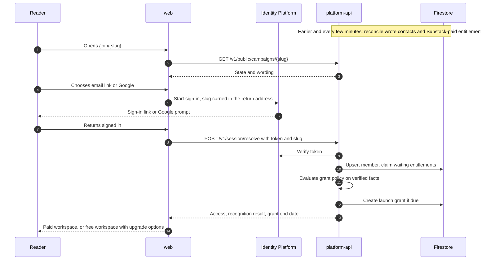

# Launch track: invite links, launch grants and promotions

**Status:** Proposed for the owner's review · 2026-11-19
**Changes:** [02 membership](../../architecture/02-membership-and-entitlements.md) §5.3, §6, §8 · [03 commerce](../../architecture/03-commerce-and-revenue.md) §3, §5 · [09 data and events](../../architecture/09-events-and-data-model.md) · the order of slices in the [Stage 1 plan](../../plans/stage-1-members-and-commerce.md)
**Decisions:** [ADR 0021](../../adr/0021-one-join-link-recognition-by-verified-email.md) · [ADR 0022](../../adr/0022-campaigns-grants-and-promotions-as-configuration.md)
**Interfaces:** [contracts for the launch track](../../contracts/stage-1-launch.md)

This repository is public. Percentages, grant lengths, prices and dates are the owner's decisions and live in private configuration and the private launch plan. This document describes the mechanism and names the parameters.

## 1. Intent

The owner wants Substack readers on the platform before a seasonal promotion, with as little friction as possible:

1. A **paid** Substack subscriber follows one link, signs in, and is inside the paid workspace. Nothing to pay, no code to paste. Each receives a **launch grant**: paid access to the platform for a set number of months, whatever happens to the Substack subscription in that time.
2. A **free** subscriber follows a link, signs in, and is a free member with a clear way to become paid.
3. A **time-boxed promotion** on the annual plan nudges free readers to paid, and the platform makes that offer visible and counts what it produced.

Why now: the promotion window is fixed by the calendar, and the invite is what gives paid readers a reason to arrive. Why this shape: the owner wants no manual step per reader, and the architecture already says access follows what Stripe and Substack report.

## 2. Goals, non-goals, anti-goals

**Goals**

- One link per audience, safe to forward: the link carries no rights.
- Recognition from the verified email alone, within minutes of a Substack upgrade.
- Grant and promotion terms changed by editing configuration, not code.
- Each layer usable without the next: the promotion works with no platform; registration works with no library.
- Counts per campaign (registered, recognised as paid, grants created, upgrades in the window) with no personal data in them.

**Non-goals for the launch track**

- Stripe webhooks, Payhip purchases, search, the admin screens, tier-change emails, linking a second email address in the browser. They follow in the rest of Stage 1.
- Selling a platform-only membership. Built after launch unless the owner chooses the model that needs it (§9, decision 1).
- Importing free subscribers. Anyone can register as free, so their addresses are not needed in advance.

**Anti-goals: these would make the launch a failure even if it "works"**

- A reader who pays Substack is told they are free and has no route to a human.
- Access granted on a guess: from a link, a code, or an unverified claim.
- A subscriber list in a public repository, a log line or an event.
- The promotion's revenue depending on code written this week.

## 3. Constraints

- The six entitlement rules ([02 §4](../../architecture/02-membership-and-entitlements.md)) hold. A launch grant is an ordinary `grant` entitlement. One part of Rule 5 arrives late and is listed in §8 for the owner to accept: the tier-change event is published from the first day, the email that goes with it from the first slice after launch.
- Read-only towards Stripe objects that Substack created. The launch track's key can read customers and subscriptions and nothing else; the wider read scopes named in [03 §2](../../architecture/03-commerce-and-revenue.md) arrive with the revenue export. Only the reconcile job's identity can read the key. `platform-api` never holds it.
- Substack has no webhook and no general API. Invitations travel through Substack posts and Substack's welcome emails. The platform's only email is the sign-in link a person asked for.
- The checklist "Before the first production import" ([08 §10](../../architecture/08-security-identities-and-org.md)) gates the first import of real subscribers. The launch track does not shorten it; §8 says which items may be met by a written manual procedure at launch.
- No fixed monthly cost is added. Cloud Scheduler stays within its free allowance; Cloud Run jobs are billed per run.

## 4. Approaches

| | Approach | What it needs | Trade-off |
| --- | --- | --- | --- |
| **A** | **Promotion on Substack only.** The owner creates a special offer in Substack and announces it. The platform is not involved. | Nothing built | Protects the revenue event completely. Gives paid readers nothing new. |
| **B** | **Thin platform on top of A (chosen).** One join link per audience. Sign-in proves the email. Paid status comes from Stripe (read-only) and one roster file. A launch grant is created at first sign-in. The upgrade page shows the Substack offer while it runs. A small library opens the PDFs. | Sign-in, an entitlement engine without its later extras, a read-only Stripe reconcile job, a roster import, a small library, three pages | Built from the Stage 1 design, so nothing is thrown away. Access after an upgrade can lag by minutes because there are no webhooks yet. Tight against the calendar. |
| **C** | **Personal invitations and platform checkout.** The platform emails each subscriber a personal link and sells its own discounted membership through Stripe Checkout. | Everything in B, plus bulk email from a new sending domain, webhooks, Checkout, tax settings, terms of sale | Cold email from a new domain lands in spam and needs a consent position. New code would handle money in its first week. Needs a price that is not decided. |
| – | A hosted membership product as a stopgap | An account with another processor | Fast to a first page, but member identities and payment status move to one more vendor and must be migrated back. Conflicts with the design rule that every component is replaceable on the owner's own cloud. |

**Chosen: A now, B as soon as its launch gate passes.** A can go live on any day and does not wait for B. B is layered so that it can open in two steps (§7). C's parts are the remainder of Stage 1 and arrive in order.

## 5. How it works

### 5.1 Vocabulary

| Term | Meaning |
| --- | --- |
| **Campaign** | A named invitation with an audience and a time window. It replaces "invite wave". It has a short **slug** that appears in the link, and it may carry a **grant policy**. A campaign authorises nothing; it selects wording and counts arrivals. |
| **Launch grant** | A `grant` entitlement for `tier:paid`, created by a campaign's grant policy when its conditions are met by verified facts. |
| **Promotion** | A time-boxed offer shown on the upgrade page. Its **channel** says where the money changes hands: `substack_offer` (a link to an offer the owner created in Substack) or, later, `platform_checkout` (a Stripe coupon applied by the platform). |
| **Reconcile** | A job that reads the current state from the source and makes the platform match it. Here: read Stripe's subscriptions, update contacts and entitlements. |
| **Roster** | Substack's own list of subscribers, read from the export file until the Publisher API adapter exists. |

### 5.2 The join flow



- **The link is `/join/{slug}`.** `/join` alone uses the default campaign. The slug travels inside the sign-in return address, so it survives when a reader opens the emailed link on another device.
- **A leaked link is harmless.** A person who is not a paid subscriber and opens the paid campaign's link signs in and is a free member.
- **Recognition uses what the platform already holds:** entitlements this member has claimed, and entitlements waiting under the contact for the verified email. If the last completed reconcile is older than the configured age, sign-in also starts one in the background and the page says a check is running.
- **The grant does not depend on the link.** Grant policies of every open campaign are evaluated for the member, whichever link they arrived through. The slug is recorded as `joined_via` for counting only. A paid reader who comes through the free link, a forwarded link or a Substack welcome email gets the same grant.
- **When recognition fails for a real subscriber** (another email at Substack, billed through Apple, a gift), the page says so in plain words and offers two routes: sign in with the email Substack writes to, or "Tell us" which files a support request the owner sees. The owner grants by hand with one command; a manual grant takes seconds and is audited.

### 5.3 Where paid status comes from at launch

| Source | Covers | How fresh | Built as |
| --- | --- | --- | --- |
| Stripe, read-only | Readers who pay Substack by card on the web | A scheduled reconcile, every few minutes while a campaign is open, plus "Check again" for one member | `stripe-reconcile` job, already in the Stage 1 design as the backfill; the webhook path is added later without changing it |
| Roster file | Complimentary, gift, group, lifetime and Apple-billed readers: paid rows for which Stripe shows no live Substack subscription | When the owner uploads a new export | `SubscriberDirectory` port with the file adapter. At launch the import only creates and refreshes; it ends nothing |
| Owner | Anyone the two sources miss | Immediately | `platform-cli grant create`, reason required |

- **"Check again"** calls `POST /v1/me/refresh-access`. `platform-api` does not look anything up in Stripe itself: it starts the reconcile job, unless one finished within the last minute, and the page polls `GET /v1/me` until the result is in. One code path, one holder of the key, and no dependence on Stripe's exact-match email filter. Requests are limited per member, and job starts have a floor between them so the button cannot be used to flood the job.
- **The reconcile is the sweep at launch.** It reads every Substack-created subscription on each run and applies Stripe's current state (Rule 6), including the cap on `grace`. It creates, updates and ends entitlements strictly from what Stripe says about a subscription. An entitlement whose subscription is not in a run is left as it is and reported as unseen ([03 §3.1](../../architecture/03-commerce-and-revenue.md): never act on absence). The mass-change guard (Rule 3) applies from the first run.
- **The roster import runs after a reconcile.** It refuses to write unless the latest Stripe reconcile completed and passed its guard within the last day, so a card payer is never given a roster entitlement that a Stripe cancellation could not end. Ending roster entitlements needs two complete exports in a row; that history starts with the first import and is used from S1.4 onwards.
- **Each source state carries `started_at`:** when the source says the paid period began (Stripe's start date for the subscription; the roster's own date where the file has one, otherwise the export's date). It is stored as the entitlement's `valid_from`. The platform's first sight of a record is never used as a start date: otherwise the first import would make every reader look new.

### 5.4 The launch grant

A grant policy is data on the campaign:

```yaml
# private configuration, applied with: platform-cli campaign apply --file <path>
campaigns:
  - slug: <slug>
    audience: substack_paid          # substack_paid | substack_free | public
    opens_at: <timestamp>
    closes_at: <timestamp>
    grant:
      grant: tier:paid
      months: <n>
      starts: at_claim               # at_claim | fixed
      fixed_until: null              # used when starts is fixed
      requires_live_source: [substack_stripe, substack_roster]
      paid_since_before: <timestamp or null>   # see "abuse" below
```

- **Created when** a registered member holds a live entitlement from one of `requires_live_source`, the campaign is open, and `paid_since_before` (if set) is later than that entitlement's `valid_from`. Evaluated at every sign-in, and after any reconcile or roster run that writes a tier entitlement for a contact who is already a member.
- **A reader who cancelled and subscribed again after the cut-off** does not qualify automatically; the owner can grant by hand.
- **Identity:** `entitlement_id = sha256("grant:campaign:<campaign_id>:<contact_id>:tier:paid")[:32]`. Evaluating twice changes nothing. One grant per contact per campaign.
- **It is a verified grant.** The evidence (the entitlement that satisfied the policy) is written to the audit log. A campaign slug, by itself, never satisfies a policy.
- **It ends on its date** like every `grant` (Rule 1), and `access_for` treats it as ended from that moment even before the daily sweep runs.
- **Abuse to design against:** subscribe for one month, collect the grant, cancel. `paid_since_before`, set to a moment before the invitation is announced, limits the launch grant to readers who were already paying.

What a member holds after the grant ends depends on decision 1 (§9), and one configuration value carries the answer. Under (a) the reconcile records a paying Substack reader as `tier:paid`, so access continues for as long as they pay. Under (b) it records the same fact as `status:substack_paid`, a status that unlocks nothing by itself: it satisfies a grant policy's `requires_live_source`, and only the grant, or later a platform membership, gives access. The engine is the same for both: the union of live entitlements decides.

### 5.5 The promotion

```yaml
# private configuration, applied with: platform-cli promo apply --file <path>
promotions:
  - id: <id>
    channel: substack_offer          # substack_offer | platform_checkout
    audience: [free_members, guests]
    plan_interval: year
    starts_at: <timestamp>
    ends_at: <timestamp>
    substack_offer_url: <the link Substack gives for the offer>
    display: { badge: <text>, headline: <text>, body: <text> }
```

- **`substack_offer`:** the owner creates the offer in Substack's settings (percentage, how long the reduced price lasts, end date, and whether it shows to everyone or only through its link). The platform shows it on the upgrade page between `starts_at` and `ends_at` and sends the reader to Substack. Substack takes the payment and enforces the terms. The upgrade reaches the platform through the Stripe reconcile.
- **`platform_checkout`** (after launch): a Stripe coupon restricted to the platform's annual price, applied by the server when it creates the Checkout Session. No code to type. Same record, different channel.
- **The upgrade page** always shows what exists: "Subscribe on Substack" with the promotion when one is active, and "Platform only" once that product exists.
- **Counting:** a Substack-paid entitlement whose `valid_from` falls inside a promotion window, for a contact with no Substack-paid entitlement live at the window's start, is counted as an upgrade in that window. It is a count, not proof of cause. If Stripe shows the offer as a discount on the subscription, the count becomes exact; that is checked once the offer exists.

### 5.6 What members see

| Page | Guest | Free member | Paid member |
| --- | --- | --- | --- |
| `/join/{slug}` | Campaign wording, two sign-in buttons, links to terms and privacy notice | Redirect to workspace | Redirect to workspace |
| `/welcome` after first sign-in | – | "You're in as a free member", upgrade options, the help route | "Recognised as a paid subscriber", what the workspace holds, grant end date |
| Workspace: Overview | – | Yes | Yes |
| Workspace: Library | – | Catalogue, each item marked "included with paid" or with its buy link | Catalogue and downloads |
| `/upgrade` | Sends to `/join` | Routes and active promotion, "Check again" | "You have full access" and why |
| Account | – | Membership, why access is what it is, terms accepted, delete request | Same |

First sign-in asks the member to accept the terms and privacy notice; the versions accepted are stored.

## 6. Scope of the launch track

| Piece | From slice | In the launch track | Deferred |
| --- | --- | --- | --- |
| Foundations | S1.0 | All of it | – |
| Sign-in | S1.1 | Email link and Google, session cookie, CSRF protection, member record, terms acceptance, workspace shell | Admin screens, custom sending domain |
| Entitlements | S1.2 | Contact key, contacts, entitlements, `access_for`, `can_open`, claim at sign-in, grant and revoke with audit, the `membership.tier.changed` event, campaigns and grant policies, paid-only route guard, the admin routes behind `platform-cli` | Linking a second email in the browser, tier-change emails, the daily sweep (the reconcile covers Stripe; no grant can end inside the launch window) |
| Stripe | S1.3 | Restricted-key client, reconcile job with dry run and guard, started on a schedule and on request | Webhooks, raw-event bucket, test-clock journeys beyond subscribe and cancel |
| Roster | S1.4 | Desk package skeleton, `SubscriberDirectory`, file adapter for paid rows, dry run | Publisher API adapter, free-subscriber flags, admin upload |
| Library | S1.5 | Private bucket, manifest, `platform-cli library publish`, signed downloads with entitlement check and a simple rate limit | Public catalogue pages with structured data, "recently opened" |
| Onboarding | S1.8 | Join and welcome pages, upgrade page, promotions with the Substack channel, campaign counts report | Platform checkout, welcome emails, cockpit |
| Readiness | S1.9 | Privacy notice and terms pages, alert on errors and failed reconciles, deletion by documented manual procedure, production rollout runbook | Automated erasure, retention jobs, restore drill automation |

Owner administration at launch is by command. `platform-cli` is a thin client: it calls admin routes on `platform-api` with the owner's Google identity, which the service checks against a configured list of owner accounts, so every change is audited under a person's name and no person needs direct access to the database or to the contact key. Bulk work (reconcile, roster import) runs as jobs under their own identities; the roster file is placed in a restricted bucket that deletes its contents after a week. Email addresses are read from standard input, so they do not land in shell history, job arguments or logs.

## 7. Layers and exit tests

| Layer | Opens | Exit test |
| --- | --- | --- |
| **A** | The Substack offer | The offer link shows the reduced annual price; a test upgrade on the owner's second address completes |
| **B1** | Join, sign-in, recognition, grant, upgrade page | On production, wave 0 (the owner and test accounts): a paid test address lands in the paid workspace with a grant end date; a free address lands in the free workspace and sees the promotion; a test upgrade is recognised within the stated time; a forwarded paid link gives a non-subscriber the free workspace; the reconcile dry run's paid count matches Substack's dashboard |
| **B2** | Library | A paid member downloads a published item; a free member is refused with the upgrade route; a copied download link stops working after ten minutes; the bucket refuses anonymous reads |

Each layer has a switch in runtime configuration (`config/launch`): closing it shows "opening soon" and changes nothing else.

## 8. Launch gate

All of [08 §10](../../architecture/08-security-identities-and-org.md) applies. For the launch track these items may be met by a written procedure in the runbook instead of automation, if the owner accepts that:

| Item | At launch | Automated in |
| --- | --- | --- |
| Account deletion and erasure | Owner runs documented commands within the period the privacy notice promises | S1.9 |
| Backup restore | Point-in-time recovery switched on; one restore performed in dev before the first import | S1.9 |
| Retention | Schedule accepted; nothing is old enough to delete yet | S1.9 |
| The message of Rule 5 | A tier change publishes its event and shows on the Account page with the reason; no email yet | The first slice after launch |

Not negotiable at launch: the privacy notice and terms are published and approved by the owner; two-step verification is on for every account in the checklist; the dev project holds only invented data; logs and events carry no email address; the Stripe key is restricted and read-only and sits in Secret Manager.

## 9. Decisions the owner makes

Defaults are what the build assumes until told otherwise. None of them is in code.

| # | Decision | Options | Default |
| --- | --- | --- | --- |
| 1 | What does a Substack paid subscription include? | (a) The platform, for as long as it is paid; the launch grant is a guarantee on top. (b) The platform is a separate membership; the launch grant is a free period, after which the member pays or becomes free. Under (b) the platform-only product must exist before the first grant ends, and decision 2 should let readers who become paid during a promotion qualify. | (a). The choice changes one configuration value and the wording of the invitation, not the build |
| 2 | Grant terms | Number of months; counted from each person's first sign-in or to one fixed date; a last day to claim; whether only readers paying before the announcement qualify | From first sign-in; a claim-by date; `paid_since_before` set |
| 3 | Promotion terms | Percentage; first year only or for good; end date; shown to everyone or by link only | Owner's values, kept private |
| 4 | Open B1 and B2 together or B1 first | – | B1 first if fewer than the planned items are published |
| 5 | Sign-in email sender | Identity Platform's default sender now; the platform's own domain after its DNS records are verified | Default sender now |
| 6 | Minimum age and the texts of the terms and privacy notice | – | Owner approves the drafts |
| 7 | Who qualifies as "paid" for recognition | Card-paying only; or also complimentary, gift and Apple-billed through the roster file | Both |

## 10. Left to the builder

Page wording and layout within the site's existing design; the cookie and CSRF mechanics inside the `web` app; the Firestore indexes; the reconcile schedule's exact period (a setting); retry and back-off values; test fixture names (invented people at `example.org`).

## 11. Risks

| Risk | Likelihood | Effect | Answer |
| --- | --- | --- | --- |
| The thin platform is not ready by the promotion | Medium | Paid readers are invited later than hoped | Layer A is independent; B1 can open any day after its exit test |
| A paid reader is not recognised | High at first | Frustration on the first visit | Plain message, two self-service routes, support request, manual grant |
| Sign-in emails go to spam | Medium | Nobody gets in by email | Google sign-in beside it; own sending domain as the next step |
| Reconcile reads a partial list | Low | Wrong downgrades | Guard stops the run; nothing is ended on missing information; launch grants do not depend on the source |
| A promotion keeps showing after Substack ended it | Low | A broken promise on the page | One end time in configuration, set to Substack's; the page states the end; the layer switch hides it at once |
| First personal data in the project | Certain | Legal duties begin | The launch gate (§8) |

## 12. Calls made in this document

An independent builder's read of this design raised questions. These are the answers chosen here, for the owner to check while reading; each can be changed before the plans are written.

1. The launch grant follows the person, not the link: any open campaign's grant policy applies to any member who meets it (§5.2).
2. "Paid since" means the start date the source reports, stored as `valid_from` (§5.3). A reader who cancelled and came back after the cut-off is handled by hand (§5.4).
3. The roster import covers only readers Stripe does not, runs only after a good reconcile, and ends nothing at launch (§5.3).
4. `platform-api` never holds the Stripe key. "Check again" starts the reconcile job (§5.3).
5. `platform-cli` calls admin routes; nobody writes to the database by hand (§6).
6. The reconcile job doubles as the sweep for Stripe-sourced access at launch; the tier-change event is published from day one and its email follows (§6, §8).
7. A campaign's slug is its id.

